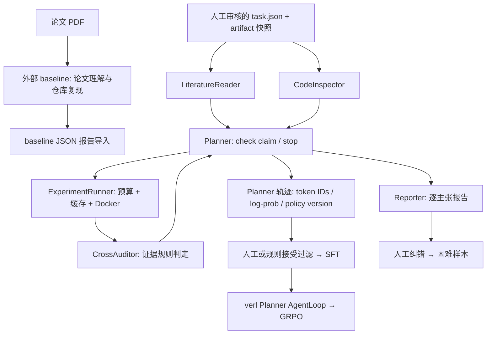

# ArtiCheck — 论文 Artifact 复现预审助手

面向论文 Artifact Evaluation 和投稿前自查的**可运行基础架构**。以 [Paper Reproducibility Agent](https://github.com/1a1a11a/2026_paper_reproduce) 为业务 baseline，新增结构化主张核查、受限执行、缺陷注入数据、评测与 Planner 后训练接口。

当前版本是工程 MVP：CPU 核查链路已验证，真实论文 benchmark、7B 训练、GPU 性能与量化收益尚未验证。仓库不包含虚构的简历指标。

## 5 分钟运行

要求 Python 3.10+。核心包仅用标准库，无需 API key 或 GPU。

```bash
python -m venv .venv
source .venv/bin/activate
python -m pip install -e .

# 仅运行仓库自带的可信教学样例；local 不是隔离沙箱
python -m articheck demo --sandbox local --output runs/demo
python -m unittest discover -s tests -v
```

生成 `runs/demo/metrics.json`、`scores.jsonl`，以及四组独立的 `report.md`、`report.json`、`trace.jsonl`。样例包含 clean 和三种单缺陷变体，共 12 条主张。**样例分数只用于冒烟测试，不能作为真实论文泛化效果。**

核查一个任务清单：

```bash
python -m articheck run --task examples/task.json \
  --sandbox local --output runs/example
```

默认执行后端为 Docker；对外部 artifact 使用已审查的镜像和 probe：

```bash
docker pull python:3.11-slim
python -m articheck run --task examples/task.json --output runs/docker-example
```

## 架构



六个角色为 LiteratureReader、CodeInspector、Planner、ExperimentRunner、CrossAuditor、Reporter。它们是可替换的角色接口，**默认仅 Planner 可选用 LLM**；其余为确定性实现。文献输入与代码清单通过 asyncio DAG 并发处理，规划和执行循环按依赖推进。

## 已实现与边界

| 模块 | 当前能力 | 验证状态 |
|---|---|---|
| baseline 集成 | 独立启动脚本、报告适配、提交号溯源 | 按指定上游源码接口核对；真实 PDF/API 运行待验证 |
| 六角色运行时 | asyncio DAG、check/stop、时间/工具/token/API 费用预算 | CPU 测试通过 |
| 证据核查 | 指标数值比较、训练/测试 ID 交集、基线训练步数比较 | 受控样例通过 |
| 执行与缓存 | Docker 默认；可信样例可显式 local；内容与镜像身份缓存 | local 已验证；Docker 在 CI 中执行 |
| 缺陷数据 | 3 类受控注入、clean 对照、原仓库分组拆分 | CPU 测试通过；任意外部仓库需新增 adapter |
| 评测 | 宏 F1、误报率、召回率、弃权率；验证集选阈值 | CPU 测试通过 |
| 轨迹 | OpenAI-compatible 推理；vLLM 原生 token 模式；严格训练导出校验 | 模拟服务契约测试通过；真实 vLLM 待验证 |
| SFT | 教师轨迹接受过滤、assistant-only LoRA 脚本 | 过滤已测试；GPU 训练待验证 |
| RL | 自定义多轮 verl AgentLoop、Planner token mask、奖励、GRPO 启动脚本 | 源码接口核对；GPU 集成待验证 |
| DAPO 相关 | clip-higher 配置；动态组过滤与截断 IS 的独立实现 | 动态采样补批与 IS 尚未接入分布式启动器 |
| 反馈 | 人工纠错与困难样本记录 | CPU 测试覆盖；未自动触发增量训练 |
| 效率 | FSDP2/LoRA/检查点/动态批预算配置、vLLM 前缀缓存启动脚本 | 未测显存、吞吐、量化或成本收益 |

当前没有实现通用 PDF 主张抽取、任意仓库自动缺陷注入、全论文正确性裁决或 AWQ/FP8 量化。新增任务需提供人工审核的主张与受信 probe；probe 的自报结果仍需审计，不能据此排除硬编码或伪造实验结果。

## 使用指定 baseline

baseline 固定参考版本为 `dffac1885dbca1aff9b28d79916140b8af71dedf`。本仓库没有复制上游源码；通过进程和 JSON 报告接口对接。上游当前参考版本根目录未附 LICENSE，详见 [来源与许可](docs/BASELINE.md)。

```bash
# 用户在独立环境安装 baseline 依赖
git clone https://github.com/1a1a11a/2026_paper_reproduce.git vendor/baseline
git -C vendor/baseline checkout dffac1885dbca1aff9b28d79916140b8af71dedf

# BASELINE_PYTHON 指向安装了其 requirements.txt 的独立 Python 环境
export UPSTREAM_DIR="$PWD/vendor/baseline"
export BASELINE_PYTHON=/absolute/path/to/baseline-env/bin/python
bash scripts/run_upstream.sh /absolute/paper.pdf /absolute/baseline-report.md \
  --vm-host your-dedicated-host --vm-user your-user

python -m articheck import-upstream \
  --input /absolute/baseline-report.json --output runs/imported-baseline.json
```

导入保留上游原判定，不将 `not_reproduced` 自动转换为“论文有缺陷”。导入结果需独立核验证据，不能直接当作训练真值。上游运行器的执行隔离由它自身配置；本项目 Docker 限制不会自动作用于外部 baseline 进程。

## 接入自部署 Planner

```bash
export MODEL_PATH=Qwen/Qwen2.5-7B-Instruct
bash scripts/serve_vllm.sh

python -m articheck run --task examples/task.json --output runs/planner \
  --planner model --model "$MODEL_PATH" --policy-version base-model-revision \
  --base-url http://127.0.0.1:8000/v1 --native-tokens
```

原生模式调用 vLLM `/tokenize` 与 `/v1/completions`，使用服务端返回的 token IDs 和对齐 log-prob。普通兼容服务可去掉 `--native-tokens`，但其文本轨迹不允许导出为 RL token 训练数据。所有训练轨迹必须保存实际模型 revision / checkpoint 作为 `--policy-version`。

API key 使用 `ARTICHECK_API_KEY` 环境变量。API 费用按 `--input-price`、`--output-price` 的每百万 token 美元价格计算；默认 0 只表示未配置计价，不代表 GPU 推理免费。

## 数据与评测

```bash
python -m articheck inject --source examples --output data/leak \
  --repo-id canonical-original-repo --defect split_leakage
python -m articheck split --input data/labels.jsonl --output data/splits

# 先在独立验证集定阈值，再将同一阈值应用到测试集
python -m articheck calibrate --validation data/validation-scores.jsonl \
  --max-fpr 0.05 --output runs/threshold.json
python -m articheck evaluate --input data/test-scores.jsonl \
  --threshold 0.7 --output runs/test-metrics.json
```

上例 `0.7` 为占位阈值，实际应使用 `threshold.json` 中的值。`score` 当前为规则输出，未经概率校准。`inconclusive` 保留在评测分母中；漏检按负预测处理，并单独报告弃权率。详见 [数据协议](docs/DATA.md)。

训练说明见 [TRAINING.md](docs/TRAINING.md)，人工纠错见 [DATA.md](docs/DATA.md)，本地验证记录见 [VALIDATION.md](docs/VALIDATION.md)。

## 目录

```text
articheck/
  schema.py            主张、任务、证据、判定数据结构
  runtime.py           DAG / 预算 / 内容快照 / 缓存
  sandbox.py           Docker 与显式 trusted-local 执行
  roles.py             六角色中的确定性组件
  planner.py           固定策略与模型规划策略
  pipeline.py          核查循环与报告
  llm.py / trace.py    模型客户端与原生轨迹校验
  data.py              注入、分组拆分、教师数据接受过滤
  evaluation.py        指标与验证集阈值
  feedback.py          人工纠错记录
  adapters/upstream.py baseline 报告适配
  training/            verl AgentLoop、奖励、loss 与导出
examples/              原创可执行教学 artifact
scripts/               baseline、vLLM、SFT、GRPO、数据准备入口
tests/                 CPU 行为与契约测试
```

原创代码使用 MIT License。第三方工具、模型、数据按各自许可使用。
