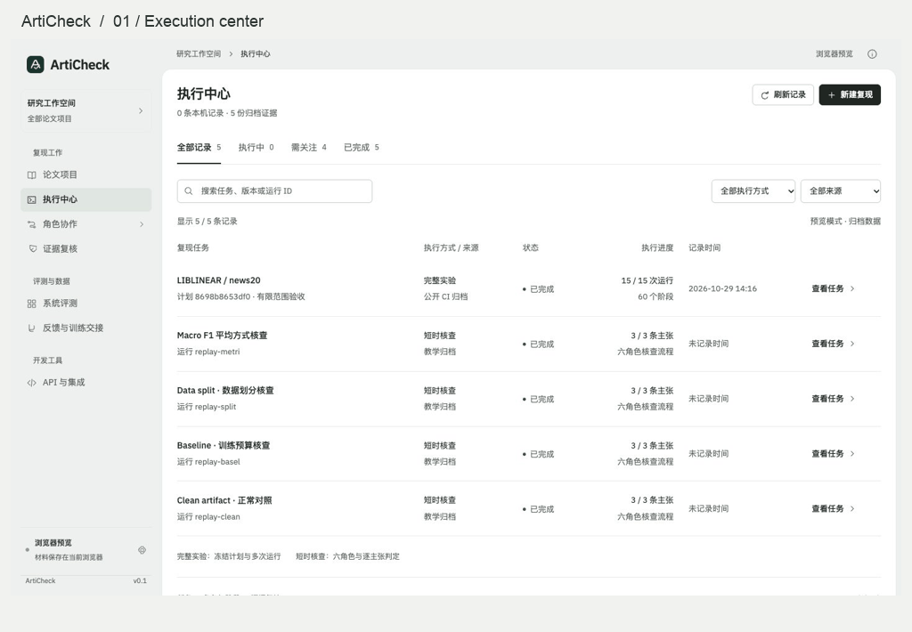
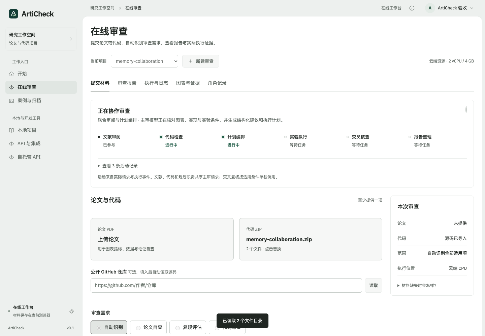
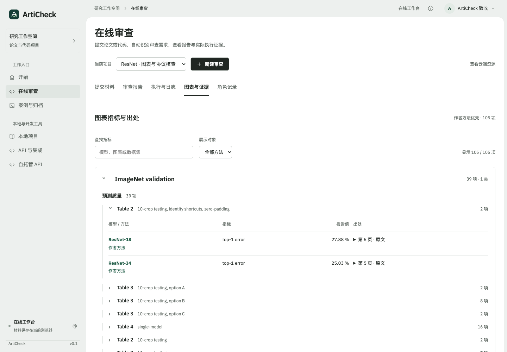
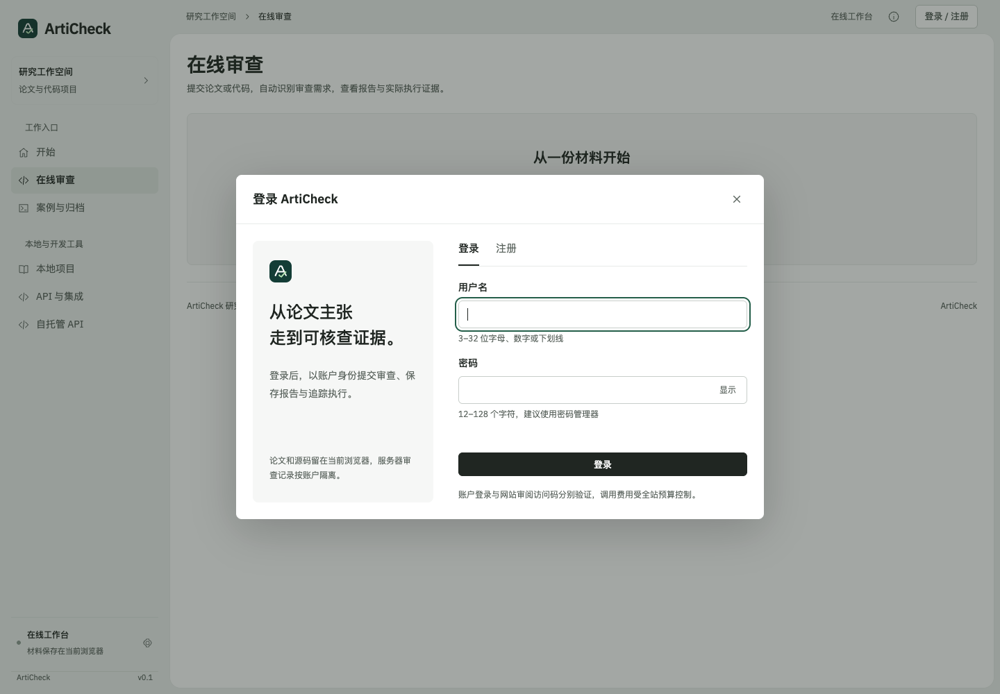
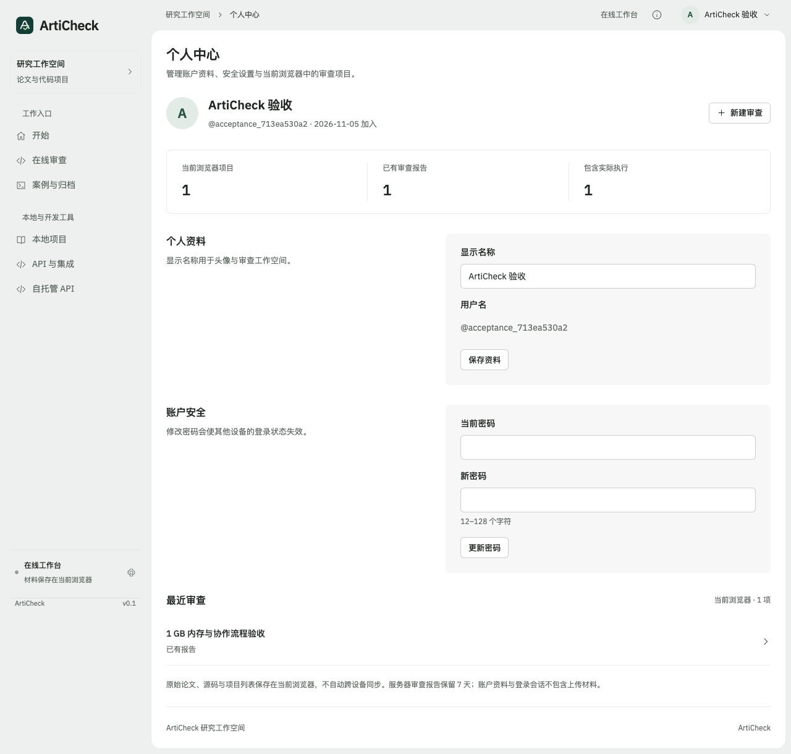
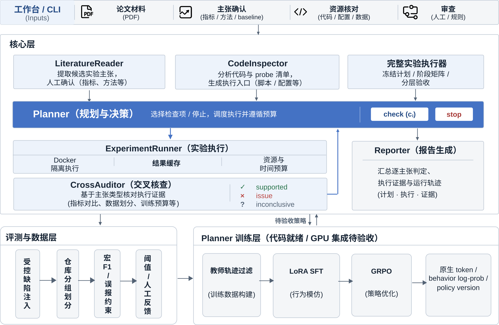

<div align="center">

# ArtiCheck

**让论文里的每一条实验主张都有执行证据。**

面向 Artifact Evaluation 与投稿前自查的论文复现预审系统。<br>
围绕论文、作者代码和数据，构建了环境重建、实验执行、独立指标核对与逐主张报告流程。

[](https://github.com/Gump111458785/ArtiCheck/actions/workflows/ci.yml)
[](pyproject.toml)
[](pyproject.toml)
[](LICENSE)
[](https://github.com/Gump111458785/ArtiCheck/actions/runs/41408434563)

[打开在线工作台](https://articheck-workbench.edgeone.dev) · [快速开始](#quickstart) · [查看复现案例](#case)

</div>



*轮播展示四个工作台页面，并非一次任务的连续执行录像。在线工作台已部署至 EdgeOne；采用受邀账户独立登录，不再要求额外的网站访问码。*

[解决的问题](#problem) · [使用方式](#usage) · [核心能力](#capabilities) · [界面展示](#showcase) · [系统架构](#architecture) · [实测结果](#results) · [Planner 后训练](#training) · [路线图](#roadmap) · [文档](#docs)

<a id="problem"></a>

## 1. 要解决的问题

在投稿前自查、Artifact Evaluation 和复用论文方法时，研究团队需要核对论文中的实验主张与代码、数据和运行结果是否一致。这项工作涉及多份材料，还需要判断一次运行究竟验证了哪些结论。

| 痛点 | 对核查工作的影响 | ArtiCheck 的处理方式 |
|---|---|---|
| 论文、代码和实验设置需要人工逐项对齐 | 指标口径、数据划分或基线配置的差异容易遗漏；看到相近的数字，也需要追查计算过程 | 将实验拆成主张，关联原文、代码版本、配置和执行证据 |
| 环境和材料问题挡在实验之前 | 依赖、数据或权重缺失时，需要先排查原因，才能判断是否值得继续投入算力 | 核对材料与运行条件，记录环境重建过程和阶段失败原因 |
| 代码跑通后，结论仍需要核验 | 一次成功执行不能回答指标是否算对、对照是否公平，以及主要结论是否有足够支持 | 独立重算指标，检查对照与多次运行结果，按运行、环境、训练协议和主要结论分层验收 |
| 检查记录分散，交接与复核需要重新找依据 | 更换材料版本或审核人后，容易混用旧结果，也难以追溯一条判断的来源 | 固定材料与计划指纹，保存逐主张证据、角色事件和人工复核意见 |
| 时间和算力有限，检查顺序需要取舍 | 遍历所有实验可能超出预算，过早停止又可能漏掉重要问题 | 设置工具、时间与费用预算；训练 Planner 选择核查顺序和停止时机 [待完成] |

ArtiCheck 面向课题组自查、论文评审和研究方法复用，建立了材料核对、实验执行与结论复核的一体化流程，将每条判断与可复查的证据关联。核查时间、人工投入与费用变化见 [评测方案](#training)，对应实测 [待完成]。

[逐主张报告](docs/smoke/metric-defect-report.md) · [分层验收案例](web/dist/samples/liblinear-reproduction.json) · [公开 CPU 执行证据](https://github.com/Gump111458785/ArtiCheck/actions/runs/41408434563)

<a id="usage"></a>

## 2. 使用方式

按模型运行的位置选择使用方式：在自己的机器上运行 ArtiCheck 微调模型，直接调用主流大模型 API，或通过网站提交任务。

| 方式 | 模型与权重 | 使用流程 |
|---|---|---|
| 本地 | 下载 ArtiCheck 微调模型与权重，在自己的机器上推理；权重发布 [待完成] | 准备模型与运行环境 → 启动推理服务 → 提交核查任务 |
| API | 使用自己的供应商 API key 直接调用主流大模型，无需下载 ArtiCheck 权重 | 配置模型地址、名称与密钥 → 运行核查 → 查看报告；供应商联调与质量评测 [待完成] |
| 网站 | EdgeOne 承载网页与模型审阅接口；接入云端隔离 CPU 与自有 RTX 4090 GPU 执行 | 受邀登录 → 命名项目并上传论文与代码 → 选择审查需求 → 跟踪进度并查看一页式报告 |

### 2.1 本地：运行 ArtiCheck 微调模型

下载 ArtiCheck 微调模型与权重，在自己的 GPU 环境中启动推理服务。Planner 使用本地模型选择核查主张和停止时机，工具调用与实验代码执行也在自己的机器上运行。微调权重、下载入口与运行资源说明 [待完成]。

准备 vLLM 环境后，用模型目录启动推理服务。下面的路径和版本号需要替换为实际下载的模型目录与检查点版本。

```bash
export MODEL_PATH="/absolute/path/to/articheck-model"
bash scripts/serve_vllm.sh
```

在另一个终端提交核查任务：

```bash
export MODEL_PATH="/absolute/path/to/articheck-model"
python -m articheck run --task examples/task.json --output runs/local-model \
  --planner model --base-url http://127.0.0.1:8000/v1 \
  --model "$MODEL_PATH" --policy-version your-checkpoint-version
```

`examples/task.json` 指定论文主张、代码路径和执行命令；使用时替换为自己的任务文件。模型服务与 Docker 执行环境分别配置。[训练与推理说明](docs/TRAINING.md) · [执行协议](docs/DATA.md)。

### 2.2 API：直接调用主流大模型

保留 ArtiCheck 的核查流程，将 Planner 的推理请求直接发送给模型供应商。填写自己的 API 地址、模型名称与密钥，无需下载或部署 ArtiCheck 微调模型。密钥由运行核查的进程读取；论文工具与实验代码仍在自己的执行环境中运行。

```bash
export ARTICHECK_API_KEY="your-provider-key"
python -m articheck run --task examples/task.json --output runs/provider-api \
  --planner model --base-url https://your-provider.example/v1 \
  --model your-provider-model --policy-version your-provider-model-version
```

示例采用兼容 Chat Completions 的供应商接口，地址、模型名称与版本均需替换。DeepSeek 的在线接入已通过实际调用；其他供应商适配与跨模型质量评测 [待完成]。调用预算与费用配置见 [模型接入说明](docs/TRAINING.md)。

需要在其他应用中提交 PDF / ZIP 并查询审阅任务时，可使用独立的材料静态审阅接口：[接入说明](docs/API_REVIEW.md) · [OpenAPI 契约](web/dist/review-api.openapi.json) · [Python 调用示例](examples/api_review/submit.py) · [配置模板](examples/api_review/provider.env.example)。该接口返回 `model_api_static_review` 报告，实验执行与验收由执行器负责。

### 2.3 网站：浏览器中提交评测

打开 [ArtiCheck 在线工作台](https://articheck-workbench.edgeone.dev/#api-review)，通过受邀账户完成独立登录（不再使用额外网站访问码，管理员可在个人中心创建、停用或重置受邀账户）。新建项目并命名后，上传论文 PDF、代码 ZIP，或粘贴公开 GitHub 地址。代码 ZIP 与 GitHub 源码包支持最大 100 MB，大文件通过短期直传通道或固定提交引用处理。材料初步识别后，弹窗选择自动识别、论文自查、复现评估或代码审查；允许仅上传论文或代码，默认检查适用范围，也可指定表格、实验与最长执行时间。审查记录按受邀账户隔离。常规脚本采用 2 vCPU、4 GB 内存 E2B 隔离实例执行，需要 CUDA 的阶段由自有 RTX 4090（24 GB 显存）隔离执行器（`bwrap` 无特权命名空间与禁网环境）接单运行。

网站使用 DeepSeek API 阅读论文文字与原页图像，核对八项条件、图表数字及论证依据。有公开代码线索时自动获取固定提交的源码；有可执行计划时，按计划硬件需求在隔离 CPU 或自有 GPU 环境中运行命令并保存日志、退出码和观测值。审查完成后优先呈现包含“通过 / 未通过 / 待核查”结论横幅、问题建议、对齐的指标比较表与出处的一页式最终报告；执行计划、阶段日志与默认展开的分层协作活动记录统一收纳在“过程详情”页。实际受阻后再请求用户补充材料，确认不可得的实验保留无法复现原因。

正式网站已完成 LIBLINEAR 作者代码的浏览器上传、模型审查、CPU 编译、训练与预测检查。进程成功、数值符合与论文主要结论成立分开记录；该次 `heart_scale` 运行检查代码流程，不替代下文 news20 案例或论文完整验收。[使用与接口](docs/ONLINE_WORKBENCH.md) · [真实网站验收](docs/ONLINE_ACCEPTANCE.md) · [部署与密钥配置](docs/EDGEONE_DEPLOYMENT.md)。

在线流程使用主流模型 API；ArtiCheck 后训练权重的发布与效果评测 [待完成]。

<a id="case"></a>

## 3. 旗舰案例：LIBLINEAR / news20

使用 **LIBLINEAR（JMLR 2008）作者代码和公开 news20 数据**，完成 CPU 环境重建、数据准备、训练、预测和独立指标重算。三种方法设置各运行五个划分种子，共记录 **15 次运行与 60 个阶段证据**。


| 实测项目 | 结果 | 证据 |
|---|---:|---|
| 方法设置 × 划分种子 | 3 × 5 = **15 次运行** | [运行明细](web/dist/samples/liblinear-reproduction.json) |
| 阶段记录 | **60 个** | [执行 CI](https://github.com/Gump111458785/ArtiCheck/actions/runs/41408434563) |
| L2-SVM 准确率均值 | **96.76%** | [结果与统计](web/dist/samples/liblinear-reproduction.json) |
| 准确率样本标准差 | **0.31 个百分点** | 同上，5 个划分种子 |
| 执行器墙钟时长 | **111.36 秒** | [计时与资源口径](docs/EXECUTION_EVIDENCE.md) |
| 全阶段子进程峰值 RSS 最大值 | **366.3 MiB** | 同上 |
| 容器外内存采样峰值 | **217.4 MiB** | 33 / 60 阶段有容器外采样 |

准确率的波动来自本案例的五次数据重新划分，不代表原论文成绩的置信区间。时长不含准备脚本下载和基础镜像拉取；GPU 峰值与费用测量 [待完成]。

### 3.1 案例验收

| 核对项 | 本案例结果 | 判定依据 |
|---|---|---|
| 执行完成 · `run` | `true` | 15 次运行完成，保留 60 阶段证据 |
| 环境重建 · `environment_rebuilt` | `true` | 固定基础镜像，记录构建与环境检查 |
| 独立指标与控制核对 | 预测独立重算、控制配置与公平性核对 | 预测结果独立重算；新增 LR 控制与正则化消融有实际配置与公平性检查 |
| 论文训练协议 · `training` | `false` | 对齐历史作者代码、原始划分 ID 与训练协议 [待完成]；本次使用现代作者代码与 80/20 seeded split |
| 论文主要结论 · `conclusion` | `false` | 覆盖 Figure 1、rcv1、Pegasos/SVMperf 及论文调参与计时曲线 [待完成] |

报告按运行、环境、训练协议与主要结论分别记录验收值。新增控制项只用于本案例核对，不替代原论文基线；本案例的证据范围为 news20 CPU 实验。

> **六角色记录**：本次 CI 保留 162 条角色事件，包含 15 次排程、60 个阶段执行、60 次阶段核查及最终分层结论。[查看角色事件](web/dist/samples/liblinear-roles.jsonl) · [打开角色视图](https://articheck-workbench.edgeone.dev/?mode=demo&example=reproduction&case=liblinear&view=roles)

[案例来源与完整运行命令](examples/liblinear_case/README.md) · [证据归档](web/dist/samples/liblinear-reproduction.json) · [执行 CI](https://github.com/Gump111458785/ArtiCheck/actions/runs/41408434563)

<a id="capabilities"></a>

## 4. 核心能力

| 能力 | 工作方式 | 代码与证据 |
|---|---|---|
| 主张级核查 | [六角色](#roles)协作，核对指标、样本重叠和训练预算；每条判定引用执行证据，证据不足保留 `inconclusive` | [报告](docs/smoke/metric-defect-report.md) · [流水线](articheck/pipeline.py) |
| 受控执行 | Docker 禁网、只读挂载、非 root、移除 capabilities，限制 CPU、内存、进程及输出；工具 / token / 时间 / 费用预算与执行缓存 | [沙箱](articheck/sandbox.py) · [Docker CI](https://github.com/Gump111458785/ArtiCheck/actions/workflows/ci.yml) |
| 可审计执行器 | 不可变材料工作区、PDF / ZIP / 计划指纹、阶段与种子矩阵、产物与资源记录 | [执行引擎](docs/REPRODUCTION_ENGINE.md) · [实现](articheck/reproduction/) |
| 分层验收 | 结合多次运行、统计与覆盖证据，分别判断运行、环境、训练协议及主要结论 | [完成验收清单](docs/REPRODUCTION_COMPLETION_CHECKLIST.md) |
| 可视化工作台 | PDF / 代码材料导入、主张确认、服务器资源核对、执行中心、角色协作与证据复核；26 条 API 路径、30 个操作 | [界面与模块对应](docs/REVIEW_WORKSPACE.md) · [OpenAPI](web/dist/openapi.json) |
| 训练轨迹契约 | 保留采样器提供的 token IDs、行为 log-prob 与策略版本；外部接受后的教师轨迹可导出 SFT，缺失原生 token 时拒绝 RL 导出 | [轨迹契约与测试范围](docs/TRAINING.md#5-原生训练轨迹契约) · [导出实现](articheck/training/export.py) |

<a id="showcase"></a>

## 5. 界面展示

在开始页进入在线审查，提交材料后查看报告、执行日志、图表证据与角色记录。本地工作台保留完整实验与归档案例入口。审查中实时展示各职责的实际活动；图表指标按数据集、类别、图表与评测协议分层，支持作者方法筛选。

| 动态协作进度 | 分层图表指标 |
|---|---|
|  |  |

| 注册与登录 | 个人中心 |
|---|---|
|  |  |

[账户与协作功能说明](docs/ACCOUNTS_AND_COLLABORATION.md)。

| 在线审查报告 | 实际 CPU 执行 |
|---|---|
|  |  |

[打开开始页](https://articheck-workbench.edgeone.dev/#home) · [浏览执行中心](https://articheck-workbench.edgeone.dev/#workbench) · [查看角色协作](https://articheck-workbench.edgeone.dev/#roles) · [完整界面图集](docs/UI_GALLERY.md)

<table>
<tr>
<td width="50%" valign="top">
<strong>开始页 · 从论文材料进入</strong><br>
新建评估、继续个人项目，或先查看公开案例。
<a href="docs/assets/home-desktop.jpg"></a>
</td>
<td width="50%" valign="top">
<strong>执行中心 · 找到一次运行</strong><br>
按来源、执行方式与状态检索，再打开任务详情。
<a href="docs/assets/execution-center.jpg"></a>
</td>
</tr>
<tr>
<td width="50%" valign="top">
<strong>角色协作 · 查看实际分工</strong><br>
可选择短时核查或完整实验，对照六角色的输入输出契约与任务中的真实事件。
<a href="docs/assets/role-workspace.jpg"></a>
</td>
<td width="50%" valign="top">
<strong>案例验收 · 对照结果与证据</strong><br>
展示多次运行指标，分别核对执行完成与结论依据。
<a href="docs/assets/execution-detail.jpg"></a>
</td>
</tr>
</table>

在线审查按「提交材料 → 自动审查 → 云端执行 → 证据与报告」组织，无需预先绑定本地命令。本地项目保留实验覆盖、人工主张编辑、服务器核对与完整实验的配置流程。[开始页设计](docs/HOME_SCREEN.md) · [界面与模块对应](docs/REVIEW_WORKSPACE.md) · [八项复现条件](docs/IMPLEMENTATION_STATUS.md)。

<a id="architecture"></a>

## 6. 系统架构



[打开 SVG 原图](docs/assets/architecture.svg)。训练层覆盖轨迹导出、LoRA SFT 与 GRPO Planner；GPU 训练及集成评测 [待完成]。本地完整实验需要明确配置并确认执行入口；在线 CPU 流程由模型生成计划并冻结后执行。

短时核查通过 asyncio DAG 并发读取文献主张、检查代码，再由 Planner 决定继续检查或停止；默认使用固定 Planner。完整实验按冻结计划执行，执行器为各阶段记录负责角色，并将事件写入 `roles.jsonl`。界面按角色读取实际事件，不补造角色活动。[执行中心的数据与模块对应](docs/EXECUTION_CENTER.md)。

<a id="roles"></a>

### 6.1 六角色：职责与分工

六角色用于两条执行路径：**短时主张核查**（[`articheck/roles.py`](articheck/roles.py) + [`pipeline.py`](articheck/pipeline.py)）和**完整实验复现**（[`articheck/reproduction/roles.py`](articheck/reproduction/roles.py) 为 [`engine.py`](articheck/reproduction/engine.py) 的各阶段标注角色）。各角色的输入、动作和输出随任务记录。

| 角色 | 短时核查 | 完整实验 | 模型调用 |
|---|---|---|---|
| **LiteratureReader** 文献读取 | 读取人工确认的主张清单（`extraction: manifest`）；不解析 PDF | 计划审计中的 `scope` 维度：论文身份、原文出处、引用与实验覆盖 | 否 |
| **CodeInspector** 代码检查 | 列出仓库文件清单，只作上下文，不作科学证据 | `code / data / environment / settings` 维度审计；源码快照与快照再审计；结束时的源码完整性核对 | 否 |
| **Planner** 规划 | 观测「主张 / 已查 / 剩余工具预算」，输出 `check` 或 `stop`；默认 `FixedPlanner` 按顺序检查 | 按冻结计划排程：`commands / resources / acceptance` 维度、环境依赖检查、每次运行的排程与停止原因 | 默认否；`ModelPlanner` 对接 OpenAI 兼容服务；模型策略评测 [待完成] |
| **ExperimentRunner** 执行 | Docker 禁网沙箱执行探针；按「仓库哈希 + argv + 沙箱身份」缓存，仅未命中时消耗工具预算 | 禁网镜像构建、镜像内环境验证、逐阶段执行与输入输出指纹 | 否 |
| **CrossAuditor** 交叉核查 | 三类规则：指标容差、训练/测试 ID 不相交、方法与基线训练预算一致；证据缺失时给出 `inconclusive` | 镜像兼容性、未声明的文件改动、配置冻结、划分与训练证据、独立指标重算、实验验收与公平性 | 否 |
| **Reporter** 报告 | 生成 Markdown 报告，写明判定只覆盖提交的主张与探针 | 汇总分层验收（`run / environment_rebuilt / training / conclusion`），写入 `report.json` | 否 |

使用时需注意：

- **完整实验的角色事件**：LIBLINEAR CI 记录 15 次运行、60 个阶段和 162 条角色事件；Reporter 的分层结论与原报告一致。[执行依据](https://github.com/Gump111458785/ArtiCheck/actions/runs/41408434563)。
- **完整实验中的 Planner 不做决策**：它按冻结计划排程并记录停止原因（`policy: frozen_plan`），可学习的 Planner 只在短时核查里运行。
- **角色记录不影响结果**：写入失败只记入 `roles.errors`，不改变执行与验收结论。

<a id="quickstart"></a>

## 7. 快速开始

Python 3.10+，macOS 或 Linux。内置受控缺陷基准无需 API key、GPU 或 Docker。

**1. 获取源码并安装**

```bash
git clone https://github.com/Gump111458785/ArtiCheck.git
cd ArtiCheck
python3 -m venv .venv
source .venv/bin/activate
python -m pip install -e .
```

**2. 运行内置核查**

```bash
python -m articheck demo --sandbox local --output runs/demo
```

这条命令核查同一仓库的 clean 版本，以及分别含指标计算、数据划分、baseline 训练预算缺陷的三个版本。`local` 直接在主机上执行可信的内置代码；再次运行请使用新的输出目录。

**3. 查看结果**

`runs/demo/metrics.json` 汇总指标；每个版本目录包含 `report.md`、`report.json` 与 `trace.jsonl`。逐主张真值与得分分别保存在 `labels.jsonl`、`scores.jsonl`。

### 7.1 材料与执行工作台

<a id="workbench"></a>

```bash
python -m articheck.workbench --port 8787
```

打开 **http://127.0.0.1:8787**。同一 Python 服务提供界面和 API。可在页面提交真实任务，查看执行进度、报告与反馈，数据保存在 `runs/workbench/`。工作台的核查入口使用固定 Planner；选择本地模型或供应商模型时，使用上方 CLI。工作台中的模型选择与任务接入 [待完成]。托管界面预览回放归档记录。

### 7.2 核查自己的 artifact

按 [task.json 示例](examples/task.json) 声明本地仓库、主张和输出 JSON 的 probe，准备好镜像后运行：

```bash
docker pull python:3.11-slim
python -m articheck run --task examples/task.json --output runs/review
```

替换任务文件以绑定自己的执行入口；额外依赖需预先构建到镜像中。任务字段与 probe 协议见 [数据与执行指南](docs/DATA.md)。

<a id="results"></a>
<a id="benchmarks"></a>
<a id="example"></a>

## 8. 实测结果

| 验证对象 | 范围与结果 | 证据 |
|---|---|---|
| 公开 CPU 案例 | LIBLINEAR / news20，15 次运行、60 个阶段；L2-SVM 准确率 96.76%，样本标准差 0.31 个百分点 | [案例 CI](https://github.com/Gump111458785/ArtiCheck/actions/runs/41408434563) · [报告](web/dist/samples/liblinear-reproduction.json) |
| 内置受控缺陷基准 | 单仓库 4 个版本、12 条主张；FixedPlanner + 规则核查：TP=3、FP=0、TN=9、FN=0，宏 F1=1.000，问题召回率 100%，误报率 0% | [原始结果](docs/smoke/metrics.json) · [问题报告](docs/smoke/metric-defect-report.md) |
| Python 工程测试 | 173 项：本地 169 项通过、4 项 Docker 专项跳过；CI 覆盖 Python 3.10–3.12 | [网站与回归验收](docs/ONLINE_ACCEPTANCE.md) · [历史验证记录](docs/VALIDATION.md) · [CI](https://github.com/Gump111458785/ArtiCheck/actions/workflows/ci.yml) |
| 前端测试 | 106 项通过，覆盖完整实验角色事件、API 接入、演示评测、开始页、材料、验收、资源、执行中心和审查状态 | [测试代码](tests/frontend/) · [CI](https://github.com/Gump111458785/ArtiCheck/actions/workflows/ci.yml) |

内置基准的阈值为 0.5，包含正例 3 条、负例 9 条。这组结果仅验证工程链路，不能外推到真实论文或独立仓库。ArtiCheck-Claims、CORE-Bench、JudgeEval 评测 [待完成]；[评测协议与公平对照要求](docs/BENCHMARKS.md)。

<a id="training"></a>

## 9. Planner 后训练

后训练框架完成了受预算约束的序列决策建模，定义了主张选择与停止策略的优化路径，并将问题召回、误报、覆盖率和取证成本纳入统一评测协议。策略训练与效果评测 [待完成]。

训练方案已将参数更新范围限定为规划模型（Planner）。模型读取主张清单、检查历史、工具反馈和剩余预算，输出 `check(claim_id)` 或 `stop`；实验执行、指标重算和结论核对由固定工具与规则承担。完整实验继续按冻结计划排程。

### 9.1 模型选型与训练范围

| 模型 | 定位 | 训练任务 |
|---|---|---|
| [Qwen2.5-7B-Instruct](https://huggingface.co/Qwen/Qwen2.5-7B-Instruct) | 主实验模型，与项目 7B 基线保持一致 | LoRA SFT、GRPO 策略优化及本地权重发布 [待完成] |
| [Qwen2.5-1.5B-Instruct](https://huggingface.co/Qwen/Qwen2.5-1.5B-Instruct) | 轻量验证模型，用于检验训练流程和规模效应 | 数据、动作协议、奖励与部署成本对照 [待完成] |
| [Qwen3-8B](https://huggingface.co/Qwen/Qwen3-8B) | 扩展对照模型，用于评估方法迁移能力 | 非思考模式下的模板适配、SFT 与 GRPO 对照 [待完成] |

三个候选模型的官方许可均为 Apache-2.0。对照方案已覆盖每个模型的原始指令、SFT 和 GRPO 版本，并规定基础模型 revision、分词器、对话模板与工具权限保持一致，用于区分模型选型收益和后训练收益。

### 9.2 数据构建与隔离 [待完成]

数据方案明确了至少 **50 个独立原始仓库、1,000 条人工审核主张**的建设规模，覆盖指标计算、数据划分和基线设置，并纳入正常实验、缺陷注入样本与可取得独立证据的真实问题。样本生产协议已定义教师候选轨迹、执行证据、规则校验与人工复核的筛选流程。数据构建 [待完成]。

划分协议已按原始仓库谱系设置 **80/10/10** 的训练、验证与测试分组。同源仓库、fork、缺陷版本和相关主张保留在同一组；验证与测试标签仅供评估，不进入模型输入。样本保留材料版本、标签依据、模型版本和审核记录。

训练数据协议划分了动作监督与任务级奖励两类信息：

| 数据层 | 内容与约束 |
|---|---|
| 决策输入 | 主张文本与规范、已检查集合、已有判定和剩余预算；成本估计与证据共享关系作为观察扩展 [待完成] |
| 监督目标 | 合法的 `check(claim_id)` / `stop` 动作；保留证据不足、执行失败与预算变化对应的多轮上下文 |
| 奖励标签 | 独立审核的逐主张真值，仅进入奖励计算和评测，不暴露给策略模型 |
| 追溯元数据 | 原始仓库谱系、材料与计划指纹、教师及策略版本、采样参数、接受依据和数据划分 |

轨迹接受协议规定了先核对动作合法性、执行证据与停止依据，再使用独立接受清单筛选。拒绝无证据的自评标签、跨版本混合轨迹和中途截断的动作；同一轨迹导出的多个决策样本保持同组。各缺陷类型、正常样本及难度分布按数据版本记录，训练采样与测试分布分别报告。

决策环境设计纳入了不同取证成本、证据共享关系与受限预算，并设置顺序、随机和成本启发式对照，用于验证检查顺序和停止时机对质量及成本的影响。观察字段扩展与决策环境验收 [待完成]。

### 9.3 监督微调（SFT）[待完成]

SFT 设计采用了 LoRA 参数化，冻结基础权重，仅更新线性层的低秩适配器。对权重矩阵使用 `W = W₀ + (alpha/r)BA`，其中 `W₀` 保持固定，`A/B` 为可训练参数。每个样本保留完整交互历史，仅对最后一条 assistant 动作计算交叉熵；历史消息、工具反馈和 padding 的标签设为 `-100`。聊天模板须满足前缀一致性检查，避免监督标签偏移。多轮拆分样本沿用原仓库分组。

| 配置项 | 脚本初始配置 |
|---|---|
| 适配器 | `r=16`、`alpha=32`、`dropout=0.05`，覆盖 `all-linear` |
| 优化参数 | 学习率 `2e-5`，单卡 batch `1`，梯度累积 `8` |
| 精度与内存 | BF16、激活检查点，训练时关闭 KV cache |
| 上下文与轮数 | 最大 `4096` tokens，首轮 `1` epoch；超长样本整条跳过并统计比例，避免截断动作 |

[SFT 脚本](scripts/train_sft.py)已设置上述初始配置；模型选择协议已纳入动作合法率、核查质量与成本，训练 loss 用于监测收敛。验证回调、训练种子配置及 GPU 运行 [待完成]。

检查点验收协议已规定在独立验证集执行冻结任务，并记录动作合法率、主张质量、工具调用和 token 消耗。超过长度限制的样本不截断、不静默计入有效训练量，报告总样本数、有效样本数与跳过原因。按训练种子保存配置与检查点，避免用单次最低 loss 代表稳定收益。

SFT 脚本已定义 LoRA adapter、分词器和对话模板的保存流程；交付协议已纳入适配器合并、动作一致性与任务质量核对，并衔接 GRPO 初始化和本地推理。合并验收与权重发布 [待完成]。

### 9.4 强化学习（GRPO）[待完成]

GRPO 方案已采用 SFT 检查点初始化策略，并通过 verl 自定义 AgentLoop 组织“选择主张—取得证据—接收反馈—继续或停止”的交互。采样配置已为每个任务设置 **8 条轨迹**，依据最终核查结果计算组内相对奖励，再更新 LoRA 参数。仅模型生成的 token 参与优化，工具与环境观察使用零损失掩码；采样器记录原生 token IDs、行为 log-prob 和策略版本。

优化协议已对同一任务的轨迹奖励定义组内优势 `Aᵢ = (Rᵢ − mean(R)) / (std(R) + ε)`，将任务级优势用于该轨迹的模型动作 token。更新采用裁剪策略比率，并以 KL 项约束策略偏移；参考策略与 rollout 行为策略分别记录，避免混用两种 log-prob。该过程不训练独立价值网络。算法依据见 [verl GRPO](https://verl.readthedocs.io/en/latest/algo/grpo.html)，运行接口遵循 [项目固定版本](docs/TRAINING.md)。

| 奖励项 | 函数默认权重 |
|---|---:|
| 正确发现问题 | `+1` |
| 错误指控正常主张 | `-2` |
| 将问题主张判为正常 | `-0.5` |
| 正确支持正常主张 | `+0.25` |
| 证据不足或停止后未检查的主张 | `-0.1` |

奖励函数已对主张奖励取均值，并扣除 `0.02 × 工具调用数` 与 `0.000001 × 生成 token 数`；失败轨迹额外扣除 `1`。这些系数用于平衡核查质量与调用开销，实际费用另行计量。奖励验收协议已纳入验证集校准，以及过早停止、过度弃权和缓存重复调用等行为检查。

[GRPO 配置](scripts/train_grpo.sh)已设置 actor 学习率 `1e-6`、KL 约束和 `0.2 / 0.28` 的非对称裁剪，结合 FSDP2、LoRA、激活检查点与动态 token 批处理。消融方案已覆盖动态补采样、clip-higher、截断重要性采样和课程训练，用于评估各机制对稳定性与任务效果的贡献。动态补采样、重要性采样、课程调度的分布式集成及调用计量对齐 [待完成]。

| RL 配置项 | 脚本初始配置 |
|---|---|
| 采样与批量 | 每任务 `8` 条轨迹，prompt batch `16`，更新 mini-batch `8` |
| 序列预算 | prompt 上限 `4096`、response 总预算 `2048`；每次动作生成上限 `256` tokens，以剩余预算为限 |
| 参数更新 | LoRA `r=16 / alpha=32`，actor 学习率 `1e-6`，token-mean 损失聚合 |
| 训练与推理 | FSDP2、BF16 训练链路集成 [待完成]；vLLM 异步 rollout、动态 token 批、分块 log-prob 长度预算 `16384` |
| 训练监控 | KL、熵、优势方差、裁剪比例、无效动作率、工具调用与验证集质量；监控与验证回调联调 [待完成] |

机制方案已定义组内同奖励轨迹的过滤与补采样，以及按 rollout 行为概率和训练侧概率偏差修正权重的截断重要性采样；截断上限初值已设为 `2.0`。这两项与课程训练分别消融，防止将多项配置同时变化产生的收益归因于单一机制。实验配置与完整公式见 [技术方案](docs/POST_TRAINING.md)。

### 9.5 效果评估与发布门槛 [待完成]

评测方案纳入了独立仓库测试集，并以相同材料、工具、上下文与预算，对照固定流程、原始模型、SFT 模型、等预算拒绝采样 SFT 和 GRPO 模型。训练计算量、教师数据量与采样开销分别记录；测试阈值、奖励权重和验收路线在查看测试结果前冻结。

| 对照组 | 控制变量与用途 |
|---|---|
| 原始 Planner / SFT / GRPO | 固定基础模型、工具、输入和推理预算，比较后训练收益 |
| 等预算拒绝采样 SFT / GRPO | 对齐数据与采样开销，区分训练方法与额外计算的贡献 |
| 移除误报惩罚 / 成本项 | 检验质量约束与预算约束的作用 |
| 移除 clip-higher / 动态采样 / IS / 课程 | 每轮只改变一个因素，报告任务效果与训练稳定性 |

| 评估维度 | 指标与验收要求 |
|---|---|
| 执行可靠性 | JSON 与动作联合合法率 ≥ `99%`，预算越界为 `0`；重复或不存在的主张计为无效动作 |
| 判断质量 | 报告宏 F1、问题召回与 precision；相对同模型原始 Planner，SFT 的等预算宏 F1 差值须满足仓库级配对 95% 区间下界 > `0` |
| 误报与覆盖 | 测试误报率的 95% 置信上界 ≤ `5%`，判断覆盖率 ≥ `95%`；失败与弃权保留在总体统计中 |
| 强化学习收益 | 相对最强 SFT 对照，等预算质量改善的 95% 区间下界 > `0`；或宏 F1 差值区间下界 ≥ `-1` 个百分点，且工具调用至少减少 `10%`、配对区间支持成本下降。质量路线与成本路线预先选定 |
| 泛化与稳定性 | 至少 `3` 个训练随机种子，测试独立仓库、未见缺陷组合与不同预算；按仓库聚类统计，公开各次结果与置信区间 |
| 部署效果 | 核对 adapter、合并权重与推理服务的任务表现；分别报告显存、时延、工具调用和实际费用，量化版本独立评测 |

宏 F1 同时衡量问题主张与正常主张的判断质量。误报率以全部正常主张为分母；弃权和失败计入对应真值类别的漏判，并单列覆盖率。时延报告中位数与 P95，费用保留价格日期和计费范围。

基准方案已按任务分工：项目任务集衡量缺陷发现，CORE-Bench 衡量实验执行，JudgeEval 衡量判定与人工评分的一致性；结果分别报告，区分规划模型与完整系统的贡献。外部基准适配 [待完成]。

### 9.6 模型交付与结果归档 [待完成]

交付协议覆盖了模型 adapter / 合并权重、分词器、对话模板、基础模型许可、文件校验和与模型卡，并定义评测报告与数据划分、模型版本、训练配置、奖励权重、逐任务轨迹和汇总脚本的关联方式，用于本地部署、网站服务与后续版本回归。

| 结果项 | 结果 |
|---|---|
| 三种模型的 SFT / GRPO 收益、误报与覆盖率 | [待完成] |
| 等预算对照、机制消融及跨种子统计 | [待完成] |
| 独立仓库与外部基准评测 | [待完成] |
| 权重发布、部署质量、显存、时延与实际成本 | [待完成] |

完整奖励公式、数据协议与统计判据见 [后训练技术方案](docs/POST_TRAINING.md)。

<a id="roadmap"></a>

## 10. 路线图

| 版本 | 范围 |
|---|---|
| v0.1.0 · 核查与复现 | 主张级流水线、本地工作台、API 接入、Docker 执行、公开 CPU 案例与证据复核 |
| v0.2 · 决策环境与多仓库评测 [待完成] | 比较同预算下不同策略的质量与成本；冻结 ≥8 个独立原始仓库，验证 / 测试均含正负例；比较固定工作流 + 7B 与单 Agent |
| v0.3 · SFT / GRPO Planner [待完成] | 使用冻结数据训练 GPU SFT、三种子 GRPO，保存曲线、置信区间与等预算对照，发布模型权重与下载说明 |
| v0.4 · 效率与部署 [待完成] | 测量 GPU 训练、缓存与量化的质量、显存、吞吐、延迟和成本，部署微调权重服务并完成效果对照；网站的模型 API 与 CPU 执行见第 2.3 节 |

更新日期：**2026-11-03**。版本范围已按上表划分，结果、配置与日志纳入统一归档协议。GitHub Release 发布 [待完成]。

<a id="docs"></a>

## 11. 文档与开发

| 入口 | 内容 |
|---|---|
| [使用与数据](docs/DATA.md) | task.json、probe、执行、缓存、受控缺陷、划分与反馈 |
| [工作台与 API](docs/WORKBENCH.md) · [执行中心](docs/EXECUTION_CENTER.md) | 本地运行、材料准备、角色与事件、HTTP / SSE、前后端对应 |
| [复现执行器](docs/REPRODUCTION_ENGINE.md) · [完成验收清单](docs/REPRODUCTION_COMPLETION_CHECKLIST.md) | 材料身份、完整实验、资源测量、统计与分层验收 |
| [Benchmark 协议](docs/BENCHMARKS.md) · [Baseline 来源](docs/BASELINE.md) | 数据隔离、误报约束、对照公平性、报告导入与许可 |
| [Planner 训练](docs/TRAINING.md) | 教师接受过滤、原生轨迹、LoRA SFT、verl GRPO |
| [验证记录](docs/VALIDATION.md) · [八项能力核对](docs/IMPLEMENTATION_STATUS.md) | 测试、CI、实际完成范围与剩余验收项 |

```bash
python -m articheck --help
python -m unittest discover -s tests -v
node --test tests/frontend/*.test.mjs
```

开发入口：[核查流水线](articheck/pipeline.py)、[六角色](articheck/roles.py)、[Planner](articheck/planner.py)、[完整实验](articheck/reproduction/)、[本地工作台服务](articheck/workbench.py)、[前端](web/dist/)、[训练适配](articheck/training/)。如需报告问题或提出适配建议，请提交至 [Issues](https://github.com/Gump111458785/ArtiCheck/issues)，并附上已去除敏感信息的任务配置与日志。

## 12. 来源与许可

业务 baseline 参考 [Paper Reproducibility Agent](https://github.com/1a1a11a/2026_paper_reproduce)，采用独立进程和 JSON 报告对接，未分发其源码；[固定参考版本与许可说明](docs/BASELINE.md)。Planner 训练接口参考 [verl](https://github.com/verl-project/verl)，推理服务提供 [vLLM](https://github.com/vllm-project/vllm) 接入入口。

PDF 阅读器随仓库分发 PDF.js 6.4.299（Apache-2.0）；字体与 CMap 各自许可见 `web/dist/vendor/pdfjs/`。ArtiCheck 原创代码采用 [MIT License](LICENSE)，外部工具、模型和数据遵循各自许可。
