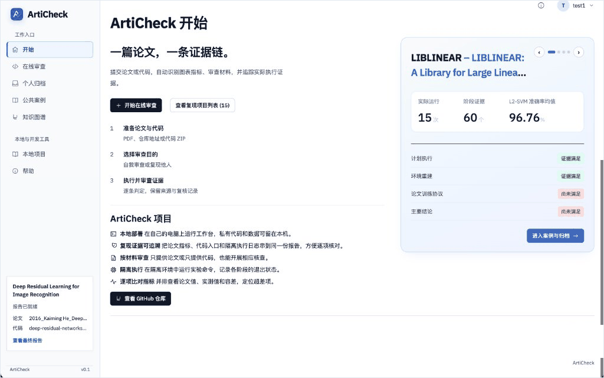
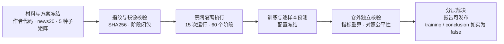
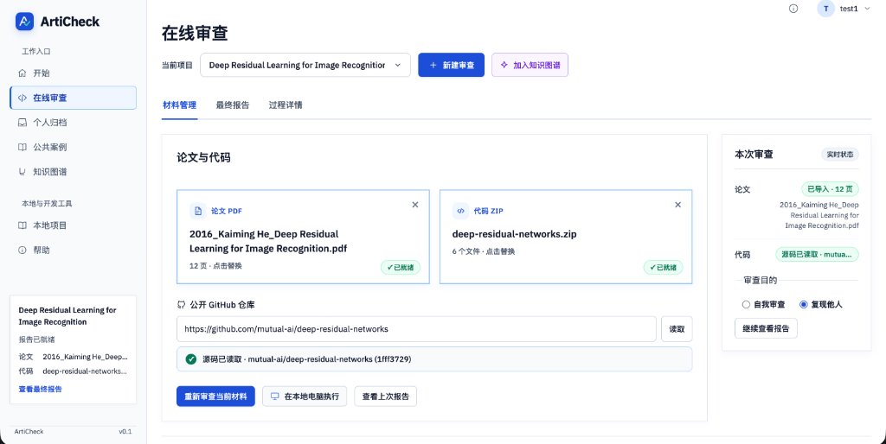
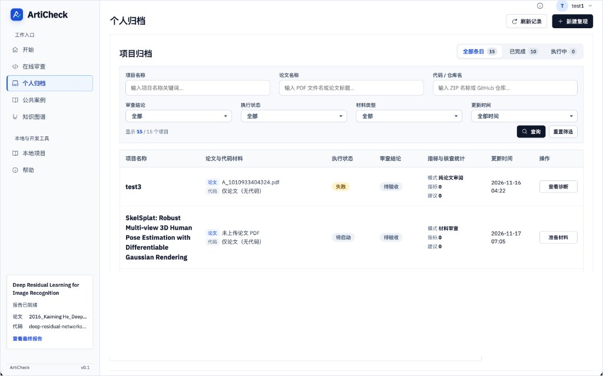
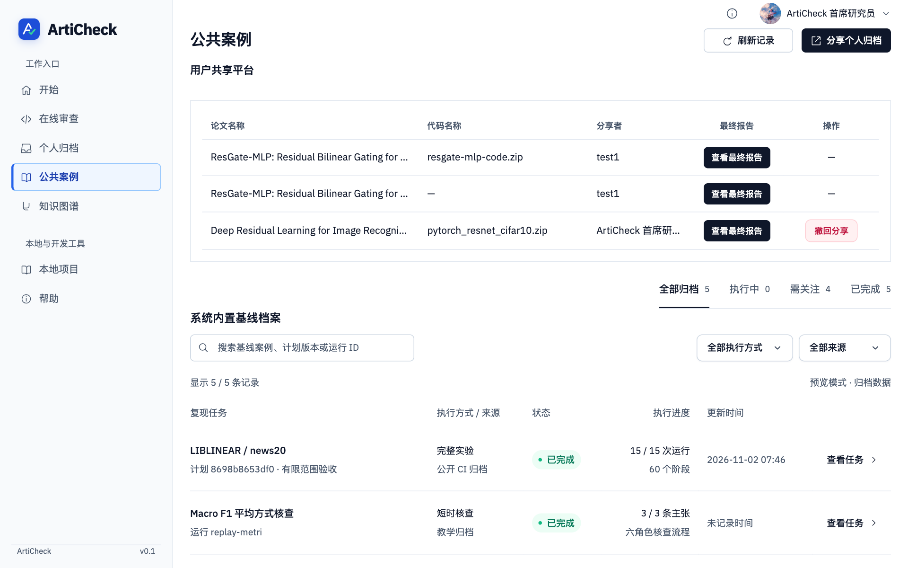
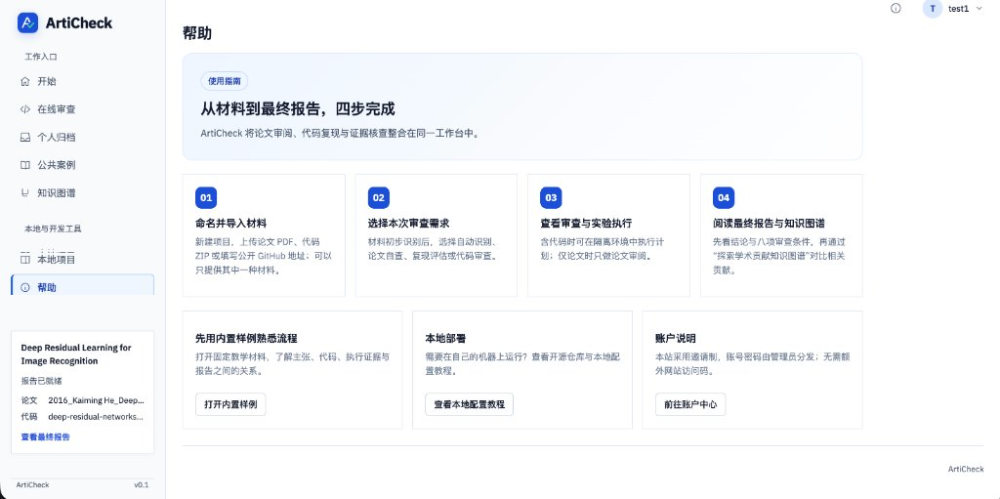

<div align="center">


# ArtiCheck

**一篇论文，一条证据链。**

面向 **Artifact Evaluation、投稿前自查与论文复现** 的多 Agent 核查系统。<br>
把论文 PDF、作者代码（GitHub 固定提交或 ZIP）与运行环境绑定在一起，完成隔离执行、独立指标重算、逐主张审查与科学贡献图谱，并用 SFT + GRPO 训练全局调度策略。

[](https://github.com/Gump111458785/ArtiCheck/actions/workflows/ci.yml)
[](pyproject.toml)
[](pyproject.toml)
[](LICENSE)
[](https://github.com/Gump111458785/ArtiCheck/actions/runs/41408434563)

[在线工作台](https://articheck-workbench.edgeone.dev) · [系统架构](#architecture) · [快速开始](#quickstart)

</div>



<a id="problem"></a>

## 1. 要解决的问题

核对一篇论文的实验主张，需要同时看论文、代码、数据和运行结果，还要判断一次运行到底验证了哪些结论。

| 痛点 | ArtiCheck 的做法 |
|---|---|
| 论文、代码、实验设置要人工逐项对齐，口径差异容易漏掉 | 把实验拆成主张，每条主张绑定原文页码、代码版本、配置与执行证据 |
| 依赖、数据或权重缺失挡在实验之前 | 9 类失败定位区分「环境问题」和「算法问题」；可修的由 `Fixer` 在白名单内最小修复后重跑 |
| 代码跑通不等于结论成立 | 仓外独立重算指标，按「运行 / 环境 / 训练协议 / 主要结论」四层分别验收 |
| 材料换版本或换人复核后，旧结论被混用 | 材料与计划用 SHA256 固定；补丁产生新版本后，受影响的结论按依赖自动失效并重跑 |
| 时间和算力有限，检查顺序需要取舍 | `Supervisor` 在预算内决定先查什么、何时修复、何时停止，策略经 SFT + GRPO 训练（[后训练与评测](docs/SUPERVISOR_TRAINING.md)） |

[逐主张报告样例](docs/smoke/metric-defect-report.md) · [分层验收样例](web/dist/samples/liblinear-reproduction.json) · [公开 CPU 执行证据](https://github.com/Gump111458785/ArtiCheck/actions/runs/41408434563)

<a id="architecture"></a>

## 2. 系统架构


[SVG 原图](docs/assets/architecture.svg) · [开源部分架构图](docs/assets/architecture-current.svg)

设计原则：**Agent 只提议，Runtime 授权并执行，Evidence Validator 核验，Quality Gate 裁决。** 所有 Agent 都被视为不可信的提议者，只能提交 `Draft`；经 Runtime 和 Evidence Validator 校验后，才写成不可变的 `Record`。

### 2.1 七个 Agent

主审查链路 5 个，Paper Tree 子系统 2 个。

| Agent | 位置 | 职责 | 不允许做的事 |
|---|---|---|---|
| **Supervisor** | 主审查 · 编排 | 读取压缩后的任务状态，从 12 类动作中选择下一步，失败时重规划，申请结束或弃权 | 直接执行工具、修改文件、生成判定、绕过 Quality Gate |
| **Reviewer** | 主审查 · 专业 | 内部多轮取证：按需读页、读代码、查文献，拆解主张并生成执行计划 | 把未执行的结果标为通过；放宽容差；自查模式下给出「拒稿」结论 |
| **Novelty** | 主审查 · 专业 | 只读查询 Paper Tree 与公开文献，找出最接近的前作，核对创新点是否真的在代码中实现 | 仅凭摘要认定创新；引用未检索到的论文 |
| **Auditor** | 主审查 · 专业 | 先**盲抽证据**（看不到主张和初审结论），再与主张对抗比对；撤回证据不足的指控 | 盲抽阶段读取初审结论；没有实验产出时凭常识改判 `SUPPORTED` |
| **Fixer** | 主审查 · 专业 | 针对缺依赖、入口偏差、设备映射等环境问题，提出最小补丁 | 修改数据划分、随机种子、损失函数、模型逻辑、评测公式或测试断言 |
| **Relation Analysis** | Paper Tree | 抽取带逐字出处的主贡献与细分贡献，推断论文间的候选关系 | 覆盖用户手动确认的关系；无原文依据硬凑关系 |
| **GraphAssistant** | Paper Tree | 用 6 个只读工具多步检索图谱与原文，回答附经程序校验的出处 | 修改图谱；引用未通过逐页校验的原文 |

### 2.2 确定性组件

| 组件 | 职责 |
|---|---|
| **Deterministic Runtime** | 状态机以 `node_id` 标识节点，以 `execution_epoch` 区分执行轮次，并幂等合并并发更新；计算当前合法动作集合；步数、时间、沙箱次数与修复轮数的硬预算；停滞循环熔断；补丁后的依赖失效 |
| **Tool Gateway** | PDF、代码、文献检索、沙箱的统一入口；按 Agent 区分只读与写入权限；外部内容统一包裹 `<untrusted_data>` 防提示注入 |
| **Evidence Validator** | 三项相互独立的检查：引文逐字存在于对应页；数值按指标类型的容差一致并经仓外独立重算；数据划分互斥、配置冻结、补丁未触碰禁改区 |
| **ExperimentRunner** | 调度禁网 Docker、E2B CPU 沙箱与自有 RTX 4090 GPU Worker（`bwrap` 禁网）；采集日志、退出码、资源峰值与产物指纹 |
| **Evidence Ledger / Trace Store** | 持久化、不可变的证据账本；全链路轨迹，含动作掩码、原生 token IDs 与行为 log-prob，直接供 SFT / RL 使用。Redis 只做会话缓存与队列 |
| **Scientific Quality Gate** | 8 项确定性检查（材料未变、引文全部校验通过、高风险指控已复核、补丁后已重跑等），决定报告能否发布；不调用模型 |

数值容差按指标类型分级：常规指标以原文印刷精度为下限、以报告值的 1% 为上限；近零值使用绝对容差；多种子结果计入样本标准误。

### 2.3 四类相互独立的状态

「报告可以发布」和「论文没有问题」是两回事。系统把下面四类状态分开记录：

| 状态 | 回答的问题 | 取值 |
|---|---|---|
| `TaskStatus` | 任务进行到哪里 | `CREATED` · `RUNNING` · `PAUSED_WAIT_MATERIAL` · `COMPLETED` · `PARTIAL` · `CANCELLED` · `FAILED` |
| `ReleaseGateStatus` | 这份审查报告是否可信、能否发布 | `RELEASE_READY` · `REPLAN` · `PARTIAL_RELEASE` · `WAIT_MATERIAL` · `FAILED` |
| `ClaimVerdict` | 单条主张是否成立 | `SUPPORTED` · `ISSUE` · `INCONCLUSIVE`（未检查记为 `NOT_CHECKED`） |
| 四层验收 | 复现成立到哪一层 | `run` · `environment_rebuilt` · `training` · `conclusion` |

证据完整、复核完成时，即使查出了 `ISSUE`，报告也应当是 `RELEASE_READY`。

### 2.4 一次审查怎么运行

1. Supervisor 按依赖图推进：拆解主张、检查代码与环境、评估创新点可以并行；执行必须等计划冻结后才能开始。
2. 执行失败时，失败位置分为 9 类，并标注 `CONFIRMED`（来自日志、退出码）或 `SUSPECTED`（来自模型推断）。只有 `CONFIRMED` 的环境问题才会派给 Fixer。
3. Fixer 只能写入白名单内的依赖文件、启动封装与设备映射；原仓库只读挂载；指标由仓外独立进程重算。补丁会生成新版本，受影响的阶段按 `StageCacheKey` 失效并重跑，只依赖论文的证据保持有效。
4. 缺私有数据或权重、GPU 不可用时，系统请求用户补充材料或诚实弃权，不用 CPU 冒充、不造数据。
5. 回环有上限：Fixer 最多 2 轮，Auditor 要求 Reviewer 补读最多 2 轮，连续两次相同且无新证据的动作会被熔断。
6. Supervisor 申请结束时，Quality Gate 检查 8 项条件；不满足就退回 `REPLAN`。最终报告单列 Fixer 的全部补丁。

Paper Tree 有独立入口和编排，不经过 Supervisor；主审查只通过 Novelty 的只读接口查询图谱。Relation Analysis 生成的关系一律是 `CANDIDATE`，用户确认后才升级为 `USER_CONFIRMED`。

<a id="roadmap"></a>

### 2.5 实现与开源对照

| 模块 | 状态 | 开源代码入口 |
|---|---|---|
| 在线工作台、材料上传、双模式报告、归档与共享 | 已实现 · 开源 | [`hosted_api.py`](articheck/hosted_api.py) · [`web/dist/`](web/dist/) |
| 隔离执行：E2B CPU、RTX 4090 `bwrap`、禁网 Docker | 已实现 · 开源 | [`hosted_sandbox.py`](articheck/hosted_sandbox.py) · [`gpu_worker.py`](articheck/gpu_worker.py) · [`sandbox.py`](articheck/sandbox.py) |
| 完整实验复现引擎与六角色事件 | 已实现 · 开源 | [`reproduction/`](articheck/reproduction/) |
| Paper Tree：入库、OpenAlex 扩展、贡献抽取、GraphAssistant | 已实现 · 开源 | [`kg_service.py`](articheck/kg_service.py) · [`kg_assistant.py`](articheck/kg_assistant.py) |
| 训练接口：轨迹导出、LoRA SFT、`verl` AgentLoop、GRPO 目标函数 | 已实现 · 开源 | [`training/`](articheck/training/) · [`train_sft.py`](scripts/train_sft.py) · [`train_grpo.sh`](scripts/train_grpo.sh) |
| Supervisor、Deterministic Runtime、Quality Gate | 已实现 · 未开源 | — |
| Reviewer / Novelty / Auditor / Fixer、Relation Analysis | 已实现 · 未开源 | 开源版对应 [`hosted_review.py`](articheck/hosted_review.py)、[`hosted_audit.py`](articheck/hosted_audit.py)、[`kg_methods.py`](articheck/kg_methods.py) |
| Evidence Ledger、Trace Store、Model Router | 已实现 · 未开源 | 开源版轨迹契约见 [`training/export.py`](articheck/training/export.py) |
| SFT / GRPO 训练流水线、权重与私有评测集 | 已实现 · 未开源 | — |

<a id="roles"></a>

### 2.6 开源部分的本地六角色

开源仓库保留了一条可独立运行的本地流水线：**短时主张核查**（[`roles.py`](articheck/roles.py) + [`pipeline.py`](articheck/pipeline.py)）和**完整实验复现**（[`reproduction/engine.py`](articheck/reproduction/engine.py)，由 [`reproduction/roles.py`](articheck/reproduction/roles.py) 记录角色事件）。

| 角色 | 短时核查 | 完整实验 | 调用模型 |
|---|---|---|---|
| **LiteratureReader** | 读取人工确认的主张清单 | 计划审计的 `scope` 维度：论文身份、出处与实验覆盖 | 否 |
| **CodeInspector** | 列出仓库文件，只作上下文 | `code / data / environment / settings` 审计与源码完整性核对 | 否 |
| **Planner** | 输出 `check(cᵢ)` 或 `stop`；默认 `FixedPlanner`，可接 `ModelPlanner` | 按冻结计划排程（`policy: frozen_plan`），记录停止原因 | 可选 |
| **ExperimentRunner** | 禁网 Docker 执行探针，按「仓库哈希 + argv + 沙箱身份」缓存 | 禁网镜像构建、环境验证、逐阶段执行与指纹 | 否 |
| **CrossAuditor** | 指标容差、训练/测试 ID 不相交、训练预算一致 | 镜像兼容、未声明改动、配置冻结、独立重算、公平性 | 否 |
| **Reporter** | 生成 Markdown 报告 | 汇总四层验收，写入 `report.json` | 否 |

角色事件写入失败只记入 `roles.errors`，不影响执行与验收结论。

<a id="usage"></a>

## 3. 使用方式

| 方式 | 适合 | 入口 |
|---|---|---|
| 网站 | 直接上传材料、在线执行并查看报告 | [在线工作台](https://articheck-workbench.edgeone.dev/#home)（受邀账户） |
| 本地开源版 | 材料不能离开本机；或想直接跑通流程 | [快速开始](#quickstart) |
| 自选模型 | 用自己部署的模型或供应商 API 驱动 Planner | 见下方 3.2 |

### 3.1 网站

侧边栏有五个工作区：

- **开始**：三步引导，以及 4 个案例的四层验收卡片轮播。
- **在线审查**：上传论文 PDF（≤ 20 MB / 150 页）、代码 ZIP（≤ 100 MB）或绑定公开 GitHub 仓库，然后选择审查目的：
  - **自我审查**：给出「需要修改 / 可优化 / 待你确认」分级清单，并比对图谱中的相关工作。
  - **复现他人**：给出复现程度、阶段实测、指标吻合度、带逐字出处的创新点，以及七步审查时间轴。

  普通脚本在 E2B 沙箱运行；需要 CUDA 的实验自动派发到 RTX 4090 节点。执行过程可暂停、继续、终止，断网后可续传。
- **个人归档**：7 个维度组合筛选。
- **公共案例**：用户共享的报告与原始材料，以及系统内置的基线档案。
- **知识图谱**：用标题、arXiv、DOI 或本地 PDF 添加论文，OpenAlex 自动扩展脉络；支持展开子贡献、手动建立联系、只读图谱问答，以及**一键复现**（自动寻找配套仓库）。

[使用说明](docs/ONLINE_WORKBENCH.md) · [网站验收记录](docs/ONLINE_ACCEPTANCE.md) · [部署与密钥](docs/EDGEONE_DEPLOYMENT.md)

### 3.2 自选模型

开源版的 `ModelPlanner` 可以接任何 OpenAI 兼容接口。用 vLLM 在本地部署自己的模型：

```bash
export MODEL_PATH="/absolute/path/to/your-model"
bash scripts/serve_vllm.sh
```

在另一个终端提交任务：

```bash
python -m articheck run --task examples/task.json --output runs/local-model \
  --planner model --base-url http://127.0.0.1:8000/v1 \
  --model "$MODEL_PATH" --policy-version your-checkpoint-version
```

改用供应商 API 时，设置 `ARTICHECK_API_KEY`，并把 `--base-url` 和 `--model` 换成供应商的地址与模型名。DeepSeek 已经过线上实际调用。ArtiCheck 训练得到的权重不随开源版发布。

[训练与推理说明](docs/TRAINING.md) · [任务与执行协议](docs/DATA.md)

<a id="case"></a>

## 4. 旗舰案例：LIBLINEAR / news20

使用 **LIBLINEAR（JMLR 2008）作者代码**和公开的 news20 数据，由开源复现引擎在 GitHub Actions 上完成：CPU 环境重建、数据准备、训练、预测与独立指标重算。3 种方法设置各跑 5 个划分种子。



| 实测项目 | 结果 | 证据 |
|---|---:|---|
| 方法设置 × 划分种子 | 3 × 5 = **15 次运行** | [运行明细](web/dist/samples/liblinear-reproduction.json) |
| 阶段记录 | **60 个** | [执行 CI](https://github.com/Gump111458785/ArtiCheck/actions/runs/41408434563) |
| 角色事件 | **162 条** | [角色事件](web/dist/samples/liblinear-roles.jsonl) · [角色视图](https://articheck-workbench.edgeone.dev/?mode=demo&example=reproduction&case=liblinear&view=roles) |
| L2-SVM 准确率均值 | **96.76%** | [结果与统计](web/dist/samples/liblinear-reproduction.json) |
| 准确率样本标准差 | **0.31 个百分点** | 同上，5 个划分种子 |
| 执行器墙钟时长 | **111.36 秒** | [计时与资源口径](docs/EXECUTION_EVIDENCE.md) |
| 全阶段子进程峰值 RSS 最大值 | **366.3 MiB** | 同上 |
| 容器外内存采样峰值 | **217.4 MiB** | 33 / 60 个阶段有容器外采样 |

准确率波动来自 5 次数据重新划分，不代表原论文成绩的置信区间。时长不含下载准备脚本和拉取基础镜像。

**验收结果**：证据链完整，报告可以发布（`RELEASE_READY`）。本次验收范围是环境重建和已声明的实验，论文主要结论仍以分层验收记录为准。

| 层次 | 结果 | 依据 |
|---|---|---|
| `run` | `true` | 15 次运行完成，60 个阶段均有证据 |
| `environment_rebuilt` | `true` | 固定基础镜像，禁网 Docker 构建与环境检查 |
| `training` | `false` | 使用现代代码与 80/20 种子划分，未对齐历史代码与原始划分 |
| `conclusion` | `false` | Figure 1、rcv1、Pegasos / SVMperf 对比及调参与计时曲线不在本次 CPU 案例范围内 |

新增的 LR 对照与正则化消融只用于本案例的公平性核对，不替代原论文基线。

[案例来源与完整命令](examples/liblinear_case/README.md) · [证据归档](web/dist/samples/liblinear-reproduction.json)

<a id="capabilities"></a>

## 5. 开源部分核心能力

| 能力 | 工作方式 | 代码 |
|---|---|---|
| 主张级核查 | 六角色核对指标、样本重叠与训练预算；每条判定引用 PDF 页码与源码出处，证据不足保留 `inconclusive` | [`pipeline.py`](articheck/pipeline.py) · [样例报告](docs/smoke/metric-defect-report.md) |
| 在线联合审阅与交叉复核 | 读取 PDF 文字与原页图、源码节选，给出建议、图表指标与冻结执行计划；交叉复核撤回证据不足的指控 | [`hosted_review.py`](articheck/hosted_review.py) · [`hosted_audit.py`](articheck/hosted_audit.py) |
| 受控执行 | Docker / `bwrap` 禁网、只读挂载、非 root；自动识别 PyTorch / CUDA 并路由到 GPU；补齐纯 Python 依赖；拦截 `caffe` 等无法 `pip` 安装的框架 | [`sandbox.py`](articheck/sandbox.py) · [`gpu_worker.py`](articheck/gpu_worker.py) |
| 可审计复现引擎 | 不可变材料工作区、PDF / ZIP / 计划指纹、阶段与种子矩阵、断点续传与产物清理 | [`reproduction/`](articheck/reproduction/) · [说明](docs/REPRODUCTION_ENGINE.md) |
| 图谱与图谱问答 | OpenAlex 脉络、带逐字出处的贡献节点、一键复现；问答为只读多步工具调用，出处经逐页程序校验 | [`kg_service.py`](articheck/kg_service.py) · [`kg_assistant.py`](articheck/kg_assistant.py) |
| 训练轨迹契约 | 原生 token IDs、行为 log-prob 与策略版本由采样侧旁路写入；缺失原生 token 时拒绝导出 RL 数据 | [`training/export.py`](articheck/training/export.py) · [契约说明](docs/TRAINING.md#5-原生训练轨迹契约) |

<a id="showcase"></a>

## 6. 界面展示

以下截图均来自当前线上部署。

### 6.1 开始、材料绑定与双模式报告

<table>
<tr>
<td width="50%" valign="top">
<strong>开始页</strong><br>
三步开启在线审查，右侧为 4 个案例的四层验收卡片。<br><br>
<a href="docs/assets/ui-home.png"></a>
</td>
<td width="50%" valign="top">
<strong>材料管理与 GitHub 绑定</strong><br>
同屏导入论文 PDF、代码 ZIP 或公开仓库，切换「自我审查 / 复现他人」。<br><br>
<a href="docs/assets/ui-materials-review.png"></a>
</td>
</tr>
<tr>
<td width="50%" valign="top">
<strong>自我审查报告</strong><br>
「需要修改 / 可优化 / 待你确认」分级清单，逐条定位到 PDF 页码。<br><br>
<a href="docs/assets/ui-report-selfreview.png"></a>
</td>
<td width="50%" valign="top">
<strong>复现他人报告</strong><br>
复现程度、阶段完成度、指标比对、带逐字出处的创新点与七步审查时间轴。<br><br>
<a href="docs/assets/ui-report-reproduce.png"></a>
</td>
</tr>
</table>

### 6.2 知识图谱、图谱问答、归档与共享

<table>
<tr>
<td width="50%" valign="top">
<strong>科学贡献知识图谱</strong><br>
104 篇论文的引文与贡献关系；右侧「节点详情 / 主要贡献 / 研究脉络 / 图谱问答」四栏，支持展开子贡献、扩展、建立联系与一键复现。<br><br>
<a href="docs/assets/ui-knowledge-graph.png"></a>
</td>
<td width="50%" valign="top">
<strong>图谱问答</strong><br>
只读检索自己的图谱与已保存原文，回答列出经逐字核验的出处，点击页码直接打开 PDF。<br><br>
<a href="docs/assets/ui-kg-ask.png"></a>
</td>
</tr>
<tr>
<td width="50%" valign="top">
<strong>个人归档</strong><br>
按项目名、论文名、代码、结论、执行状态、材料类型与时间组合筛选。<br><br>
<a href="docs/assets/ui-personal-archive.png"></a>
</td>
<td width="50%" valign="top">
<strong>公共案例</strong><br>
上方为用户共享的报告与原始材料，下方为系统内置的基线档案。<br><br>
<a href="docs/assets/ui-public-platform.png"></a>
</td>
</tr>
<tr>
<td width="50%" valign="top">
<strong>本地项目</strong><br>
材料需要留在本机时，提供环境要求与一键复制的启动命令。<br><br>
<a href="docs/assets/ui-local-project.png"></a>
</td>
<td width="50%" valign="top">
<strong>帮助页</strong><br>
四步操作引导、内置样例与账户说明。<br><br>
<a href="docs/assets/ui-help-guide.png"></a>
</td>
</tr>
</table>

[完整界面图集](docs/UI_GALLERY.md)

<a id="quickstart"></a>

## 7. 快速开始

[在线工作台](https://articheck-workbench.edgeone.dev/#home)支持上传材料、查看审查进度和报告，需要受邀账户。下方命令可在本机运行内置样例。

需要 Python 3.10+，macOS 或 Linux。内置受控缺陷基准不需要 API key、GPU 或 Docker。

```bash
git clone https://github.com/Gump111458785/ArtiCheck.git
cd ArtiCheck
python3 -m venv .venv && source .venv/bin/activate
python -m pip install -e .

python -m articheck demo --sandbox local --output runs/demo
```

这条命令会核查同一仓库的 4 个版本：一个干净版本，以及分别含指标计算、数据划分、基线训练预算缺陷的三个版本。`local` 直接在主机上执行内置的可信代码；再次运行请换一个输出目录。

结果在 `runs/demo/`：`metrics.json` 为汇总指标，每个版本目录下有 `report.md`、`report.json` 与 `trace.jsonl`，逐主张真值与得分在 `labels.jsonl` 和 `scores.jsonl`。

<a id="workbench"></a>

**本地工作台**

```bash
python -m articheck.workbench --port 8787
```

打开 http://127.0.0.1:8787，提交任务、查看执行进度与报告，数据保存在 `runs/workbench/`。工作台使用固定 Planner；要用模型驱动，请使用 [3.2 节](#usage)的 CLI。

**核查自己的仓库**

按 [task.json 示例](examples/task.json)声明仓库、主张和输出 JSON 的 probe，然后运行：

```bash
docker pull python:3.11-slim
python -m articheck run --task examples/task.json --output runs/review
```

额外依赖需要预先构建进镜像。字段与 probe 协议见 [数据与执行指南](docs/DATA.md)。

<a id="results"></a>
<a id="benchmarks"></a>
<a id="example"></a>

## 8. 实测结果

以下结果均来自开源部分，可以按链接复查。

| 验证对象 | 范围与结果 | 证据 |
|---|---|---|
| 公开 CPU 案例 | LIBLINEAR / news20：15 次运行、60 个阶段、162 条角色事件；L2-SVM 准确率 96.76%，标准差 0.31 个百分点 | [CI](https://github.com/Gump111458785/ArtiCheck/actions/runs/41408434563) · [报告](web/dist/samples/liblinear-reproduction.json) |
| 内置受控缺陷基准 | 1 个仓库、4 个版本、12 条主张；FixedPlanner + 规则核查：TP=3、FP=0、TN=9、FN=0 | [原始结果](docs/smoke/metrics.json) · [问题报告](docs/smoke/metric-defect-report.md) |
| Python 测试 | 259 项（本地 255 项通过，4 项 Docker 专项跳过）；CI 覆盖 Python 3.10–3.12 | [CI](https://github.com/Gump111458785/ArtiCheck/actions/workflows/ci.yml) · [验收记录](docs/ONLINE_ACCEPTANCE.md) |
| 前端测试 | 147 项，覆盖角色事件、API 接入、材料、报告、归档与共享、图谱问答、个人中心与审查控制 | [测试代码](tests/frontend/) |

内置基准只有 3 个正例、9 个负例，只能说明工程链路正确，不能外推到真实论文。

公开的 [GRPO 启动脚本](scripts/train_grpo.sh)同时启用异步 vLLM rollout、`0.2 / 0.28` 非对称裁剪和 `token-mean`。M0–M4 各阶段的对照条件见 [后训练与评测](docs/SUPERVISOR_TRAINING.md#rl-stages)。完整系统的评测数据与结果暂不公开。

<a id="docs"></a>

## 9. 文档与开发

[文档目录](docs/README.md)按使用、部署、验收与训练组织。

| 文档 | 内容 |
|---|---|
| [使用与数据](docs/DATA.md) | task.json、probe、执行、缓存、受控缺陷、划分与反馈 |
| [工作台与 API](docs/WORKBENCH.md) · [执行中心](docs/EXECUTION_CENTER.md) | 本地运行、材料准备、角色与事件、HTTP / SSE |
| [复现引擎](docs/REPRODUCTION_ENGINE.md) · [验收清单](docs/REPRODUCTION_COMPLETION_CHECKLIST.md) | 材料身份、完整实验、资源测量、统计与分层验收 |
| [Benchmark 规范](docs/BENCHMARKS.md) · [Baseline 来源](docs/BASELINE.md) | 数据隔离、误报约束、对照公平性 |
| [Supervisor 后训练与评测](docs/SUPERVISOR_TRAINING.md) | 数据划分、SFT、GRPO、M0–M4 对照与评测协议 |
| [训练接口](docs/TRAINING.md) · [本地 Planner 后训练](docs/POST_TRAINING.md) | 教师轨迹、LoRA SFT 与 verl GRPO |
| [术语](docs/GLOSSARY.md) | 证据、报告状态、运行指纹与训练术语 |
| [验证记录](docs/VALIDATION.md) · [能力核对](docs/IMPLEMENTATION_STATUS.md) | 测试、CI 与验收项 |

```bash
python -m articheck --help
python -m unittest discover -s tests -v
node --test tests/frontend/*.test.mjs
```

代码入口：[核查流水线](articheck/pipeline.py) · [六角色](articheck/roles.py) · [Planner](articheck/planner.py) · [复现引擎](articheck/reproduction/) · [本地工作台](articheck/workbench.py) · [前端](web/dist/) · [训练](articheck/training/)

问题与建议请提交 [Issues](https://github.com/Gump111458785/ArtiCheck/issues)，并附上去除敏感信息后的任务配置与日志。

## 10. 来源与许可

业务 baseline 参考 [Paper Reproducibility Agent](https://github.com/1a1a11a/2026_paper_reproduce)，通过独立进程和 JSON 报告对接，未分发其源码（[版本与许可](docs/BASELINE.md)）。训练接口参考 [verl](https://github.com/verl-project/verl)，推理服务接入 [vLLM](https://github.com/vllm-project/vllm)。

PDF 阅读器随仓库分发 PDF.js 6.4.299（Apache-2.0），字体与 CMap 的许可见 `web/dist/vendor/pdfjs/`。ArtiCheck 原创代码采用 [MIT License](LICENSE)；外部工具、模型和数据遵循各自的许可。
