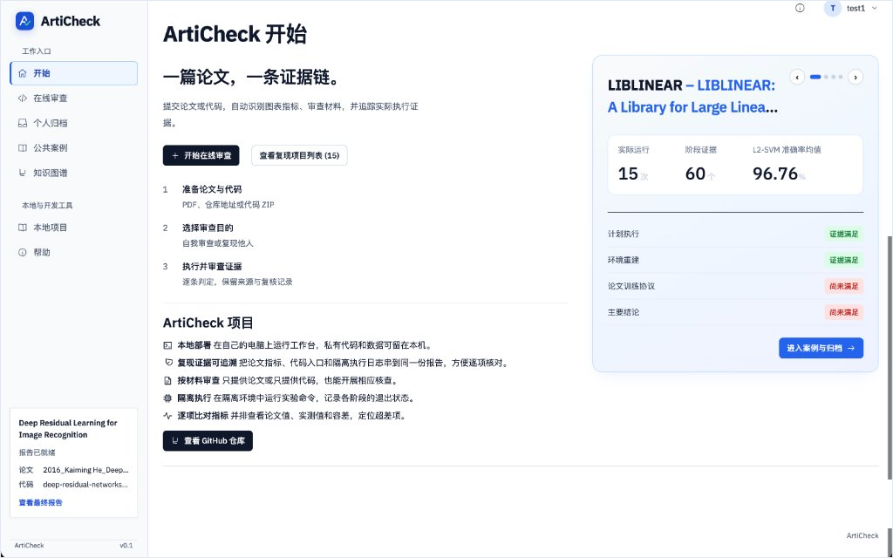
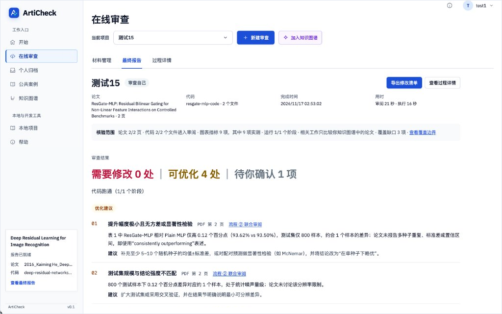
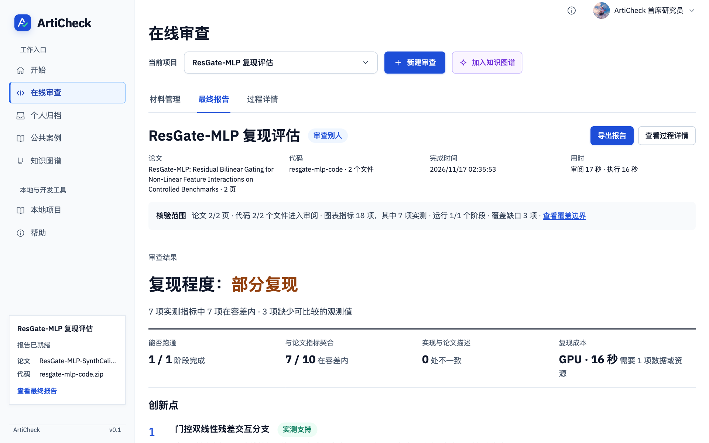
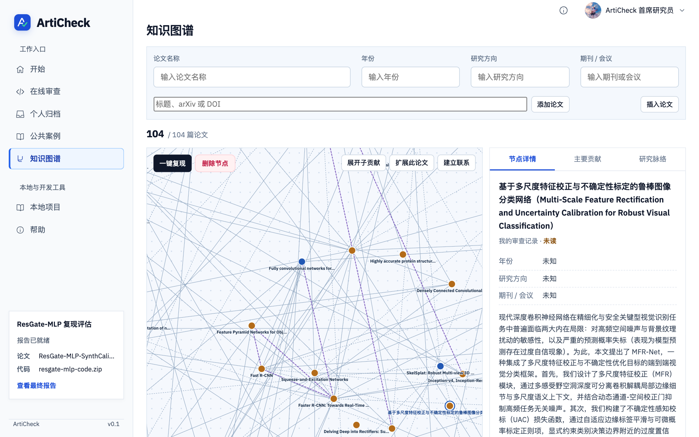
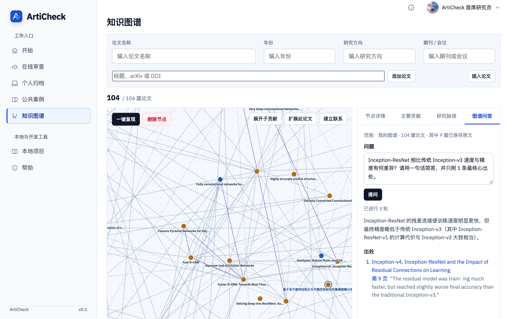
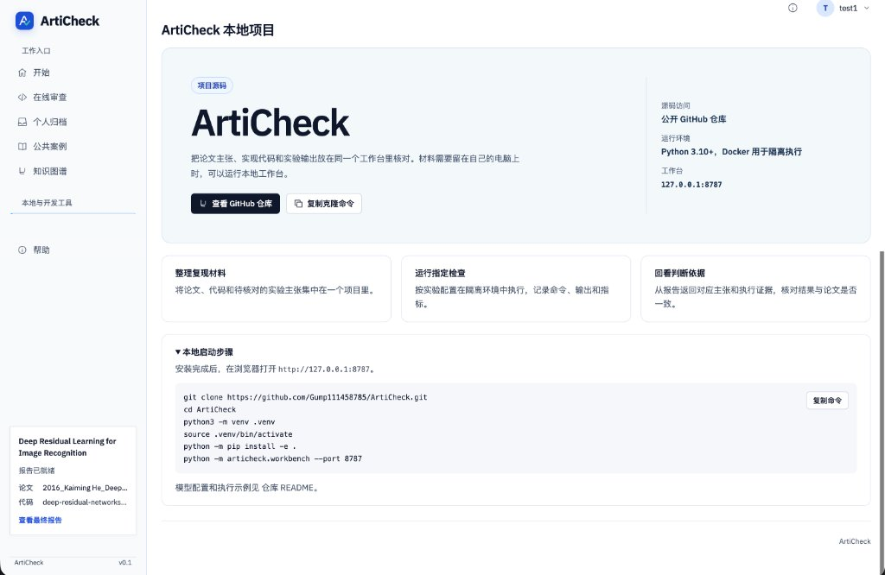
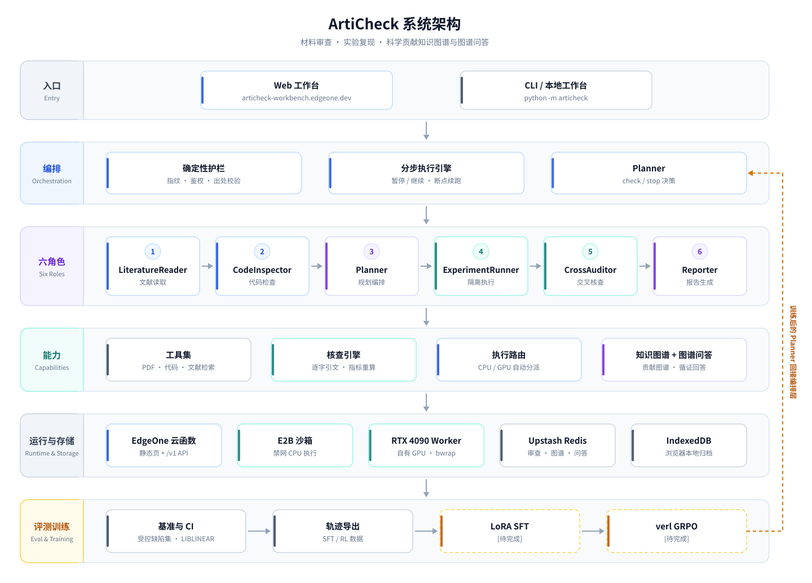

<div align="center">


# ArtiCheck

**一篇论文，一条证据链。**

面向 **Artifact Evaluation、投稿前自查与论文复现研究** 的一体化核查工作台。<br>
围绕论文 PDF、Author Code / GitHub 固定提交与运行环境，打通材料绑定、云端/本地隔离执行、独立指标比对、逐主张审查报告与科学贡献知识图谱。

[](https://github.com/Gump111458785/ArtiCheck/actions/workflows/ci.yml)
[](pyproject.toml)
[](pyproject.toml)
[](LICENSE)
[](https://github.com/Gump111458785/ArtiCheck/actions/runs/41408434563)

[打开在线工作台](https://articheck-workbench.edgeone.dev) · [快速开始](#quickstart) · [查看界面展示](#showcase) · [总体架构](#architecture) · [后训练体系](#training) · [旗舰复现案例](#case)

</div>

> [!NOTE]
> **开源底座与目标架构边界说明（Open-Core vs. Architecture & Private Extensions）**
> - **本仓库公开可运行底座（Open Core）**：提供在线工作台与 Flask API、Docker / `bwrap` 隔离执行与 LIBLINEAR 复现引擎、Paper Tree 科学贡献图谱与只读图谱问答 `GraphAssistant`，以及 `verl` / LoRA SFT / GRPO 训练与轨迹导出 MVP 骨架。
> - **目标总体架构与私有演进能力**：[第 6 节](#architecture)与[第 9 节](#training)同时完整阐述了重构后的目标多 Agent 编排（全局 `Supervisor` + `Deterministic Runtime` DAG + `Fixer` / `Novelty` / 盲抽 `Auditor` + `Evidence Ledger`）与完整多阶段后训练体系；相关商业化核心调度与私有训练权重未纳入开源代码仓，公开榜单之外的私有实测数值亦不在此提前声称。


<a id="problem"></a>

## 1. 要解决的问题

在投稿前自查、Artifact Evaluation 和复用论文方法时，研究团队需要核对论文中的实验主张与代码、数据和运行结果是否一致。这项工作涉及多份材料，还需要判断一次运行究竟验证了哪些结论。

| 痛点 | 对核查工作的影响 | ArtiCheck 的处理方式 |
|---|---|---|
| 论文、代码和实验设置需要人工逐项对齐 | 指标口径、数据划分或基线配置的差异容易遗漏；看到相近的数字，也需要追查计算过程 | 将实验拆成主张，关联原文、代码版本、配置和执行证据 |
| 环境和材料问题挡在实验之前 | 依赖、数据或权重缺失时，需要先排查原因，才能判断是否值得继续投入算力 | 核对材料与运行条件，记录环境重建过程和阶段失败原因 |
| 代码跑通后，结论仍需要核验 | 一次成功执行不能回答指标是否算对、对照是否公平，以及主要结论是否有足够支持 | 独立重算指标，检查对照与多次运行结果，按运行、环境、训练协议和主要结论分层验收 |
| 检查记录分散，交接与复核需要重新找依据 | 更换材料版本或审核人后，容易混用旧结果，也难以追溯一条判断的来源 | 固定材料与计划指纹，保存逐主张证据、角色事件和人工复核意见 |
| 时间和算力有限，检查顺序需要取舍 | 遍历所有实验可能超出预算，过早停止又可能漏掉重要问题 | 设置工具、时间与费用预算；训练 Planner 选择核查顺序和停止时机 [待完成] |

ArtiCheck 面向课题组自查、论文评审和研究方法复用，建立了材料核对、实验执行与结论复核的一体化流程，将每条判断与可复查的证据关联。核查时间、人工投入与费用变化见 [评测方案](#training)，对应实测 [待完成]。

[逐主张报告](docs/smoke/metric-defect-report.md) · [分层验收案例](web/dist/samples/liblinear-reproduction.json) · [公开 CPU 执行证据](https://github.com/Gump111458785/ArtiCheck/actions/runs/41408434563)

<a id="usage"></a>

## 2. 使用方式

按模型运行的位置选择使用方式：在自己的机器上运行 ArtiCheck 微调模型，直接调用主流大模型 API，或通过网站提交任务。

| 方式 | 模型与权重 | 使用流程 |
|---|---|---|
| 本地 | 下载 ArtiCheck 微调模型与权重，在自己的机器上推理；权重发布 [待完成] | 准备模型与运行环境 → 启动推理服务 → 提交核查任务 |
| API | 使用自己的供应商 API key 直接调用主流大模型，无需下载 ArtiCheck 权重 | 配置模型地址、名称与密钥 → 运行核查 → 查看报告；供应商联调与质量评测 [待完成] |
| 网站 | EdgeOne 承载网页与模型审阅接口；接入云端隔离 CPU 与自有 RTX 4090 GPU 执行 | 受邀登录 → 命名项目并上传论文与代码 → 选择审查需求 → 跟踪进度并查看一页式报告 |

### 2.1 本地：运行 ArtiCheck 微调模型

下载 ArtiCheck 微调模型与权重，在自己的 GPU 环境中启动推理服务。Planner 使用本地模型选择核查主张和停止时机，工具调用与实验代码执行也在自己的机器上运行。微调权重、下载入口与运行资源说明 [待完成]。

准备 vLLM 环境后，用模型目录启动推理服务。下面的路径和版本号需要替换为实际下载的模型目录与检查点版本。

```bash
export MODEL_PATH="/absolute/path/to/articheck-model"
bash scripts/serve_vllm.sh
```

在另一个终端提交核查任务：

```bash
export MODEL_PATH="/absolute/path/to/articheck-model"
python -m articheck run --task examples/task.json --output runs/local-model \
  --planner model --base-url http://127.0.0.1:8000/v1 \
  --model "$MODEL_PATH" --policy-version your-checkpoint-version
```

`examples/task.json` 指定论文主张、代码路径和执行命令；使用时替换为自己的任务文件。模型服务与 Docker 执行环境分别配置。[训练与推理说明](docs/TRAINING.md) · [执行协议](docs/DATA.md)。

### 2.2 API：直接调用主流大模型

保留 ArtiCheck 的核查流程，将 Planner 的推理请求直接发送给模型供应商。填写自己的 API 地址、模型名称与密钥，无需下载或部署 ArtiCheck 微调模型。密钥由运行核查的进程读取；论文工具与实验代码仍在自己的执行环境中运行。

```bash
export ARTICHECK_API_KEY="your-provider-key"
python -m articheck run --task examples/task.json --output runs/provider-api \
  --planner model --base-url https://your-provider.example/v1 \
  --model your-provider-model --policy-version your-provider-model-version
```

示例采用兼容 Chat Completions 的供应商接口，地址、模型名称与版本均需替换。DeepSeek 的在线接入已通过实际调用；其他供应商适配与跨模型质量评测 [待完成]。调用预算与费用配置见 [模型接入说明](docs/TRAINING.md)。

需要在其他应用中提交 PDF / ZIP 并查询审阅任务时，可使用独立的材料静态审阅接口：[接入说明](docs/API_REVIEW.md) · [OpenAPI 契约](web/dist/review-api.openapi.json) · [Python 调用示例](examples/api_review/submit.py) · [配置模板](examples/api_review/provider.env.example)。该接口返回 `model_api_static_review` 报告，实验执行与验收由执行器负责。

### 2.3 网站：浏览器中提交评测

打开 [ArtiCheck 在线工作台](https://articheck-workbench.edgeone.dev/#home)，通过受邀账户登录后可使用侧边栏「工作入口」五大核心工作区（**开始**、**在线审查**、**个人归档**、**公共案例**、**知识图谱**）、「本地与开发工具」（**本地项目**、**帮助**）以及顶部**个人中心**：

- **开始与帮助**：开始页提供「准备材料 → 选择审查目的 → 执行并审查证据」引导、项目列表入口与右侧 4 个案例轮播（LIBLINEAR、ResNet-110、GAT-Variant、QLoRA-Adapter）的四层验收卡片；帮助页提供四步操作指南与内置样例入口。
- **在线审查（材料管理 → 过程详情 → 最终报告）**：支持上传论文 PDF（最大 `20 MB` / `150 页`）、代码 ZIP（最大 `100 MB`），或绑定公开 GitHub 仓库。普通脚本在 E2B 隔离沙箱（自动补齐缺失依赖）运行，导入 `torch` / 需要 CUDA 的实验自动派发至自有 RTX 4090 GPU 隔离节点（`bwrap` 无特权命名空间与禁网执行）；「过程详情」支持实时查看角色节点活动、阶段日志、断网续传以及随时暂停/继续/终止。选择**自我审查**时生成「需要修改 / 可优化 / 待你确认」分级清单并比对知识图谱中的相关工作；选择**复现他人**时则聚焦复现程度、阶段实测、指标吻合度、创新点逐字依据与分歧差异，并将七步审查时间轴（材料接收、联合审阅、交叉复核、执行计划、环境与运行、指标比对、报告汇总）与折叠附录整合在同一报告页中。
- **科学贡献知识图谱**：支持通过「标题、arXiv 或 DOI」添加论文或直接「插入论文」上传本地 PDF，接入 OpenAlex 脉络自动构建论文节点、主贡献与细分贡献网络；右侧「节点详情 / 主要贡献 / 研究脉络 / 图谱问答」四栏支持查找原文、查看论文、标记已读/未读，以及对自己的图谱与已保存原文发起只读自然语言问答（回答附程序校验过的原文出处）；画布支持展开子贡献、扩展此论文与手动建立联系；选中任意论文节点点击**一键复现**时，自动寻找配套 GitHub 仓库，未找到时弹窗由你选择补充代码（论文+代码复现）或仅按论文核查。
- **个人归档与公共案例**：**个人归档**支持按项目名、论文名、代码/仓库名、审查结论、执行状态、材料类型与更新时间 7 维筛选；**公共案例**包含上方「用户共享平台」（支持发布已完成归档与原始材料、查看公开报告或撤回分享）与下方「系统内置基线档案」。
- **本地项目与个人中心**：**本地项目**提供本地运行环境说明与一键复制的克隆/启动命令；右上角**个人中心**提供自定义头像与显示名、近 7/14/30 天审查调用与实验执行量柱状图及近期项目跳转（管理员还可在此创建、重置密码或停用受邀账户）。

[使用与接口](docs/ONLINE_WORKBENCH.md) · [真实网站验收](docs/ONLINE_ACCEPTANCE.md) · [部署与密钥配置](docs/EDGEONE_DEPLOYMENT.md) · [OpenAPI 契约](web/dist/review-api.openapi.json)。

<a id="case"></a>

## 3. 旗舰案例：LIBLINEAR / news20

使用 **LIBLINEAR（JMLR 2008）作者代码和公开 news20 数据**，完成 CPU 环境重建、数据准备、训练、预测和独立指标重算。三种方法设置各运行五个划分种子，共记录 **15 次运行与 60 个阶段证据**。


| 实测项目 | 结果 | 证据 |
|---|---:|---|
| 方法设置 × 划分种子 | 3 × 5 = **15 次运行** | [运行明细](web/dist/samples/liblinear-reproduction.json) |
| 阶段记录 | **60 个** | [执行 CI](https://github.com/Gump111458785/ArtiCheck/actions/runs/41408434563) |
| L2-SVM 准确率均值 | **96.76%** | [结果与统计](web/dist/samples/liblinear-reproduction.json) |
| 准确率样本标准差 | **0.31 个百分点** | 同上，5 个划分种子 |
| 执行器墙钟时长 | **111.36 秒** | [计时与资源口径](docs/EXECUTION_EVIDENCE.md) |
| 全阶段子进程峰值 RSS 最大值 | **366.3 MiB** | 同上 |
| 容器外内存采样峰值 | **217.4 MiB** | 33 / 60 阶段有容器外采样 |

准确率的波动来自本案例的五次数据重新划分，不代表原论文成绩的置信区间。时长不含准备脚本下载和基础镜像拉取；GPU 峰值与费用测量 [待完成]。

### 3.1 案例验收

| 核对项 | 本案例结果 | 判定依据 |
|---|---|---|
| 执行完成 · `run` | `true` | 15 次运行完成，保留 60 阶段证据 |
| 环境重建 · `environment_rebuilt` | `true` | 固定基础镜像，记录构建与环境检查 |
| 独立指标与控制核对 | 预测独立重算、控制配置与公平性核对 | 预测结果独立重算；新增 LR 控制与正则化消融有实际配置与公平性检查 |
| 论文训练协议 · `training` | `false` | 对齐历史作者代码、原始划分 ID 与训练协议 [待完成]；本次使用现代作者代码与 80/20 seeded split |
| 论文主要结论 · `conclusion` | `false` | 覆盖 Figure 1、rcv1、Pegasos/SVMperf 及论文调参与计时曲线 [待完成] |

报告按运行、环境、训练协议与主要结论分别记录验收值。新增控制项只用于本案例核对，不替代原论文基线；本案例的证据范围为 news20 CPU 实验。

> **六角色记录**：本次 CI 保留 162 条角色事件，包含 15 次排程、60 个阶段执行、60 次阶段核查及最终分层结论。[查看角色事件](web/dist/samples/liblinear-roles.jsonl) · [打开角色视图](https://articheck-workbench.edgeone.dev/?mode=demo&example=reproduction&case=liblinear&view=roles)

[案例来源与完整运行命令](examples/liblinear_case/README.md) · [证据归档](web/dist/samples/liblinear-reproduction.json) · [执行 CI](https://github.com/Gump111458785/ArtiCheck/actions/runs/41408434563)

<a id="capabilities"></a>

## 4. 核心能力

| 能力 | 工作方式 | 代码与证据 |
|---|---|---|
| 主张级核查 | [六角色](#roles)协作，核对指标、样本重叠和训练预算；每条判定引用 PDF 页码与源码出处，证据不足保留 `inconclusive` | [报告](docs/smoke/metric-defect-report.md) · [流水线](articheck/pipeline.py) |
| 受控执行 | Docker / `bwrap` 禁网、只读挂载、非 root、自动识别 `PyTorch/CUDA` 路由并补齐纯 Python 依赖；拦截 `caffe` 等不可 `pip` 编译框架 | [沙箱](articheck/sandbox.py) · [GPU Worker](articheck/gpu_worker.py) |
| 可审计执行器 | 不可变材料工作区、PDF / ZIP / 计划指纹、阶段与种子矩阵、断网续传状态同步与产物清理 | [执行引擎](docs/REPRODUCTION_ENGINE.md) · [实现](articheck/reproduction/) |
| 知识图谱与一键复现 | 接入 OpenAlex 构建论文脉络与贡献节点；选定论文支持自动检索关联 PDF 与 GitHub 源码、一键发起「论文+代码」或「仅论文」复现；「图谱问答」只读查询自己的图谱与已保存原文，回答附程序校验过的出处 | [图谱服务](articheck/kg_service.py) · [前端图谱](web/dist/knowledge-graph.mjs) |
| 归档与用户共享 | 个人归档支持 7 维条件组合检索；用户共享平台支持发布/撤回已完成复现案例及原始材料，并与系统内置基线档案对照 | [执行与归档中心](web/dist/execution-center.mjs) · [OpenAPI](web/dist/openapi.json) |
| 训练轨迹契约 | 由路由器与采样器旁路保留原生 token IDs、行为 log-prob 与策略版本；外部接受后的教师轨迹可导出 SFT，缺失原生 token 时拒绝 RL 导出 | [轨迹契约与测试范围](docs/TRAINING.md#5-原生训练轨迹契约) · [导出实现](articheck/training/export.py) |

<a id="showcase"></a>

## 5. 界面展示

在线工作台围绕「**开始导览 → 材料导入 → 审查与实测报告 → 知识图谱 → 归档与共享 → 本地部署**」组织界面。以下截图均来自当前正式部署版本的实际运行画面。

### 5.1 核心工作流：开始、材料绑定与双模式报告

<table>
<tr>
<td width="50%" valign="top">
<strong>ArtiCheck 开始 · 一篇论文，一条证据链</strong><br>
三步快速开启在线审查，右侧提供 LIBLINEAR 等 4 个案例轮播与四层验收指标卡片。<br><br>
<a href="docs/assets/ui-home.png"></a>
</td>
<td width="50%" valign="top">
<strong>在线审查 · 材料管理与 GitHub 仓库绑定</strong><br>
同屏导入论文 PDF、代码 ZIP 或绑定公开 GitHub 仓库，右侧实时切换「自我审查 / 复现他人」。<br><br>
<a href="docs/assets/ui-materials-review.png"></a>
</td>
</tr>
<tr>
<td width="50%" valign="top">
<strong>自我审查报告 · 分级修改清单</strong><br>
面向投稿前自查，汇总「需要修改 / 可优化 / 待你确认」数量，逐条定位 PDF 原文页码并给出可执行改进方案。<br><br>
<a href="docs/assets/ui-report-selfreview.png"></a>
</td>
<td width="50%" valign="top">
<strong>复现他人报告 · GPU 实测与七步时间轴</strong><br>
输出复现程度、阶段完成度、指标比对率、创新点逐字依据、分歧与差异，并记录完整 7 步审查流程与折叠附录。<br><br>
<a href="docs/assets/ui-report-reproduce.png"></a>
</td>
</tr>
</table>

### 5.2 知识图谱、图谱问答、归档与用户共享平台

<table>
<tr>
<td width="50%" valign="top">
<strong>科学贡献知识图谱 · 引文脉络与一键复现</strong><br>
浏览 104 篇论文的引文与贡献关系（支持按名称、年份、方向、期刊过滤，以及标题/arXiv/DOI 添加或上传 PDF 插入论文），选中主节点可在右侧查看「节点详情 / 主要贡献 / 研究脉络 / 图谱问答」并使用「展开子贡献 / 扩展此论文 / 建立联系 / 一键复现 / 删除节点」。<br><br>
<a href="docs/assets/ui-knowledge-graph.png"></a>
</td>
<td width="50%" valign="top">
<strong>图谱问答 · 基于原图与 PDF 的循证检索</strong><br>
在「图谱问答」页签用自然语言只读检索自己的图谱与已保存原文（支持限定围绕当前选中论文），回答列出轮次进度与经程序逐字核验的出处列表，点击论文或页码可直接定位节点并打开对应 PDF 页面。<br><br>
<a href="docs/assets/ui-kg-ask.png"></a>
</td>
</tr>
<tr>
<td width="50%" valign="top">
<strong>个人归档 · 多维筛选与状态追踪</strong><br>
集中管理全部审查项目，支持按项目名、论文名、代码/仓库名、审查结论、执行状态、材料类型与时间快速检索与诊断跳转。<br><br>
<a href="docs/assets/ui-personal-archive.png"></a>
</td>
<td width="50%" valign="top">
<strong>公共案例 · 用户共享平台与基线档案</strong><br>
上方展示受邀用户公开发布的复现报告与原始材料，下方汇总系统内置 LIBLINEAR 与教学基准档案。<br><br>
<a href="docs/assets/ui-public-platform.png"></a>
</td>
</tr>
<tr>
<td width="50%" valign="top">
<strong>本地项目 · 一键部署私有工作台</strong><br>
当私有论文或代码需留在本地机器时，提供环境要求说明与可一键复制的本地克隆、虚拟环境与启动命令。<br><br>
<a href="docs/assets/ui-local-project.png"></a>
</td>
<td width="50%" valign="top">
<strong>使用指南（帮助页） · 四步完成核查</strong><br>
提供「命名并导入材料 → 选择审查需求 → 查看审查与实验执行 → 阅读最终报告与知识图谱」四步操作引导，以及内置教学样例、本地部署与账户说明入口。<br><br>
<a href="docs/assets/ui-help-guide.png"></a>
</td>
</tr>
</table>

[打开开始页](https://articheck-workbench.edgeone.dev/#home) · [打开在线审查](https://articheck-workbench.edgeone.dev/#api-review) · [浏览个人归档](https://articheck-workbench.edgeone.dev/#personal-archive) · [浏览公共案例](https://articheck-workbench.edgeone.dev/#public-cases) · [打开知识图谱](https://articheck-workbench.edgeone.dev/#knowledge-graph) · [完整界面图集](docs/UI_GALLERY.md)

<a id="architecture"></a>

## 6. 系统架构



[打开 SVG 原图](docs/assets/architecture.svg) · [查看开源底座实现架构图（Current Open-Core Architecture）](docs/assets/architecture-current.svg)。

上图展示 **ArtiCheck 目标总体架构（Target Architecture）**，将系统规范化为**证据驱动、可验证、可训练的多 Agent 科研系统**，并与[本仓库已开源底座架构](docs/assets/architecture-current.svg)严格区分公开实现与架构演进边界：

- **主科研审查链路（Supervisor + Deterministic Runtime）**：**Supervisor Agent（LLM）** 基于 `12` 类受约束调度动作进行任务拆解、故障定位与动态重规划；**Deterministic Runtime（Python）** 负责能力授权（ACP）、权限边界、预算熔断与恢复，调度 **Reviewer Agent**（内部多轮工具闭环抽取主张与计划）、**Novelty Agent**、**Auditor Agent**（盲抽证据核验）与 **Fixer Agent**（五重纵深隔离修复：`只读 /artifact_ro` + `/work_patch` 白名单 + 库外确定性 `recompute_metric` + AST / Diff 守卫 + 审计阻断），经 **Tool Gateway**、**Evidence Validator**（指标分级容差校验）与 **ExperimentRunner**（CPU / GPU / Docker）完成取证与复现。
- **核心运行时不变量（Runtime Invariants）**：
  - **发布门禁与科学裁决解耦**：将 `ReleaseGateStatus`（报告可发布门禁：`RELEASE_READY / BLOCKED`）与 `ClaimVerdict`（单条主张裁决：`SUPPORTED / ISSUE / INCONCLUSIVE`）及分层科学验收 `ScientificAcceptanceLayers` 严格分离——即使论文确实存在缺陷，只要证据完整且独立复核通过，仍允许签发 `RELEASE_READY` 审查报告，同时精准标记 `ISSUE`。
  - **动态 TaskNode DAG 与无冲突并发合并**：以依赖约束的有向无环子任务图替代刚性单向阶段，并行分支提交采用 `(task_state_version + node_id + node_version + execution_epoch + idempotency_key)` 幂等检验与按节点无冲突归并，精确拒绝过期 epoch / revision 的迟到写入。
  - **完整复现缓存闭包（`StageCacheKey`）**：将容器镜像 `image_sha256`、运行时后端、论文/代码子树摘要、环境锁、权重与数据资产哈希、执行命令、随机种子、上游产物及校验器版本纳入统一摘要，按依赖图精准失效而非全量作废。
  - **可信旁路训练遥测（`RouterTelemetryRecord`）**：不采信 Agent 输出载荷中的自报遥测；`native_token_ids`、`behavior_logprobs`、`model_route_id` 与 `policy_version` 均由可信组件 **Model Router / vLLM Async Sampler** 旁路直写 **Trace Store**。
- **Paper Tree 子系统（独立 Workflow）**：保持独立入口与工作流编排，涵盖论文入库（PDF / arXiv / DOI）、OpenAlex 脉络扩展、**Relation Analysis Agent**（贡献抽取与演化关系分析）、人工确认及可选 **GraphAssistant**（只读图谱问答与页码跳转）；不绕经主审查 Supervisor，仅通过结构化证据桥与主链路协同。
- **共享证据底座与开源边界**：持久化不可变 **Evidence Ledger**（按证据生命周期持久留存，与 7 天 TTL 短期会话缓存物理分离）、**Trace Store**、**Task & Material Store** 与 **Model Router** 构成数据闭环；其中本仓库公开包含可运行底座（`6.1` 与 `6.2` 节），目标态中的完整企业级调度、自动化修复及大规模训练权重属于私有演进扩展。

### 6.1 公开仓库可运行 Agent 与确定性边界（Open Core）

当前公开代码库中已直接可运行并承担模型审阅、贡献抽取、只读问答或本地策略决策的核心组件如下（其余解析、指纹校验、容差限幅、沙箱隔离与出处核验均由确定性程序执行）：

| Agent | 所在运行域 | 核心职责 | 对应实现 | 确定性约束 |
|---|---|---|---|---|
| **Review Agent** 联合审阅 | 在线工作台 | 读取 PDF 布局文字/原页图与源码节选，结合 arXiv/DOI 公开检索产出建议、图表指标与冻结执行计划 | [`hosted_review.py`](articheck/hosted_review.py) | 材料与计划 `SHA256` 校验；仅审阅建计划，不直接执行代码 |
| **Audit Agent** 交叉复核 | 在线工作台 | 针对初审疑点与图表指标独立复核，撤回证据不足的指控并补读遗漏列 | [`hosted_audit.py`](articheck/hosted_audit.py) | 服务端限定指标容差 `≤ 报告值 1%`；失败时保留初审结果 |
| **Contribution** 贡献抽取 | 在线知识图谱 | 读取方法正文与 Related Work 线索，抽取带逐字出处的主/细分贡献并构建跨论文方法关系 | [`kg_methods.py`](articheck/kg_methods.py) | 引用对照原文片段逐字核验；单账号并发限流（1 重型 / 全局 3） |
| **GraphAssistant** 图谱问答 | 在线知识图谱 | 基于 6 个只读工具分步推进查询循环，综合个人图谱与已保存原文生成带引文回答 | [`kg_assistant.py`](articheck/kg_assistant.py) | 只读不写图谱；`compact_whitespace` 程序校验出处与页码；`<untrusted_data>` 隔离与防死循环熔断 |
| **Planner Agent** 规划决策 | 本地短时核查 | 观测主张清单、已查集合与剩余工具预算，循环决策 `check(cᵢ)` 或 `stop` | [`planner.py`](articheck/planner.py) | 默认 `FixedPlanner`；仅此代理支持接入 `ModelPlanner` 及第 9 节后训练（[待完成]） |

<a id="roles"></a>

### 6.2 本地六角色：职责与分工

六角色用于两条执行路径：**短时主张核查**（[`articheck/roles.py`](articheck/roles.py) + [`pipeline.py`](articheck/pipeline.py)）和**完整实验复现**（[`articheck/reproduction/roles.py`](articheck/reproduction/roles.py) 为 [`engine.py`](articheck/reproduction/engine.py) 的各阶段标注角色）。各角色的输入、动作和输出随任务记录。

| 角色 | 短时核查 | 完整实验 | 模型调用 |
|---|---|---|---|
| **LiteratureReader** 文献读取 | 读取人工确认的主张清单（`extraction: manifest`）；不解析 PDF | 计划审计中的 `scope` 维度：论文身份、原文出处、引用与实验覆盖 | 否 |
| **CodeInspector** 代码检查 | 列出仓库文件清单，只作上下文，不作科学证据 | `code / data / environment / settings` 维度审计；源码快照与快照再审计；结束时的源码完整性核对 | 否 |
| **Planner** 规划 | 观测「主张 / 已查 / 剩余工具预算」，输出 `check` 或 `stop`；默认 `FixedPlanner` 按顺序检查 | 按冻结计划排程：`commands / resources / acceptance` 维度、环境依赖检查、每次运行的排程与停止原因 | 默认否；`ModelPlanner` 对接 OpenAI 兼容服务；模型策略评测 [待完成] |
| **ExperimentRunner** 执行 | Docker 禁网沙箱执行探针；按「仓库哈希 + argv + 沙箱身份」缓存，仅未命中时消耗工具预算 | 禁网镜像构建、镜像内环境验证、逐阶段执行与输入输出指纹 | 否 |
| **CrossAuditor** 交叉核查 | 三类规则：指标容差、训练/测试 ID 不相交、方法与基线训练预算一致；证据缺失时给出 `inconclusive` | 镜像兼容性、未声明的文件改动、配置冻结、划分与训练证据、独立指标重算、实验验收与公平性 | 否 |
| **Reporter** 报告 | 生成 Markdown 报告，写明判定只覆盖提交的主张与探针 | 汇总分层验收（`run / environment_rebuilt / training / conclusion`），写入 `report.json` | 否 |

使用时需注意：

- **完整实验的角色事件**：LIBLINEAR CI 记录 15 次运行、60 个阶段和 162 条角色事件；Reporter 的分层结论与原报告一致。[执行依据](https://github.com/Gump111458785/ArtiCheck/actions/runs/41408434563)。
- **完整实验中的 Planner 不做决策**：它按冻结计划排程并记录停止原因（`policy: frozen_plan`），可学习的 Planner 只在短时核查里运行。
- **角色记录不影响结果**：写入失败只记入 `roles.errors`，不改变执行与验收结论。

<a id="quickstart"></a>

## 7. 快速开始

Python 3.10+，macOS 或 Linux。内置受控缺陷基准无需 API key、GPU 或 Docker。

**1. 获取源码并安装**

```bash
git clone https://github.com/Gump111458785/ArtiCheck.git
cd ArtiCheck
python3 -m venv .venv
source .venv/bin/activate
python -m pip install -e .
```

**2. 运行内置核查**

```bash
python -m articheck demo --sandbox local --output runs/demo
```

这条命令核查同一仓库的 clean 版本，以及分别含指标计算、数据划分、baseline 训练预算缺陷的三个版本。`local` 直接在主机上执行可信的内置代码；再次运行请使用新的输出目录。

**3. 查看结果**

`runs/demo/metrics.json` 汇总指标；每个版本目录包含 `report.md`、`report.json` 与 `trace.jsonl`。逐主张真值与得分分别保存在 `labels.jsonl`、`scores.jsonl`。

### 7.1 材料与执行工作台

<a id="workbench"></a>

```bash
python -m articheck.workbench --port 8787
```

打开 **http://127.0.0.1:8787**。同一 Python 服务提供界面和 API。可在页面提交真实任务，查看执行进度、报告与反馈，数据保存在 `runs/workbench/`。工作台的核查入口使用固定 Planner；选择本地模型或供应商模型时，使用上方 CLI。工作台中的模型选择与任务接入 [待完成]。托管界面预览回放归档记录。

### 7.2 核查自己的 artifact

按 [task.json 示例](examples/task.json) 声明本地仓库、主张和输出 JSON 的 probe，准备好镜像后运行：

```bash
docker pull python:3.11-slim
python -m articheck run --task examples/task.json --output runs/review
```

替换任务文件以绑定自己的执行入口；额外依赖需预先构建到镜像中。任务字段与 probe 协议见 [数据与执行指南](docs/DATA.md)。

<a id="results"></a>
<a id="benchmarks"></a>
<a id="example"></a>

## 8. 实测结果

| 验证对象 | 范围与结果 | 证据 |
|---|---|---|
| 公开 CPU 案例 | LIBLINEAR / news20，15 次运行、60 个阶段；L2-SVM 准确率 96.76%，样本标准差 0.31 个百分点 | [案例 CI](https://github.com/Gump111458785/ArtiCheck/actions/runs/41408434563) · [报告](web/dist/samples/liblinear-reproduction.json) |
| 内置受控缺陷基准 | 单仓库 4 个版本、12 条主张；FixedPlanner + 规则核查：TP=3、FP=0、TN=9、FN=0，宏 F1=1.000，问题召回率 100%，误报率 0% | [原始结果](docs/smoke/metrics.json) · [问题报告](docs/smoke/metric-defect-report.md) |
| Python 工程测试 | 259 项：本地 255 项通过、4 项 Docker 专项跳过；CI 覆盖 Python 3.10–3.12 | [网站与回归验收](docs/ONLINE_ACCEPTANCE.md) · [历史验证记录](docs/VALIDATION.md) · [CI](https://github.com/Gump111458785/ArtiCheck/actions/workflows/ci.yml) |
| 前端测试 | 147 项通过，覆盖完整实验角色事件、API 接入、演示评测、开始页、材料、归档与共享、知识图谱一键复现与图谱问答、个人中心图表和审查控制 | [测试代码](tests/frontend/) · [CI](https://github.com/Gump111458785/ArtiCheck/actions/workflows/ci.yml) |

内置基准的阈值为 0.5，包含正例 3 条、负例 9 条。这组结果仅验证工程链路，不能外推到真实论文或独立仓库。ArtiCheck-Claims、CORE-Bench、JudgeEval 评测 [待完成]；[评测协议与公平对照要求](docs/BENCHMARKS.md)。

<a id="training"></a>

## 9. Agent 与后训练技术体系

> 本仓库开源提供了 `verl` 自定义 `AgentLoop`、LoRA SFT 与 GRPO 决策训练的 **MVP 骨架**（覆盖公开仓内 `check(claim_id)` / `stop` 动作空间）；下述完整 **Supervisor 受约束编排 + 专家 Agent SFT + 多阶段 RL（`M1→M4`）+ 选择性覆盖评测体系** 为 ArtiCheck 完整目标后训练架构，其私有扩展模块与完整 GPU 训练权重未随开源仓库发布。

后训练框架将科研审查调度建模为**受预算与权限约束的序列决策问题（Constrained POMDP）**：在公开 MVP 中由 `Planner Agent` 决策 `check(claim_id)` / `stop`；在演进后的目标架构中进一步扩展为**先通过 SFT 固化四大专业 Agent（`Reviewer / Novelty / Auditor / Fixer`）能力与工具协议（ACP），冻结专家策略后，再对全局 `Supervisor Agent`（`12` 类结构化调度与重规划动作）实施渐进式 RL 优化**。实验执行、指标重算、缓存闭包与发布门禁始终由确定性 Runtime 与工具网关承担，不交由策略模型自由发挥。

### 9.1 模型选型与路由（Model Router）

| 模型 | 定位 | 训练与路由职责 |
|---|---|---|
| [Qwen2.5-7B-Instruct](https://huggingface.co/Qwen/Qwen2.5-7B-Instruct) | 主实验与路由骨干 | 专家 Agent LoRA SFT、Supervisor 渐进式 RL 优化与推理权重路由 |
| [Qwen2.5-1.5B-Instruct](https://huggingface.co/Qwen/Qwen2.5-1.5B-Instruct) | 轻量验证与对照模型 | 检验动作协议、奖励塑造、规模效应与低成本路由分支 |
| [Qwen3-8B](https://huggingface.co/Qwen/Qwen3-8B) | 跨家族扩展对照 | 非思考模式模板适配与跨基座方法迁移验证 |

三个候选模型的官方许可均为 Apache-2.0。**Model Router** 统一管理在线/离线推理分配、能力降级回退、Shadow / Canary 灰度流量切分，并负责将推理引擎产出的原生 token IDs 与 log-prob 旁路写入 `Trace Store`。

### 9.2 数据谱系隔离与三态 Rollout 环境

1. **谱系级防泄漏聚类**：数据方案按原始仓库谱系执行 `80/10/10` 训练/验证/测试划分，基于 `repo_origin`、`paper_id` 与引用/派生树构建聚类群组（明确剔除 `shared_dataset_source` 等宽泛公开基准共用边的过度并组，防止样本流失与长尾域塌陷）；`CORE-Bench` 等外部评测严格遵循官方原始划分并独立报告。
2. **数据与可信遥测契约**：决策输入涵盖九层压缩状态投影（主张账本、依赖图进度、缓存命中闭包、证据缺口、剩余预算等）；监督与奖励标签严禁泄漏进推理上下文；所有用于 off-policy / RL 训练的 `native_token_ids`、`behavior_logprobs`、`model_route_id` 与 `policy_version` 均以 `RouterTelemetryRecord` 形式由 `Model Router / vLLM` 写入，拒绝接收来自 Agent 输出载荷的自报遥测。
3. **三态混合 RL 交互环境**：为兼顾真实环境覆盖、确定性可复现与采样吞吐，Rollout 环境按状态转移性质分流为三种模式：
   - **Recorded Replay**：命中 `StageCacheKey` 闭包的确定性重放（秒级零成本返回经校验证据）；
   - **Live Sandbox**：仅对缺失证据链路触发容器按需执行与 `recompute_metric` 核验；
   - **Unsupported Transition**：对越权、无效依赖或超预算请求返回结构化拒答与确定性负反馈。

### 9.3 监督微调（SFT）与能力固化

SFT 采用 LoRA 参数化（`W = W₀ + (alpha/r)BA`），优先固化专家 Agent（含 `Novelty` ACP 工具调用、`Reviewer` 多轮检索与 `Fixer` 补丁边界）及 `Supervisor` 合法动作分布；保留完整多轮工具交互上下文，仅对助手动作 token 计算交叉熵，历史观察与工具反馈设为 `-100`。

| 配置项 | 开源脚本初始配置 |
|---|---|
| 适配器 | `r=16`、`alpha=32`、`dropout=0.05`，覆盖 `all-linear` |
| 优化参数 | 学习率 `2e-5`，单卡 batch `1`，梯度累积 `8` |
| 精度与内存 | BF16、激活检查点，训练时关闭 KV cache |
| 上下文与截断策略 | 最大 `4096` tokens；超长样本整条跳过并统计比例，避免截断末端监督动作 |

公开仓库中的基础实现见 [SFT 训练脚本](scripts/train_sft.py) 与 [训练契约说明](docs/TRAINING.md)。

### 9.4 渐进式强化学习（M1→M4：GRPO / DAPO / Truncated Rollout IS）

RL 阶段基于 SFT 检查点初始化，通过 `verl` 自定义 `AgentLoop` 组织多轮决策—取证—状态收敛交互。采用**组内无价值网络相对优势**（`Aᵢ = (Rᵢ − mean(R)) / (std(R) + ε)`），并按 **M1→M4** 四阶段渐进消融集成各项稳定机制（先验验证单一变量收益后再叠加下一机制）：

- **M1（Baseline GRPO）**：固定每任务 `8` 条轨迹、基础 KL 约束与动作合法性基础奖励；
- **M2（DAPO Clip-Higher + Token-Mean）**：采用 `0.2 / 0.28` 非对称裁剪缓解高概率动作熵塌陷，配合 token-mean 损失聚合消除长短轨迹梯度偏置；
- **M3（Dynamic Filtering & Replay）**：过滤组内全同奖励的零优势轨迹并动态补采样，维持有效梯度密度；
- **M4（Truncated Rollout IS）**：针对异步 `vLLM` 采样策略与 `FSDP2` 更新策略之间的 off-policy 偏差引入截断重要性采样（截断上限初值 `2.0`）。

| 奖励/惩罚结构项 | 开源 MVP 权重参考 | 目标架构扩展约束 |
|---|---|---|
| 正确发现缺陷 / 核验支持 | `+1` / `+0.25` | 结合 `ClaimVerdict` 与证据链路完整度校验 |
| 错误指控正常主张（FP） | `-2` | 非对称强惩罚，抑制幻觉指控与过度审查 |
| 漏判问题主张 / 证据不足未决 | `-0.5` / `-0.1` | 配合覆盖率与成本感知预算正则，避免消极弃权 |
| 工具调用与生成开销惩罚 | `0.02/call` + `1e-6/tok`（失败 `-1`） | 越权与违反 `ReleaseGateStatus` 协议触发硬性截断罚分 |

公开仓库基础配置见 [GRPO 配置脚本](scripts/train_grpo.sh)（actor 学习率 `1e-6`、FSDP2 + LoRA + 动态 token 批 + 分块 log-prob 长度预算 `16384`）及 [技术方案](docs/POST_TRAINING.md)。

### 9.5 选择性覆盖率评测协议与门槛

为避免“用笼统覆盖率掩盖拒答”或“把合理拒答混同于误判”，评测体系对固定流程、原始基座、SFT、等预算拒绝采样 SFT 与 `M1→M4` RL 在同预算/同上下文下执行仓库级配对对照，并采用**解耦四维选择性指标**：

| 评估维度 | 核心指标与协议口径 |
|---|---|
| 执行与协议可靠性 | JSON + 动作联合合法率、预算越界计数、`StageCacheKey` 缓存命中准确性与幂等提交一致性 |
| 选择性覆盖与拒答 | 拆解报告 **Attempted Coverage**（尝试核验比例）、**Resolved Coverage**（有效闭环结论比例）与 **Justified Abstention Rate**（依据不足时的合理拒答率） |
| 错判与发布门禁风险 | **Selective Error Rate**（在已下达肯定/否定裁决上的错误率）与 **Unverified Report Release Rate**（未满足证据闭环即放行报告的比例，`ReleaseGateStatus` 与 `ClaimVerdict` 严格分开统计） |
| 统计检验与外部基准 | 至少 `3` 组随机种子、按仓库聚类计算配对 95% 置信区间；外部基准分任务报告 `CORE-Bench`（官方切分执行能力）与 `JudgeEval`（裁决一致性） |

| 阶段产出状态 | 公开仓库状态 | 说明 |
|---|---|---|
| 公开仓库 MVP 骨架与契约单测 | **已开源可运行** | 覆盖 `259` Python / `147` 前端测试、LIBLINEAR `15` runs 与 `12`-claim 冒烟链路 |
| 完整多 Agent SFT / `M1→M4` 私有训练权重与大规模评测 | **私有实现 / 公开数值未纳入** | 涉及商业化策略与私有评测集；待完成开源脱敏归档后另行公开对照表格 |

完整公式、奖励消融路线与数据协议见 [后训练技术方案](docs/POST_TRAINING.md) 与 [评测基准规范](docs/BENCHMARKS.md)。

<a id="roadmap"></a>

## 10. 路线图

| 版本与轨道 | 范围 |
|---|---|
| v0.1.0 · 开源可运行底座（Open Core） | 主张级流水线、在线/本地工作台、API 接入、Docker / `bwrap` 执行、Paper Tree 知识图谱与只读问答、LIBLINEAR 公开案例及 `verl` MVP 骨架 |
| 目标架构 · Supervisor + Runtime DAG | 统一 `Deterministic Runtime` 并发无冲突合并、`StageCacheKey` 全依赖缓存闭包、`Fixer` 五重防线、`Novelty` 与盲抽 `Auditor` 闭环及持久化 `Evidence Ledger` |
| 后训练与评测 · `M1→M4` 与选择性基准 | `Model Router` + 可信 `RouterTelemetryRecord` 旁路采集、三态混合 RL 环境、SFT → GRPO/DAPO/Truncated IS 渐进优化及选择性覆盖率体系 |
| 部署与灰度发布 | `Model Router` Shadow/Canary 路由、量化推理对照、延迟与显存归档（在线与本地调用入口见第 2 节） |

更新日期：**2026-11-19**。本仓库公开记录以 [v0.1.0 开源代码及测试记录](#results)为准；私有商业演进模块与完整训练产出按内部发布协议归档。

<a id="docs"></a>

## 11. 文档与开发

| 入口 | 内容 |
|---|---|
| [使用与数据](docs/DATA.md) | task.json、probe、执行、缓存、受控缺陷、划分与反馈 |
| [工作台与 API](docs/WORKBENCH.md) · [执行中心](docs/EXECUTION_CENTER.md) | 本地运行、材料准备、角色与事件、HTTP / SSE、前后端对应 |
| [复现执行器](docs/REPRODUCTION_ENGINE.md) · [完成验收清单](docs/REPRODUCTION_COMPLETION_CHECKLIST.md) | 材料身份、完整实验、资源测量、统计与分层验收 |
| [Benchmark 协议](docs/BENCHMARKS.md) · [Baseline 来源](docs/BASELINE.md) | 数据隔离、误报约束、对照公平性、报告导入与许可 |
| [Planner 训练](docs/TRAINING.md) | 教师接受过滤、原生轨迹、LoRA SFT、verl GRPO |
| [验证记录](docs/VALIDATION.md) · [八项能力核对](docs/IMPLEMENTATION_STATUS.md) | 测试、CI、实际完成范围与剩余验收项 |

```bash
python -m articheck --help
python -m unittest discover -s tests -v
node --test tests/frontend/*.test.mjs
```

开发入口：[核查流水线](articheck/pipeline.py)、[六角色](articheck/roles.py)、[Planner](articheck/planner.py)、[完整实验](articheck/reproduction/)、[本地工作台服务](articheck/workbench.py)、[前端](web/dist/)、[训练适配](articheck/training/)。如需报告问题或提出适配建议，请提交至 [Issues](https://github.com/Gump111458785/ArtiCheck/issues)，并附上已去除敏感信息的任务配置与日志。

## 12. 来源与许可

业务 baseline 参考 [Paper Reproducibility Agent](https://github.com/1a1a11a/2026_paper_reproduce)，采用独立进程和 JSON 报告对接，未分发其源码；[固定参考版本与许可说明](docs/BASELINE.md)。Planner 训练接口参考 [verl](https://github.com/verl-project/verl)，推理服务提供 [vLLM](https://github.com/vllm-project/vllm) 接入入口。

PDF 阅读器随仓库分发 PDF.js 6.4.299（Apache-2.0）；字体与 CMap 各自许可见 `web/dist/vendor/pdfjs/`。ArtiCheck 原创代码采用 [MIT License](LICENSE)，外部工具、模型和数据遵循各自许可。
