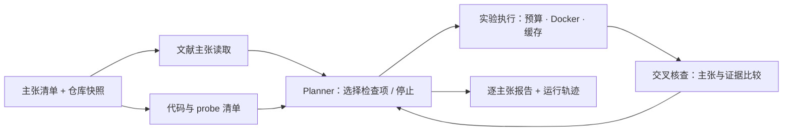

<div align="center">

# ArtiCheck

**把论文中的实验主张，变成带执行证据的核查报告。**

论文 Artifact 复现预审 · 可追溯核查 · Planner 后训练实验

[](https://github.com/Gump111458785/ArtiCheck/actions/workflows/ci.yml)
[](pyproject.toml)
[](pyproject.toml)
[](LICENSE)

[快速开始](#quickstart) · [可视化工作台](#workbench) · [报告示例](#example) · [Benchmark 与结果](#benchmarks) · [工作原理](#workflow) · [Planner 训练](#training) · [文档](#docs)

</div>

ArtiCheck 面向会议 Artifact Evaluation、课题组投稿前自查，以及科研 Agent 的评测与训练。输入**人工审核的主张清单和本地仓库快照**，系统选择检查项、执行 probe，并输出逐主张判定、执行证据和可审计轨迹。

当前版本提供可运行的 CLI 核查流程与教学样例，以及独立的 Planner 训练接口。核心核查无需模型 API 或 GPU；模型服务与训练按需接入。

## 核心能力

- **逐主张核查**：比较实验指标、检查训练/测试样本 ID 重叠、核对方法与 baseline 的训练步数。
- **证据与判定关联**：每条结论引用对应执行记录；缺失数据、超时和执行失败保留为 `inconclusive`。
- **受控执行**：默认使用 Docker，支持工具、时间和模型调用预算；确定性任务可按源码内容与执行环境缓存结果。
- **可复用的评测流程**：受控缺陷注入、原始仓库分组划分、宏 F1 与误报约束下的阈值选择。
- **可替换的 Planner**：在同一核查流程中切换固定策略与模型策略，提供教师轨迹过滤、LoRA SFT 和 verl GRPO 基础代码。

<a id="quickstart"></a>

## 快速开始

**环境要求：** Python 3.10+，macOS 或 Linux。以下命令仅运行仓库自带的可信样例，无需 API key、GPU 或 Docker。

```bash
git clone https://github.com/Gump111458785/ArtiCheck.git
cd ArtiCheck

python3 -m venv .venv
source .venv/bin/activate
python -m pip install -e .

python -m articheck demo --sandbox local --output runs/demo
```

Demo 会执行一个 clean 版本和三个单缺陷版本，分别检查指标计算、数据划分与 baseline 训练预算。`local` 模式直接在主机执行，仅用于可信代码。

结果保存在：

```text
runs/demo/
├── clean/                 # 正常 artifact 的核查结果
├── metric_average/        # 指标计算缺陷
├── split_leakage/         # 数据划分泄漏
├── baseline_budget/       # baseline 训练预算不一致
├── metrics.json           # 汇总指标
├── scores.jsonl           # 逐主张标签、得分与判定
└── labels.jsonl           # 注入真值，独立于 artifact
```

每个版本目录包含 `report.md`、`report.json` 和 `trace.jsonl`。再次运行时请指定新的输出目录。

<a id="workbench"></a>

## 可视化工作台

[打开私有交互预览](https://articheck-workbench.soft-bun-8328.chatgpt.site) · [界面与 API 设计](docs/WORKBENCH.md) · [OpenAPI 契约](web/dist/openapi.json)

工作台覆盖任务配置、六角色执行状态、逐主张证据审查、运行轨迹和人工反馈。点击角色可以查看其输入输出，在「API 契约」页可以查看请求示例、复制 cURL 和导出 OpenAPI。

在仓库根目录启动真实本地运行时：

```bash
python -m articheck.workbench --port 8787
# 打开 http://127.0.0.1:8787
```

本地界面直接调用现有 Python 核查流程，数据保存在 `runs/workbench/`。托管预览提供教学样例的归档回放；真实核查通过本地运行时执行。当前 HTTP API 支持固定 Planner，模型服务与训练启动保留在 CLI 中。

<a id="example"></a>

## 报告示例

在指标缺陷样例中，报告会定位数值偏差，同时保留其他主张的检查结果：

| 主张 | 判定 | 执行证据摘要 |
|---|---|---|
| C1：报告的指标符合预期 | `issue` | 观测值 0.833333，预期 0.777778，容差 0.000001 |
| C2：训练集与测试集不重叠 | `supported` | 样本 ID 交集为 0 |
| C3：方法与 baseline 训练步数相同 | `supported` | 双方均为 100 步 |

查看完整的 [指标缺陷报告](docs/smoke/metric-defect-report.md)、[clean 报告](docs/smoke/clean-report.md) 和 [样例指标](docs/smoke/metrics.json)。判定范围限于所提供的主张与 probe 证据。

<a id="benchmarks"></a>

## Benchmark 与结果

### 项目愿景

ArtiCheck 已打通“主张抽取、实验选择、沙箱复跑、交叉核查、人工反馈与 Planner 后训练”的完整流程，完成三层 benchmark 评测，并形成可追溯的逐主张证据报告。

| Benchmark | 完成的评测工作 | 覆盖范围 |
|---|---|---|
| **ArtiCheck-Claims** | 已构建并审核缺陷主张集，完成按仓库隔离的训练、验证与测试 | 50 个独立原始仓库、1,000 条主张；覆盖指标计算、数据泄漏与 baseline 设置 |
| **[CORE-Bench](https://github.com/siegelz/core-bench)** | 已完成计算复现能力评测，分别报告 Easy / Medium / Hard 结果 | 官方基准含 90 篇论文、270 个任务 |
| **[PaperBench · JudgeEval](https://github.com/openai/frontier-evals/tree/main/project/paperbench/paperbench/judge/judge_eval)** | 已完成自动判定与人工评分一致性评测 | 5 份带人工评分的 submission，使用官方 rubric 二元节点 |

| 评测维度 | 愿景指标 | 对照与口径 |
|---|---:|---|
| ArtiCheck-Claims 宏 F1 | 达到 0.90 | 仓库隔离的独立测试集 |
| ArtiCheck-Claims 问题召回率 | 达到 85%，误报率控制在 5% | 验证集定阈值，测试集固定阈值 |
| CORE-Bench 任务成功率 | 提高 10 个百分点 | 相对固定工作流 + 7B；同一难度、任务、硬件与预算 |
| JudgeEval 官方 F1 | 达到 0.85 | 按官方 rubric 与人工标签计算 |
| 单篇核查耗时中位数 | 降低 30% | 相对固定工作流 + 7B，区分冷启动与缓存命中 |
| 单篇核查成本 | 降低 40% | 相同计价范围，并满足上述质量约束 |

模型侧已完成教师轨迹筛选、LoRA SFT 和 Planner GRPO 优化；训练侧完成 FSDP2、激活检查点与动态批处理，推理侧复用 vLLM 前缀缓存。人工纠错已回流为困难样本，用于持续改善误报与漏报。

### 当前实测：工程冒烟测试

| 数据与策略 | 主张数 | 检出问题 | 正常主张误报 | 宏 F1 | 问题召回率 | 误报率 |
|---|---:|---:|---:|---:|---:|---:|
| 1 个教学仓库的 4 个版本 · FixedPlanner + 规则核查 | 12 | 3 / 3 | 0 / 9 | 1.000 | 100% | 0% |

该结果来自仓库内的受控样例，正例 3 条、负例 9 条，阈值为 0.5；未使用训练后的模型。它验证工程链路，不能替代独立仓库测试或外部 benchmark 成绩。[结果文件](docs/smoke/metrics.json) · [验证记录](docs/VALIDATION.md)

实验分组、指标定义、计价方式与结果发布要求见 [Benchmark 协议](docs/BENCHMARKS.md)。

<a id="workflow"></a>

## 工作原理



流程由六个可替换角色组成：`LiteratureReader`、`CodeInspector`、`Planner`、`ExperimentRunner`、`CrossAuditor` 和 `Reporter`。主张读取与代码清单通过 asyncio DAG 并发运行；Planner 选择待检查主张，执行器运行对应 probe，核查器按主张类型生成判定。

默认策略按顺序检查主张。模型策略使用相同的 `check` / `stop` 动作接口；其余角色当前采用确定性实现。

## 核查自己的 artifact

准备一份 [task.json](examples/task.json)，声明仓库位置、主张与预期结果，并提供一个向 stdout 输出 JSON 的 probe。每条主张也可以指定独立 probe，让 Planner 选择对应实验。

| 字段 | 用途 |
|---|---|
| `repo` | 相对任务文件的本地 artifact 路径 |
| `repo_id` | 原始仓库标识；同源变体共享该 ID，用于数据隔离 |
| `probe` | 默认执行命令，使用 argv 数组 |
| `claims` | 主张 ID、文本、检查类型和预期值 |

使用 Docker 执行仓库中的示例任务：

```bash
docker pull python:3.11-slim
python -m articheck run --task examples/task.json --output runs/review
```

替换 `--task` 即可运行自己的任务。需要额外依赖时，预先构建镜像并通过 `--image` 指定。容器默认无网络、只读挂载、非 root 运行，并限制 CPU、内存和进程数。任务格式、probe 输出协议和镜像要求见 [数据与执行指南](docs/DATA.md)。

<a id="training"></a>

## Planner 与后训练

ArtiCheck 将规划策略与核查工具分开，便于在相同任务和预算下比较策略：

| 路径 | 入口 | 当前状态 |
|---|---|---|
| 固定策略 | `run --planner fixed` | CLI 默认策略，已通过样例验证 |
| 模型策略 | `run --planner model` | OpenAI-compatible 客户端；真实模型服务待验证 |
| LoRA SFT | `scripts/train_sft.py` | 教师数据过滤与训练脚本已提供，GPU 训练待验证 |
| GRPO | `scripts/train_grpo.sh` | 自定义 verl AgentLoop 与启动配置已提供，GPU 集成待验证 |

教师轨迹经独立审核后可导出为 SFT 数据。原生 token 模式保留采样 token IDs、行为 log-prob 与策略版本，用于训练数据审计；普通文本响应不会被转换为合成 RL token 轨迹。

完整步骤见 [训练指南](docs/TRAINING.md)：模型服务接入、教师采样与接受过滤、SFT、仓库隔离数据准备和 GRPO 启动。FSDP2、LoRA、动态批与前缀缓存已有配置入口；DAPO 动态补采样、IS 接入和 AWQ/FP8 属于后续工作。

## 项目状态与路线图

**v0.1.0 · 工程预览。** Python 3.10–3.12 核心测试和 Linux Docker 样例已通过 [GitHub CI](https://github.com/Gump111458785/ArtiCheck/actions/workflows/ci.yml)，包含 40 项行为与契约测试。完整记录见 [验证说明](docs/VALIDATION.md)。

- [x] CLI 核查、逐主张证据报告与运行轨迹
- [x] 三类教学缺陷注入、仓库分组划分与基础评测
- [x] baseline 报告导入与人工纠错记录
- [x] Planner SFT / GRPO 基础代码
- [ ] 真实论文与仓库数据集、独立人工真值
- [ ] 真实模型服务与 GPU 训练端到端验证
- [ ] 动态补采样、课程训练与量化实验

当前主张来自人工审核的任务清单，probe 也需审核；通用 PDF 主张抽取和任意仓库自动缺陷注入尚未实现。教学样例验证的是工程流程，真实论文效果、训练增益和效率指标有待独立实验。

<a id="docs"></a>

## 文档与开发

| 文档 | 内容 |
|---|---|
| [数据与执行](docs/DATA.md) | 任务格式、probe 协议、缓存、缺陷注入、划分、评测与反馈 |
| [Benchmark 协议](docs/BENCHMARKS.md) | 正式基准选择、当前实测、理想目标与公平对照 |
| [工作台与接口](docs/WORKBENCH.md) | 可视化交互、HTTP/SSE 契约、本地运行与后续接口扩展 |
| [Planner 训练](docs/TRAINING.md) | 教师轨迹、SFT、verl AgentLoop、GRPO 与版本要求 |
| [Baseline 接入](docs/BASELINE.md) | 外部运行方式、报告映射、来源与许可 |
| [验证记录](docs/VALIDATION.md) | 测试范围、样例结果和 CI 证据 |

```bash
python -m articheck --help
python -m unittest discover -s tests -v
```

开发入口：核查流程位于 [`articheck/pipeline.py`](articheck/pipeline.py)，角色与规则位于 [`articheck/roles.py`](articheck/roles.py)，规划动作位于 [`articheck/planner.py`](articheck/planner.py)，训练适配位于 [`articheck/training/`](articheck/training/)。欢迎通过 [Issues](https://github.com/Gump111458785/ArtiCheck/issues) 提交问题或任务适配建议；报告执行问题时请附运行模式、任务结构和去除敏感信息后的日志。

## 来源与许可

业务 baseline 为 [Paper Reproducibility Agent](https://github.com/1a1a11a/2026_paper_reproduce)，通过独立进程与 JSON 报告对接，源码未包含在本仓库中。Planner 训练接口基于 [verl](https://github.com/verl-project/verl)，推理服务可接入 [vLLM](https://github.com/vllm-project/vllm)。

ArtiCheck 原创代码采用 [MIT License](LICENSE)。外部工具、模型和数据遵循各自许可；baseline 的版本与许可说明见 [BASELINE.md](docs/BASELINE.md)。
