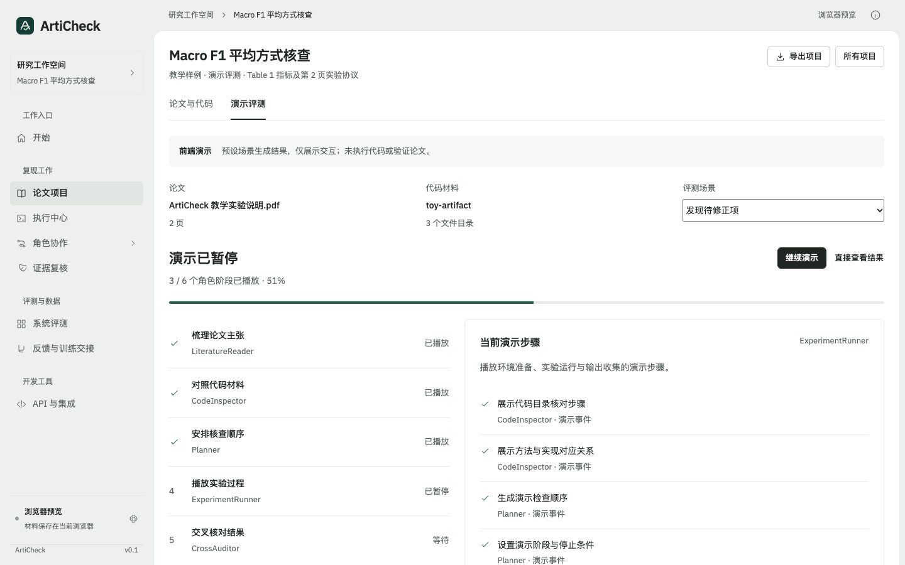
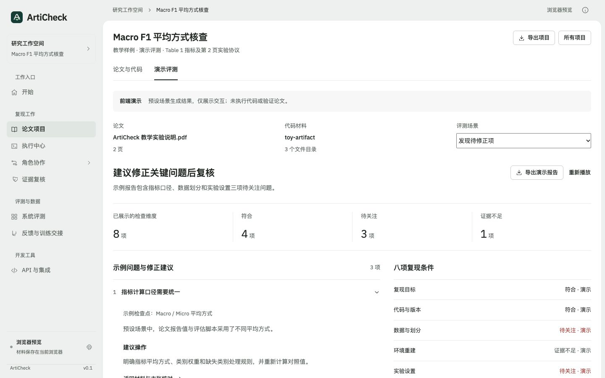
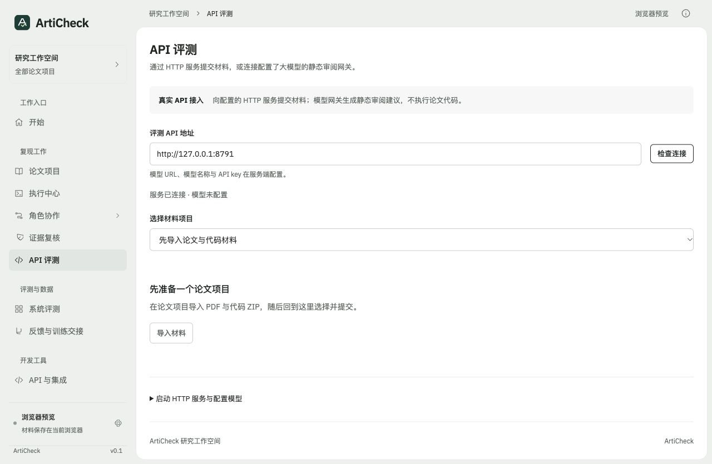
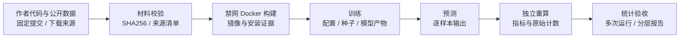
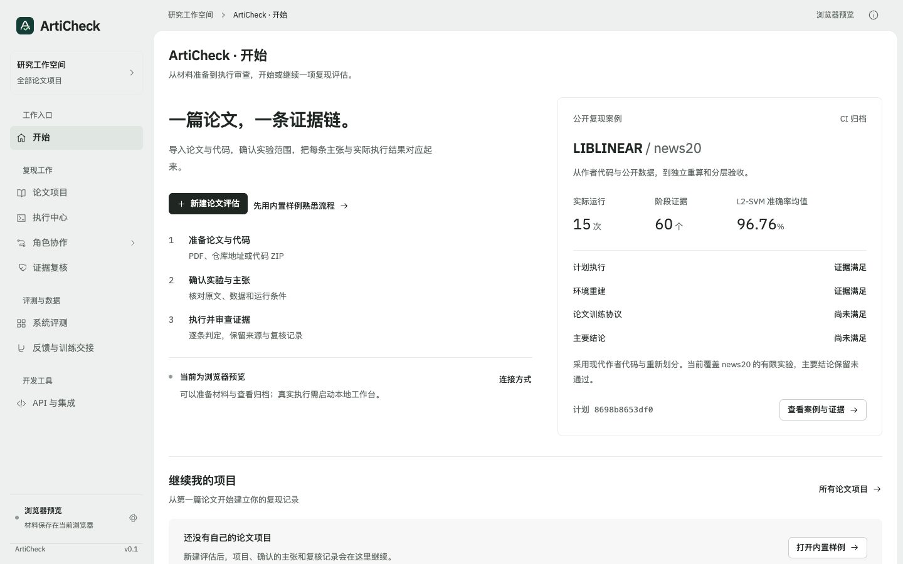
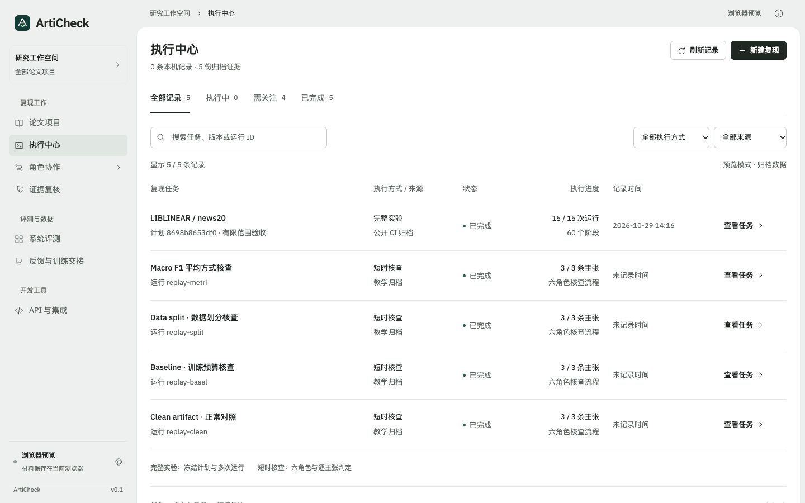
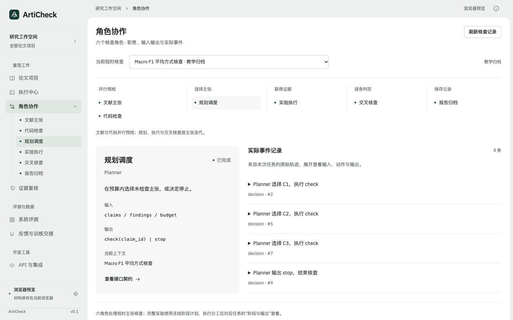
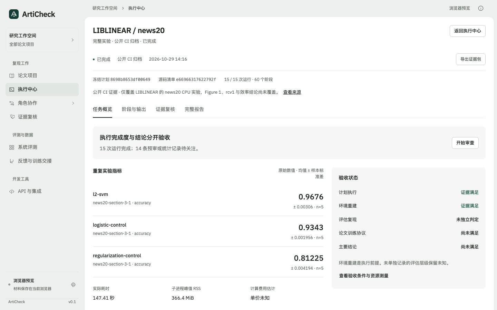
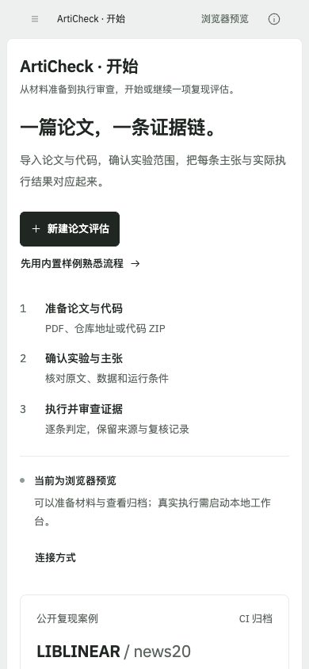
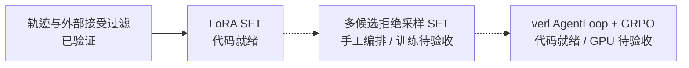

<div align="center">

# ArtiCheck

**让论文里的每一条实验主张都有执行证据。**

面向 Artifact Evaluation 与投稿前自查的论文复现预审系统。<br>
从论文、作者代码和数据出发，重建环境、执行实验、独立核对指标，生成逐主张可追溯的报告。

[](https://github.com/Gump111458785/ArtiCheck/actions/workflows/ci.yml)
[](pyproject.toml)
[](pyproject.toml)
[](LICENSE)
[](https://github.com/Gump111458785/ArtiCheck/actions/runs/40889691677)

[打开交互预览](https://articheck-workbench.onatanolf8074.chatgpt.site) · [快速开始](#quickstart) · [查看复现案例](#case)

</div>


*四个现有工作台页面的截图轮播，展示各工作视图；不是一次任务的连续执行录像。交互预览仅限获授权账号，真实执行通过本地工作台完成。*

[核心能力](#capabilities) · [界面展示](#showcase) · [系统架构](#architecture) · [实测结果](#results) · [Planner 后训练](#training) · [路线图](#roadmap) · [文档](#docs)

## 上传材料后的动态演示

[直接播放内置演示](https://articheck-workbench.onatanolf8074.chatgpt.site/?mode=demo&example=demo) · [打开预设结果页](https://articheck-workbench.onatanolf8074.chatgpt.site/?mode=demo&example=demo&view=report) · [演示操作说明](docs/FRONTEND_DEMO.md)

新建论文评估，导入 PDF 与代码 ZIP（或读取 GitHub 目录），勾选「提交后播放演示评测」，提交后即可观看六角色阶段、进度和事件。约 16 秒后进入八项条件报告；支持暂停、继续、直接查看结果、三种场景切换与 JSON 导出。

<table><tr><td width="50%"><strong>动态评测进度</strong><br></td><td width="50%"><strong>演示结果与修正建议</strong><br></td></tr></table>

文件名、PDF 页数与代码目录数量来自实际浏览器导入；评测过程与结论为预设演示，不执行代码。演示结果单独保存并标记 `data_source=frontend_demo`，不计入真实复现报告或系统成绩。

## HTTP API 与大模型 API 接入

[接入与配置说明](docs/API_REVIEW.md) · [独立 OpenAPI 契约](web/dist/review-api.openapi.json) · [命令行调用示例](examples/api_review/submit.py) · [配置模板](examples/api_review/provider.env.example)

| 使用方式 | 入口 | 已交付范围 |
|---|---|---|
| 纯前端演示 | 上传材料后进入「演示评测」 | 六角色动态过程、三种固定结果场景、报告导出，无后端依赖 |
| HTTP 后端接入 | `python -m articheck.review_client` / 网页「API 评测」 | 原始 PDF / ZIP 提交、异步状态、取消、报告下载；支持兼容 v1 契约的服务 |
| 大模型 API 版 | `python -m articheck.review_api` | 服务端模型 URL / 名称 / 密钥配置位、材料摘录、Chat Completions 调用及结构化静态建议 |

```bash
# 未配置模型也可启动，连接检查返回 configured=false
python -m articheck.review_api --port 8790 --with-ui
# 打开 http://127.0.0.1:8790/#api-review
```

模型接入使用 `ARTICHECK_REVIEW_BASE_URL`、`ARTICHECK_REVIEW_MODEL` 和服务端 `ARTICHECK_API_KEY`。默认没有预填供应商或密钥，未配置时返回明确错误，不生成预设报告。真实调用链已用本地模型替身验证，未调用付费模型。API 报告标记 `model_api_static_review`，提供材料静态审阅建议，不执行论文代码，也不授予实验复现通过状态。



## 三十秒看懂

| 面临的问题 | ArtiCheck 的处理方式 | 可核对的证据 |
|---|---|---|
| 论文中的数字与代码、数据和配置之间缺少明确对应 | 将实验拆成主张，绑定原文、执行入口与观测值 | [逐主张报告](docs/smoke/metric-defect-report.md) |
| 实验运行成功后，仍需判断它验证了什么 | 分开验收运行、环境重建、论文训练协议和主要结论 | [LIBLINEAR 分层报告](web/dist/samples/liblinear-reproduction.json) |
| 多次运行的材料、日志和人工意见难以追溯 | 固定材料与计划版本，保存阶段证据，追加复核记录 | [15 次运行 / 60 个阶段的 CI 证据](https://github.com/Gump111458785/ArtiCheck/actions/runs/40889691677) |

<a id="case"></a>

## 旗舰案例：LIBLINEAR / news20

以 **LIBLINEAR（JMLR 2008）作者代码和公开 news20 数据**为输入，完成 CPU 环境重建、数据准备、训练、预测和独立指标重算。三种方法设置、五个划分种子，共产生 **15 次运行与 60 个阶段证据**。



| 实测项目 | 结果 | 证据 |
|---|---:|---|
| 方法设置 × 划分种子 | 3 × 5 = **15 次运行** | [运行明细](web/dist/samples/liblinear-reproduction.json) |
| 阶段记录 | **60 个** | [执行 CI](https://github.com/Gump111458785/ArtiCheck/actions/runs/40889691677) |
| L2-SVM 准确率均值 | **96.76%** | [结果与统计](web/dist/samples/liblinear-reproduction.json) |
| 准确率样本标准差 | **0.31 个百分点** | 同上，5 个划分种子 |
| 执行器墙钟时长 | **147.41 秒** | [计时与资源口径](docs/EXECUTION_EVIDENCE.md) |
| 全阶段子进程峰值 RSS 最大值 | **366.4 MiB** | 同上 |
| 容器外内存采样峰值 | **370.6 MiB** | 30 / 60 阶段有容器外采样 |

准确率的波动来自本案例的五次重新划分，不是原论文成绩的置信区间。时长不含准备脚本下载及基础镜像拉取；GPU 峰值与费用未测量。

### 验收结果：明确区分“运行完成”与“论文结论成立”

| 核对项 | 本案例结果 | 判定依据 |
|---|---|---|
| 执行完成 · `run` | ✅ 通过 | 15 次运行完成，保留 60 阶段证据 |
| 环境重建 · `environment_rebuilt` | ✅ 通过 | 固定基础镜像，记录构建与环境检查 |
| 独立指标与控制核对 | ✅ 已记录验证证据 | 预测结果独立重算；新增 LR 控制与正则化消融有实际配置与公平性检查 |
| 论文训练协议 · `training` | ❌ 未通过 | 使用现代作者代码、80/20 seeded split，原始划分 ID 未找回 |
| 论文主要结论 · `conclusion` | ❌ 未通过 | Figure 1、rcv1、Pegasos/SVMperf 及论文调参与计时曲线未完整覆盖 |

**报告保留通过项，也直接暴露复现范围与论文协议的差距。** 新增控制项只用于本案例核对，不替代原论文基线；本案例不计作整篇论文复现成功。

[案例来源与完整运行命令](examples/liblinear_case/README.md) · [证据归档](web/dist/samples/liblinear-reproduction.json) · [执行 CI](https://github.com/Gump111458785/ArtiCheck/actions/runs/40889691677)

<a id="capabilities"></a>

## 核心能力

| 能力 | 已实现的行为 | 验证与实现 |
|---|---|---|
| ✅ 主张级核查 | 六角色协作，核对指标、样本重叠和训练预算；每条判定引用执行证据，证据不足保留 `inconclusive` | [报告](docs/smoke/metric-defect-report.md) · [流水线](articheck/pipeline.py) |
| ✅ 受控执行 | Docker 禁网、只读挂载、非 root、移除 capabilities，限制 CPU、内存、进程及输出；工具 / token / 时间 / 费用预算与执行缓存 | [沙箱](articheck/sandbox.py) · [Docker CI](https://github.com/Gump111458785/ArtiCheck/actions/workflows/ci.yml) |
| ✅ 可审计执行器 | 不可变材料工作区、PDF / ZIP / 计划指纹、阶段与种子矩阵、产物与资源记录 | [执行引擎](docs/REPRODUCTION_ENGINE.md) · [实现](articheck/reproduction/) |
| ✅ 分层验收 | 结合多次运行、统计与覆盖证据，分别判断运行、环境、训练协议及主要结论 | [完成验收清单](docs/REPRODUCTION_COMPLETION_CHECKLIST.md) |
| ✅ 可视化工作台 | PDF / 代码材料导入、主张确认、服务器资源核对、执行中心、角色协作与证据复核；25 条 API 路径、29 个操作 | [界面与模块对应](docs/REVIEW_WORKSPACE.md) · [OpenAPI](web/dist/openapi.json) |
| ✅ 训练轨迹契约 | 保留采样器提供的 token IDs、行为 log-prob 与策略版本；外部接受后的教师轨迹可导出 SFT，缺失原生 token 时拒绝 RL 导出 | [轨迹契约与测试范围](docs/TRAINING.md#5-原生训练轨迹契约) · [导出实现](articheck/training/export.py) |

✅ 表示该行描述的工程行为已有结果或测试依据；训练轨迹字段与过滤经过测试，真实模型服务、GPU 采样及训练收益单独验收。

<a id="showcase"></a>

## 界面展示

从开始页新建论文评估或继续已有项目，再进入执行中心、角色协作和证据审查。页面复用同一套项目、运行与报告数据。

[打开开始页](https://articheck-workbench.onatanolf8074.chatgpt.site/#home) · [浏览执行中心](https://articheck-workbench.onatanolf8074.chatgpt.site/#workbench) · [查看角色协作](https://articheck-workbench.onatanolf8074.chatgpt.site/#roles) · [完整界面图集](docs/UI_GALLERY.md)

<table>
<tr>
<td width="50%" valign="top">
<strong>开始页 · 从论文材料进入</strong><br>
新建评估、继续个人项目，或先查看公开案例。
<a href="docs/assets/home-desktop.jpg"></a>
</td>
<td width="50%" valign="top">
<strong>执行中心 · 找到一次运行</strong><br>
按来源、执行方式与状态检索，再打开任务详情。
<a href="docs/assets/execution-center.jpg"></a>
</td>
</tr>
<tr>
<td width="50%" valign="top">
<strong>角色协作 · 查看实际分工</strong><br>
六角色的输入输出契约，与本次核查的真实事件对应。
<a href="docs/assets/role-workspace.jpg"></a>
</td>
<td width="50%" valign="top">
<strong>案例验收 · 对照结果与证据</strong><br>
展示多次运行指标，分别核对执行完成与结论依据。
<a href="docs/assets/execution-detail.jpg"></a>
</td>
</tr>
</table>

<details>
<summary>手机端开始页</summary>



</details>

论文项目贯通「论文与代码 → 实验覆盖 → 复现条件 → 服务器核对 → 短时核查主张与配置 → 完整实验 → 评估结果」。PDF 正文与 ZIP 在浏览器准备，候选主张需人工确认；完整实验显式绑定本地材料和执行入口。[开始页设计](docs/HOME_SCREEN.md) · [界面与模块对应](docs/REVIEW_WORKSPACE.md) · [八项复现条件](docs/IMPLEMENTATION_STATUS.md)。

<a id="architecture"></a>

## 系统架构


[打开 SVG 原图](docs/assets/architecture.svg)。图中训练层为代码就绪、GPU 集成待验收；实验执行入口仍需显式配置与人工确认。

短时核查中，文献读取与代码检查通过 asyncio DAG 并发，Planner 驱动检查与停止循环；固定 Planner 是默认策略。完整实验由独立的冻结计划执行器运行，界面展示它的实际阶段，不生成虚构的六角色活动。[执行中心的数据与模块对应](docs/EXECUTION_CENTER.md)。

<a id="quickstart"></a>

## 快速开始

Python 3.10+，macOS 或 Linux。内置受控缺陷基准无需 API key、GPU 或 Docker。

**1. 获取源码并安装**

```bash
git clone https://github.com/Gump111458785/ArtiCheck.git
cd ArtiCheck
python3 -m venv .venv
source .venv/bin/activate
python -m pip install -e .
```

**2. 运行内置核查**

```bash
python -m articheck demo --sandbox local --output runs/demo
```

执行同一仓库的 clean 与三个单缺陷版本：指标计算、数据划分、baseline 训练预算。`local` 直接执行主机上的可信内置代码；再次运行请使用新的输出目录。

**3. 查看结果**

`runs/demo/metrics.json` 汇总指标；每个版本目录包含 `report.md`、`report.json` 与 `trace.jsonl`。逐主张真值与得分分别保存在 `labels.jsonl`、`scores.jsonl`。

### 启动前后端一体的本地工作台

<a id="workbench"></a>

```bash
python -m articheck.workbench --port 8787
```

打开 **http://127.0.0.1:8787**。同一 Python 服务提供界面和 API，页面提交真实任务、读取执行进度、报告与反馈，数据保存在 `runs/workbench/`。HTTP API 当前支持固定 Planner，模型服务与训练使用 CLI；托管预览使用归档回放。

### 核查自己的 artifact

按 [task.json 示例](examples/task.json) 声明本地仓库、主张和输出 JSON 的 probe，准备好镜像后运行：

```bash
docker pull python:3.11-slim
python -m articheck run --task examples/task.json --output runs/review
```

替换任务文件即可绑定自己的执行入口；额外依赖需要预构建镜像。任务字段与 probe 协议见 [数据与执行指南](docs/DATA.md)。

<a id="results"></a>
<a id="benchmarks"></a>
<a id="example"></a>

## 实测结果

| 验证对象 | 范围与结果 | 证据 |
|---|---|---|
| 公开 CPU 案例 | LIBLINEAR / news20，15 次运行、60 个阶段；L2-SVM 准确率 96.76%，样本标准差 0.31 个百分点 | [案例 CI](https://github.com/Gump111458785/ArtiCheck/actions/runs/40889691677) · [报告](web/dist/samples/liblinear-reproduction.json) |
| 内置受控缺陷基准 | 单仓库 4 个版本、12 条主张；FixedPlanner + 规则核查：TP=3、FP=0、TN=9、FN=0，宏 F1=1.000，问题召回率 100%，误报率 0% | [原始结果](docs/smoke/metrics.json) · [问题报告](docs/smoke/metric-defect-report.md) |
| Python 工程测试 | 129 项：本地 125 项通过，4 项 Docker 专项在 CI 执行；CI 覆盖 Python 3.10–3.12 | [验证记录](docs/VALIDATION.md) · [CI](https://github.com/Gump111458785/ArtiCheck/actions/workflows/ci.yml) |
| 前端测试 | 86 项通过，覆盖 API 接入、演示评测、开始页、材料、验收、资源、执行中心和审查状态 | [测试代码](tests/frontend/) · [CI](https://github.com/Gump111458785/ArtiCheck/actions/workflows/ci.yml) |

内置基准阈值为 0.5，正例 3 条、负例 9 条，仅验证工程链路，不能外推到真实论文或独立仓库。ArtiCheck-Claims、CORE-Bench、JudgeEval 尚无正式成绩；[评测协议与公平对照要求](docs/BENCHMARKS.md)。

<a id="training"></a>

## Planner 后训练

研究问题是：**当证据获取成本不同、执行预算有限时，Planner 应先检查哪个实验、何时停止？** 训练对象是 `check(claim_id)` / `stop` 决策；执行器与核查规则提供环境反馈。



| 里程碑 | 现有交付 | 升级为“已验证”的验收条件 | 状态 |
|---|---|---|---|
| 训练轨迹与接受过滤 | 原生 token 完整性检查、完整多轮上下文、独立接受清单与导出 | CPU 契约和过滤测试已通过；真实采样服务另行集成 | ✅ 已验证（契约与过滤） |
| LoRA SFT | [训练脚本](scripts/train_sft.py)，仅 assistant 动作计损失、激活检查点 | 完整 GPU 训练日志、检查点、冻结测试集评测 | 🧱 代码就绪 |
| GRPO Planner | [verl AgentLoop](articheck/training/verl_loop.py)、[启动配置](scripts/train_grpo.sh)、质量与成本奖励 | 三种子、等预算对照拒绝采样 SFT，保存曲线与置信区间 | 🧱 代码就绪 |
| DAPO / IS 集成 | [独立目标函数](articheck/training/objective.py)；clip-higher 已有启动配置 | 动态补采样、截断 IS 接入分布式循环并完成消融 | 🎯 规划（完整集成） |
| 推理与训练效率 | FSDP2 / LoRA / 动态批配置及 [vLLM 启动入口](scripts/serve_vllm.sh) | 同硬件同负载开关对照，质量指标不回退；量化另行实现 | 🎯 规划（性能验收与量化） |

训练配置不代表实际训练结果。目前没有 SFT / GRPO 增益、实卡显存收益、量化成绩或付费教师蒸馏数据规模。[训练步骤、依赖版本与接口边界](docs/TRAINING.md)。

| 待实测指标 | 衡量方法 | 结果 |
|---|---|---|
| 宏 F1、误报率与约束下召回率 | 独立仓库测试集；验证集固定阈值，并报告弃权比例 | 待实测 |
| 显存与训练吞吐 | 同一 GPU 与 token 负载，逐项开关对照 | 待实测 |
| 单篇延迟与成本 | 固定主张范围、硬件与预算，记录执行时间、API 用量和计价来源 | 待实测 |

<a id="roadmap"></a>

## 路线图

状态：✅ 已验证 · 🧱 代码就绪 · 🎯 规划。🧪 实验中仅在有正在运行的真实实验与日志时使用。

| 阶段 | 交付与验收门槛 | 状态 |
|---|---|---|
| v0.1.0 · 核查与复现 | 主张级流水线、前后端工作台、Docker 执行、公开 CPU 案例与证据复核 | ✅ 已验证，源码版本 |
| v0.2 · 决策环境与多仓库评测 | 先证明同预算下不同策略产生质量 / 成本差异；冻结 ≥8 个独立原始仓库，验证 / 测试均有正负例；完成固定工作流 + 7B 与单 Agent 对照 | 🎯 规划 |
| v0.3 · SFT / GRPO Planner | 训练代码已有；用冻结数据完成 GPU SFT、三种子 GRPO 及等预算对照 | 🧱 代码就绪，实验待验收 |
| v0.4 · 效率与部署 | 测量训练、缓存和量化的质量 / 显存 / 吞吐 / 延迟 / 成本；完成部署验收 | 🎯 规划 |

更新日期：**2026-11-01**。后续版本按验收结果推进，尚未设定发布日期。结果、配置和日志归档后才更新状态与成绩；当前源代码版本号不代表已创建 GitHub Release。

<a id="docs"></a>

## 文档与开发

| 入口 | 内容 |
|---|---|
| [使用与数据](docs/DATA.md) | task.json、probe、执行、缓存、受控缺陷、划分与反馈 |
| [工作台与 API](docs/WORKBENCH.md) · [执行中心](docs/EXECUTION_CENTER.md) | 本地运行、材料准备、角色与事件、HTTP / SSE、前后端对应 |
| [复现执行器](docs/REPRODUCTION_ENGINE.md) · [完成验收清单](docs/REPRODUCTION_COMPLETION_CHECKLIST.md) | 材料身份、完整实验、资源测量、统计与分层验收 |
| [Benchmark 协议](docs/BENCHMARKS.md) · [Baseline 来源](docs/BASELINE.md) | 数据隔离、误报约束、对照公平性、报告导入与许可 |
| [Planner 训练](docs/TRAINING.md) | 教师接受过滤、原生轨迹、LoRA SFT、verl GRPO |
| [验证记录](docs/VALIDATION.md) · [八项能力核对](docs/IMPLEMENTATION_STATUS.md) | 测试、CI、实际完成范围与剩余验收项 |

```bash
python -m articheck --help
python -m unittest discover -s tests -v
node --test tests/frontend/*.test.mjs
```

开发入口：[核查流水线](articheck/pipeline.py)、[六角色](articheck/roles.py)、[Planner](articheck/planner.py)、[完整实验](articheck/reproduction/)、[本地工作台服务](articheck/workbench.py)、[前端](web/dist/)、[训练适配](articheck/training/)。问题与适配建议可提交至 [Issues](https://github.com/Gump111458785/ArtiCheck/issues)，附去除敏感信息后的任务配置与日志。

## 来源与许可

业务 baseline 参考 [Paper Reproducibility Agent](https://github.com/1a1a11a/2026_paper_reproduce)，通过独立进程与 JSON 报告对接，未分发其源码；[固定参考版本与许可说明](docs/BASELINE.md)。Planner 训练接口参考 [verl](https://github.com/verl-project/verl)，推理服务提供 [vLLM](https://github.com/vllm-project/vllm) 接入入口。

PDF 阅读器随仓库分发 PDF.js 6.4.299（Apache-2.0）；字体与 CMap 各自许可见 `web/dist/vendor/pdfjs/`。ArtiCheck 原创代码采用 [MIT License](LICENSE)，外部工具、模型和数据遵循各自许可。
