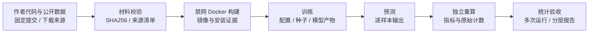

<div align="center">

# ArtiCheck

**让论文里的每一条实验主张都有执行证据。**

面向 Artifact Evaluation 与投稿前自查的论文复现预审系统。<br>
从论文、作者代码和数据出发，重建环境、执行实验、独立核对指标，生成逐主张可追溯的报告。

[](https://github.com/Gump111458785/ArtiCheck/actions/workflows/ci.yml)
[](pyproject.toml)
[](pyproject.toml)
[](LICENSE)
[](https://github.com/Gump111458785/ArtiCheck/actions/runs/41408434563)

[打开交互预览](https://articheck-workbench.onatanolf8074.chatgpt.site) · [快速开始](#quickstart) · [查看复现案例](#case)

</div>


*轮播展示四个工作台页面，并非一次任务的连续执行录像。界面预览仅限获授权账号。*

[核心能力](#capabilities) · [界面展示](#showcase) · [系统架构](#architecture) · [实测结果](#results) · [Planner 后训练](#training) · [路线图](#roadmap) · [文档](#docs)

<a id="usage"></a>

## 1. 使用方式

按模型运行的位置选择使用方式：在自己的机器上运行 ArtiCheck 微调模型，直接调用主流大模型 API，或通过网站提交任务。

| 方式 | 模型与权重 | 使用流程 |
|---|---|---|
| 本地 | 下载 ArtiCheck 微调模型与权重，在自己的机器上推理；权重发布 [待完成] | 准备模型与运行环境 → 启动推理服务 → 提交核查任务 |
| API | 使用自己的供应商 API key 直接调用主流大模型，无需下载 ArtiCheck 权重 | 配置模型地址、名称与密钥 → 运行核查 → 查看报告；供应商联调与质量评测 [待完成] |
| 网站 | 由我们的服务器提供模型推理、任务调度和实验执行 [待完成] | 打开网站 → 上传论文与代码 → 跟踪评测 → 查看或下载报告 |

### 1.1 本地：运行 ArtiCheck 微调模型

下载 ArtiCheck 微调模型与权重，在自己的 GPU 环境中启动推理服务。Planner 使用本地模型选择核查主张和停止时机，工具调用与实验代码执行也在自己的机器上运行。微调权重、下载入口与运行资源说明 [待完成]。

准备 vLLM 环境后，用模型目录启动推理服务。下面的路径和版本号需要替换为实际下载的模型目录与检查点版本。

```bash
export MODEL_PATH="/absolute/path/to/articheck-model"
bash scripts/serve_vllm.sh
```

在另一个终端提交核查任务：

```bash
export MODEL_PATH="/absolute/path/to/articheck-model"
python -m articheck run --task examples/task.json --output runs/local-model \
  --planner model --base-url http://127.0.0.1:8000/v1 \
  --model "$MODEL_PATH" --policy-version your-checkpoint-version
```

`examples/task.json` 指定论文主张、代码路径和执行命令；使用时替换为自己的任务文件。模型服务与 Docker 执行环境分别配置。[训练与推理说明](docs/TRAINING.md) · [执行协议](docs/DATA.md)。

### 1.2 API：直接调用主流大模型

保留 ArtiCheck 的核查流程，将 Planner 的推理请求直接发送给模型供应商。填写自己的 API 地址、模型名称与密钥，无需下载或部署 ArtiCheck 微调模型。密钥由运行核查的进程读取；论文工具与实验代码仍在自己的执行环境中运行。

```bash
export ARTICHECK_API_KEY="your-provider-key"
python -m articheck run --task examples/task.json --output runs/provider-api \
  --planner model --base-url https://your-provider.example/v1 \
  --model your-provider-model --policy-version your-provider-model-version
```

示例采用兼容 Chat Completions 的供应商接口，地址、模型名称与版本均需替换。供应商联调、模型适配与质量评测 [待完成]。调用预算与费用配置见 [模型接入说明](docs/TRAINING.md)。

需要在其他应用中提交 PDF / ZIP 并查询审阅任务时，可使用独立的材料静态审阅接口：[接入说明](docs/API_REVIEW.md) · [OpenAPI 契约](web/dist/review-api.openapi.json) · [Python 调用示例](examples/api_review/submit.py) · [配置模板](examples/api_review/provider.env.example)。该接口返回 `model_api_static_review` 报告，实验执行与验收由执行器负责。

### 1.3 网站：浏览器中提交评测

打开 ArtiCheck 网站，上传论文 PDF、代码及实验材料，在页面确认评测范围后提交任务。我们的服务器负责模型推理、任务调度、Docker 实验执行和报告保存；用户在浏览器中查看进度、复核证据并下载结果。服务器部署、模型与执行器接入及网站端到端服务 [待完成]。

[查看工作台界面](https://articheck-workbench.onatanolf8074.chatgpt.site/#home)。该地址用于界面预览；服务器服务入口 [待完成]。

## 2. 三十秒看懂

| 面临的问题 | ArtiCheck 的处理方式 | 可核对的证据 |
|---|---|---|
| 论文中的数字与代码、数据和配置之间缺少明确对应 | 将实验拆成主张，绑定原文、执行入口与观测值 | [逐主张报告](docs/smoke/metric-defect-report.md) |
| 实验运行成功后，仍需判断它验证了什么 | 分开验收运行、环境重建、论文训练协议和主要结论 | [LIBLINEAR 分层报告](web/dist/samples/liblinear-reproduction.json) |
| 多次运行的材料、日志和人工意见难以追溯 | 固定材料与计划版本，保存阶段证据，追加复核记录 | [15 次运行 / 60 个阶段的 CI 证据](https://github.com/Gump111458785/ArtiCheck/actions/runs/41408434563) |

<a id="case"></a>

## 3. 旗舰案例：LIBLINEAR / news20

使用 **LIBLINEAR（JMLR 2008）作者代码和公开 news20 数据**，完成 CPU 环境重建、数据准备、训练、预测和独立指标重算。三种方法设置各运行五个划分种子，共记录 **15 次运行与 60 个阶段证据**。



| 实测项目 | 结果 | 证据 |
|---|---:|---|
| 方法设置 × 划分种子 | 3 × 5 = **15 次运行** | [运行明细](web/dist/samples/liblinear-reproduction.json) |
| 阶段记录 | **60 个** | [执行 CI](https://github.com/Gump111458785/ArtiCheck/actions/runs/41408434563) |
| L2-SVM 准确率均值 | **96.76%** | [结果与统计](web/dist/samples/liblinear-reproduction.json) |
| 准确率样本标准差 | **0.31 个百分点** | 同上，5 个划分种子 |
| 执行器墙钟时长 | **111.36 秒** | [计时与资源口径](docs/EXECUTION_EVIDENCE.md) |
| 全阶段子进程峰值 RSS 最大值 | **366.3 MiB** | 同上 |
| 容器外内存采样峰值 | **217.4 MiB** | 33 / 60 阶段有容器外采样 |

准确率的波动来自本案例的五次数据重新划分，不代表原论文成绩的置信区间。时长不含准备脚本下载和基础镜像拉取；GPU 峰值与费用测量 [待完成]。

### 3.1 案例验收

| 核对项 | 本案例结果 | 判定依据 |
|---|---|---|
| 执行完成 · `run` | `true` | 15 次运行完成，保留 60 阶段证据 |
| 环境重建 · `environment_rebuilt` | `true` | 固定基础镜像，记录构建与环境检查 |
| 独立指标与控制核对 | 预测独立重算、控制配置与公平性核对 | 预测结果独立重算；新增 LR 控制与正则化消融有实际配置与公平性检查 |
| 论文训练协议 · `training` | `false` | 对齐历史作者代码、原始划分 ID 与训练协议 [待完成]；本次使用现代作者代码与 80/20 seeded split |
| 论文主要结论 · `conclusion` | `false` | 覆盖 Figure 1、rcv1、Pegasos/SVMperf 及论文调参与计时曲线 [待完成] |

报告按运行、环境、训练协议与主要结论分别记录验收值。新增控制项只用于本案例核对，不替代原论文基线；本案例的证据范围为 news20 CPU 实验。

> **六角色记录**：本次 CI 保留 162 条角色事件，包含 15 次排程、60 个阶段执行、60 次阶段核查及最终分层结论。[查看角色事件](web/dist/samples/liblinear-roles.jsonl) · [打开角色视图](https://articheck-workbench.onatanolf8074.chatgpt.site/?mode=demo&example=reproduction&case=liblinear&view=roles)

[案例来源与完整运行命令](examples/liblinear_case/README.md) · [证据归档](web/dist/samples/liblinear-reproduction.json) · [执行 CI](https://github.com/Gump111458785/ArtiCheck/actions/runs/41408434563)

<a id="capabilities"></a>

## 4. 核心能力

| 能力 | 工作方式 | 代码与证据 |
|---|---|---|
| 主张级核查 | [六角色](#roles)协作，核对指标、样本重叠和训练预算；每条判定引用执行证据，证据不足保留 `inconclusive` | [报告](docs/smoke/metric-defect-report.md) · [流水线](articheck/pipeline.py) |
| 受控执行 | Docker 禁网、只读挂载、非 root、移除 capabilities，限制 CPU、内存、进程及输出；工具 / token / 时间 / 费用预算与执行缓存 | [沙箱](articheck/sandbox.py) · [Docker CI](https://github.com/Gump111458785/ArtiCheck/actions/workflows/ci.yml) |
| 可审计执行器 | 不可变材料工作区、PDF / ZIP / 计划指纹、阶段与种子矩阵、产物与资源记录 | [执行引擎](docs/REPRODUCTION_ENGINE.md) · [实现](articheck/reproduction/) |
| 分层验收 | 结合多次运行、统计与覆盖证据，分别判断运行、环境、训练协议及主要结论 | [完成验收清单](docs/REPRODUCTION_COMPLETION_CHECKLIST.md) |
| 可视化工作台 | PDF / 代码材料导入、主张确认、服务器资源核对、执行中心、角色协作与证据复核；26 条 API 路径、30 个操作 | [界面与模块对应](docs/REVIEW_WORKSPACE.md) · [OpenAPI](web/dist/openapi.json) |
| 训练轨迹契约 | 保留采样器提供的 token IDs、行为 log-prob 与策略版本；外部接受后的教师轨迹可导出 SFT，缺失原生 token 时拒绝 RL 导出 | [轨迹契约与测试范围](docs/TRAINING.md#5-原生训练轨迹契约) · [导出实现](articheck/training/export.py) |

<a id="showcase"></a>

## 5. 界面展示

在开始页新建论文评估或继续已有项目，再进入执行中心、角色协作和证据审查。各页面使用同一套项目、运行与报告数据。

[打开开始页](https://articheck-workbench.onatanolf8074.chatgpt.site/#home) · [浏览执行中心](https://articheck-workbench.onatanolf8074.chatgpt.site/#workbench) · [查看角色协作](https://articheck-workbench.onatanolf8074.chatgpt.site/#roles) · [完整界面图集](docs/UI_GALLERY.md)

<table>
<tr>
<td width="50%" valign="top">
<strong>开始页 · 从论文材料进入</strong><br>
新建评估、继续个人项目，或先查看公开案例。
<a href="docs/assets/home-desktop.jpg"></a>
</td>
<td width="50%" valign="top">
<strong>执行中心 · 找到一次运行</strong><br>
按来源、执行方式与状态检索，再打开任务详情。
<a href="docs/assets/execution-center.jpg"></a>
</td>
</tr>
<tr>
<td width="50%" valign="top">
<strong>角色协作 · 查看实际分工</strong><br>
可选择短时核查或完整实验，对照六角色的输入输出契约与任务中的真实事件。
<a href="docs/assets/role-workspace.jpg"></a>
</td>
<td width="50%" valign="top">
<strong>案例验收 · 对照结果与证据</strong><br>
展示多次运行指标，分别核对执行完成与结论依据。
<a href="docs/assets/execution-detail.jpg"></a>
</td>
</tr>
</table>

论文项目按「论文与代码 → 实验覆盖 → 复现条件 → 服务器核对 → 短时核查主张与配置 → 完整实验 → 评估结果」组织。PDF 正文与 ZIP 在浏览器中准备，候选主张需人工确认；运行完整实验前，需明确绑定本地材料和执行入口。[开始页设计](docs/HOME_SCREEN.md) · [界面与模块对应](docs/REVIEW_WORKSPACE.md) · [八项复现条件](docs/IMPLEMENTATION_STATUS.md)。

<a id="architecture"></a>

## 6. 系统架构


[打开 SVG 原图](docs/assets/architecture.svg)。训练层覆盖轨迹导出、LoRA SFT 与 GRPO Planner；GPU 训练及集成评测 [待完成]。实验执行入口需要明确配置并经人工确认。

短时核查通过 asyncio DAG 并发读取文献主张、检查代码，再由 Planner 决定继续检查或停止；默认使用固定 Planner。完整实验按冻结计划执行，执行器为各阶段记录负责角色，并将事件写入 `roles.jsonl`。界面按角色读取实际事件，不补造角色活动。[执行中心的数据与模块对应](docs/EXECUTION_CENTER.md)。

<a id="roles"></a>

### 6.1 六角色：职责与分工

六角色用于两条执行路径：**短时主张核查**（[`articheck/roles.py`](articheck/roles.py) + [`pipeline.py`](articheck/pipeline.py)）和**完整实验复现**（[`articheck/reproduction/roles.py`](articheck/reproduction/roles.py) 为 [`engine.py`](articheck/reproduction/engine.py) 的各阶段标注角色）。各角色的输入、动作和输出随任务记录。

| 角色 | 短时核查 | 完整实验 | 模型调用 |
|---|---|---|---|
| **LiteratureReader** 文献读取 | 读取人工确认的主张清单（`extraction: manifest`）；不解析 PDF | 计划审计中的 `scope` 维度：论文身份、原文出处、引用与实验覆盖 | 否 |
| **CodeInspector** 代码检查 | 列出仓库文件清单，只作上下文，不作科学证据 | `code / data / environment / settings` 维度审计；源码快照与快照再审计；结束时的源码完整性核对 | 否 |
| **Planner** 规划 | 观测「主张 / 已查 / 剩余工具预算」，输出 `check` 或 `stop`；默认 `FixedPlanner` 按顺序检查 | 按冻结计划排程：`commands / resources / acceptance` 维度、环境依赖检查、每次运行的排程与停止原因 | 默认否；`ModelPlanner` 对接 OpenAI 兼容服务；模型策略评测 [待完成] |
| **ExperimentRunner** 执行 | Docker 禁网沙箱执行探针；按「仓库哈希 + argv + 沙箱身份」缓存，仅未命中时消耗工具预算 | 禁网镜像构建、镜像内环境验证、逐阶段执行与输入输出指纹 | 否 |
| **CrossAuditor** 交叉核查 | 三类规则：指标容差、训练/测试 ID 不相交、方法与基线训练预算一致；证据缺失时给出 `inconclusive` | 镜像兼容性、未声明的文件改动、配置冻结、划分与训练证据、独立指标重算、实验验收与公平性 | 否 |
| **Reporter** 报告 | 生成 Markdown 报告，写明判定只覆盖提交的主张与探针 | 汇总分层验收（`run / environment_rebuilt / training / conclusion`），写入 `report.json` | 否 |

使用时需注意：

- **完整实验的角色事件**：LIBLINEAR CI 记录 15 次运行、60 个阶段和 162 条角色事件；Reporter 的分层结论与原报告一致。[执行依据](https://github.com/Gump111458785/ArtiCheck/actions/runs/41408434563)。
- **完整实验中的 Planner 不做决策**：它按冻结计划排程并记录停止原因（`policy: frozen_plan`），可学习的 Planner 只在短时核查里运行。
- **角色记录不影响结果**：写入失败只记入 `roles.errors`，不改变执行与验收结论。

<a id="quickstart"></a>

## 7. 快速开始

Python 3.10+，macOS 或 Linux。内置受控缺陷基准无需 API key、GPU 或 Docker。

**1. 获取源码并安装**

```bash
git clone https://github.com/Gump111458785/ArtiCheck.git
cd ArtiCheck
python3 -m venv .venv
source .venv/bin/activate
python -m pip install -e .
```

**2. 运行内置核查**

```bash
python -m articheck demo --sandbox local --output runs/demo
```

这条命令核查同一仓库的 clean 版本，以及分别含指标计算、数据划分、baseline 训练预算缺陷的三个版本。`local` 直接在主机上执行可信的内置代码；再次运行请使用新的输出目录。

**3. 查看结果**

`runs/demo/metrics.json` 汇总指标；每个版本目录包含 `report.md`、`report.json` 与 `trace.jsonl`。逐主张真值与得分分别保存在 `labels.jsonl`、`scores.jsonl`。

### 7.1 材料与执行工作台

<a id="workbench"></a>

```bash
python -m articheck.workbench --port 8787
```

打开 **http://127.0.0.1:8787**。同一 Python 服务提供界面和 API。可在页面提交真实任务，查看执行进度、报告与反馈，数据保存在 `runs/workbench/`。工作台的核查入口使用固定 Planner；选择本地模型或供应商模型时，使用上方 CLI。工作台中的模型选择与任务接入 [待完成]。托管界面预览回放归档记录。

### 7.2 核查自己的 artifact

按 [task.json 示例](examples/task.json) 声明本地仓库、主张和输出 JSON 的 probe，准备好镜像后运行：

```bash
docker pull python:3.11-slim
python -m articheck run --task examples/task.json --output runs/review
```

替换任务文件以绑定自己的执行入口；额外依赖需预先构建到镜像中。任务字段与 probe 协议见 [数据与执行指南](docs/DATA.md)。

<a id="results"></a>
<a id="benchmarks"></a>
<a id="example"></a>

## 8. 实测结果

| 验证对象 | 范围与结果 | 证据 |
|---|---|---|
| 公开 CPU 案例 | LIBLINEAR / news20，15 次运行、60 个阶段；L2-SVM 准确率 96.76%，样本标准差 0.31 个百分点 | [案例 CI](https://github.com/Gump111458785/ArtiCheck/actions/runs/41408434563) · [报告](web/dist/samples/liblinear-reproduction.json) |
| 内置受控缺陷基准 | 单仓库 4 个版本、12 条主张；FixedPlanner + 规则核查：TP=3、FP=0、TN=9、FN=0，宏 F1=1.000，问题召回率 100%，误报率 0% | [原始结果](docs/smoke/metrics.json) · [问题报告](docs/smoke/metric-defect-report.md) |
| Python 工程测试 | 138 项：本地 134 项通过，4 项 Docker 专项在 CI 执行；CI 覆盖 Python 3.10–3.12 | [验证记录](docs/VALIDATION.md) · [CI](https://github.com/Gump111458785/ArtiCheck/actions/workflows/ci.yml) |
| 前端测试 | 95 项通过，覆盖完整实验角色事件、API 接入、演示评测、开始页、材料、验收、资源、执行中心和审查状态 | [测试代码](tests/frontend/) · [CI](https://github.com/Gump111458785/ArtiCheck/actions/workflows/ci.yml) |

内置基准的阈值为 0.5，包含正例 3 条、负例 9 条。这组结果仅验证工程链路，不能外推到真实论文或独立仓库。ArtiCheck-Claims、CORE-Bench、JudgeEval 评测 [待完成]；[评测协议与公平对照要求](docs/BENCHMARKS.md)。

<a id="training"></a>

## 9. Planner 后训练

后训练只更新 Planner 的主张选择与停止策略。输入是主张清单、检查历史、工具反馈与剩余预算，输出为 `{"action":"check","claim_id":"C1"}` 或 `{"action":"stop"}`。实验执行器、交叉核查规则和报告器保持固定；完整实验继续按冻结计划排程。

### 9.1 微调哪些模型

| 模型 | 用途与选择理由 | 训练安排 |
|---|---|---|
| [Qwen2.5-7B-Instruct](https://huggingface.co/Qwen/Qwen2.5-7B-Instruct) | 主实验模型。与仓库 SFT 示例、7B 基线一致，官方模型卡强调指令遵循和 JSON 输出，适合短动作决策 | LoRA SFT → GRPO，形成供本地下载的 Planner 权重 [待完成] |
| [Qwen2.5-1.5B-Instruct](https://huggingface.co/Qwen/Qwen2.5-1.5B-Instruct) | 轻量实验模型。先检验数据、动作掩码、奖励和训练链路，再比较模型规模与任务效果 | 小规模 SFT / GRPO 及部署成本对照 [待完成] |
| [Qwen3-8B](https://huggingface.co/Qwen/Qwen3-8B) | 扩展模型，检验方法能否迁移到另一代指令模型；训练和推理统一关闭 thinking，保持 JSON 动作协议 | 聊天模板与运行时适配、SFT / GRPO 对照 [待完成] |

三个候选模型的官方模型卡均标注 Apache-2.0。7B 是第一轮主线，1.5B 用于验证，8B 用于扩展；不把跨模型的能力差异算作微调收益。每个模型单独比较其原始 Instruct、SFT 和 GRPO 检查点，并固定基础模型 revision、tokenizer 与聊天模板。Qwen3 的非思考配置参考 [官方 vLLM 指南](https://qwen.readthedocs.io/en/latest/deployment/vllm.html)，模板适配 [待完成]。

### 9.2 训练数据与决策环境 [待完成]

以原始仓库为分组单位，按 80/10/10 划分训练、验证和测试集。同一仓库的 clean、缺陷注入版本、fork 与相关主张进入同一分组；同源论文与数据继续合并，防止换仓库名造成泄漏。数据建设目标为至少 50 个独立原始仓库、1,000 条人工审核主张，见 [评测协议](docs/BENCHMARKS.md)。

训练输入包括主张、检查结果、剩余预算，以及按历史执行估计的 probe 成本与共享关系。缺陷标签、注入位置、接受标记和奖励只由隔离的评测器读取。成本与 probe 关系进入观察的接口扩展 [待完成]。

不同主张需要有不同取证路径、成本或信息价值，且总预算不足以遍历所有主张。先在同一批任务上比较顺序检查、随机顺序和基于成本的策略，确认决策能改变问题召回或调用成本，再进入 RL。若多条主张共享一个 probe，按一次取证计费；同一证据可核对多条主张。不能用全量、同成本、共用 probe 的教学样例证明选择策略有效。

教师模型通过独立强模型 API 生成多轮轨迹，保存供应商、模型版本、采样参数与费用来源。每个任务采多个候选，由规则、执行证据和人工复核组成的独立接受流程筛选。保留有依据的 `stop`、证据不足、失败处理与不同预算样本，避免只学习“每条都查”。教师自评不作为真值，验证与测试轨迹不参与蒸馏。

### 9.3 怎么做 SFT [待完成]

采用 [PEFT LoRA](https://huggingface.co/docs/peft/developer_guides/lora)，冻结基础权重，只更新适配器。每条样本保留完整历史，以最后一条 assistant JSON 动作为监督目标；system、user、工具反馈与历史动作的标签设为 `-100`。一条多轮轨迹可导出多个逐步样本，样本始终跟随原仓库分组。

| 参数 | 首轮配置 |
|---|---|
| 目标层 | `all-linear` |
| LoRA | `r=16`、`alpha=32`、`dropout=0.05` |
| 优化 | 学习率 `2e-5`，单卡 batch `1`，梯度累积 `8` |
| 精度与内存 | BF16、激活检查点，关闭训练时 KV cache |
| 长度与轮数 | 最大 `4096` tokens、首轮 `1` epoch；超长样本整条跳过，记录跳过比例，保留完整 JSON |

这些数值来自 [SFT 脚本](scripts/train_sft.py)，是实验起点。按验证集的动作合法率、任务质量与成本选检查点，不按训练 loss 最低选模型；验证回调与可复现训练种子配置 [待完成]。Qwen3 需要额外验证非思考模板的前缀一致性和标签掩码。

```bash
python scripts/train_sft.py --data data/planner-sft.jsonl \
  --model Qwen/Qwen2.5-7B-Instruct --output checkpoints/planner-sft \
  --max-length 4096 --epochs 1
```

脚本输出 LoRA adapter。保存基础模型 revision、adapter、tokenizer 和模板；用 PEFT 合并后供 GRPO / vLLM 加载，并核对合并前后的动作与任务结果。训练运行、合并验收和下载权重发布 [待完成]。

### 9.4 怎么做 GRPO [待完成]

以 SFT 模型为初始策略，固定任务、工具权限和核查器。每个任务采样 `8` 条完整交互轨迹，终局核查结果决定奖励，再按组内相对表现更新 LoRA 参数。模型生成 token 的 mask 为 `1`，工具与环境观察为 `0`；token IDs、行为 log-prob 与策略版本来自实际采样器。方法参考 [verl GRPO](https://verl.readthedocs.io/en/latest/algo/grpo.html)，具体运行接口以 [项目固定版本](docs/TRAINING.md) 为准。

[奖励函数](articheck/training/objective.py) 按主张累计：

| 真值与判定 | 奖励 |
|---|---:|
| 问题主张判为 `issue` | `+1` |
| 正常主张判为 `issue`（错误指控） | `-2` |
| 问题主张判为 `supported`（漏报） | `-0.5` |
| 正常主张判为 `supported` | `+0.25` |
| `inconclusive`（含停止后未检查的主张） | `-0.1` |

主张奖励取均值后，减去 `0.02 × 实际工具调用数` 和 `0.000001 × 生成 token 数`；失败轨迹再减 `1`。这是质量与调用开销的代理奖励，不是美元账单。用验证集校准奖励权重，同时检查策略是否靠全弃权、早停或反复调用缓存投机获奖。

首轮沿用 [启动配置](scripts/train_grpo.sh)：actor 学习率 `1e-6`、LoRA `16/32`、FSDP2、动态 token 批、KL 约束、clip-low `0.2` / clip-high `0.28`。检查 KL、熵、裁剪比例、动作重复率、组内奖励方差和真实工具用量；不能只看平均 reward 上升。

在基础 GRPO 后逐项比较 [DAPO](https://verl.readthedocs.io/en/latest/algo/dapo.html) 的动态补采样与 clip-higher，以及 [rollout IS 修正](https://verl.readthedocs.io/en/latest/algo/rollout_corr.html)。同奖励组过滤后需要补足训练批；截断 IS 使用实际训练/采样 log-prob，课程训练按任务难度分阶段。动态补采样、IS 与课程接入分布式循环，以及 rollout 用量指标采集 [待完成]；预算和缓存语义也需在 CLI 与 RL 环境之间对齐 [待完成]。

### 9.5 怎么评估效果 [待完成]

| 对照 | 回答的问题 |
|---|---|
| 顺序 / 随机 / 成本启发式 + 同一核查器 | 任务中是否存在可学习的选择与停止收益？ |
| 单 Agent 提示词、固定工作流 + 原始 7B | 工作流组织本身带来多少效果？ |
| 原始 Instruct Planner → SFT Planner | 教师动作蒸馏是否改善决策？ |
| SFT → 追加等预算拒绝采样 SFT / GRPO | 收益是否来自 RL，而非更多数据或采样计算？ |
| GRPO 分别去掉误报惩罚、成本项、课程、clip-higher、动态采样、IS | 每项机制对质量、成本与稳定性有何贡献？ |

同模型内固定输入、上下文上限、工具权限、核查规则和预算；训练对照分别记录教师数据量、训练 token、rollout 与 GPU 小时。任务执行失败、预算耗尽与无效动作均保留，不从分母删除。缓存按相同初始快照重置，冷启动与热缓存结果分开报告。

- **主张质量：** 缺陷为正类，报告问题召回率、误报率（错误指控数 / 全部正常主张数）、precision 和正负两类宏 F1。无弃权的二分类中，误报率即 `FPR=FP/(FP+TN)`。弃权/失败计入对应真值类别的漏判，不只在回答过的主张上算 F1；另报覆盖率与弃权率。
- **误报约束：** 比较 FPR ≤ `5%` 的策略在冻结测试集上的问题召回。阈值、奖励和策略超参数只在验证集选择；规则的 `0/1` score 不当成模型置信度。需要连续置信分时，增加独立校准接口 [待完成]。
- **效率：** 报告每任务工具调用、生成/输入 token、端到端中位数与 P95 时延、GPU 时长和费用。成本使用实际单价与价格日期；本地推理不能因没有 API 账单记为零成本。
- **稳定性与泛化：** 至少 `3` 个训练随机种子；任务顺序打乱，测试独立仓库、未见缺陷组合及不同预算。按原始仓库做配对聚类 bootstrap，报告均值、波动、95% 区间及样本支持数。同仓库的版本与主张一起重采样，训练种子不计作独立仓库。
- **外部评测：** ArtiCheck-Claims 测缺陷发现；CORE-Bench 用官方 harness 测执行任务成功率；JudgeEval 用官方节点标签测判定 F1，分别发布，不混算。后两者适配 [待完成]；它们的总分不能单独归因于只输出 `check/stop` 的 Planner。

### 9.6 怎么判定微调成功 [待完成]

发布验收门槛如下，在正式实验前冻结。

| 检查 | 判据 |
|---|---|
| 动作与工程正确性 | 在冻结任务集上 JSON 与动作联合合法率 ≥ `99%`；重复/不存在的主张属于无效动作；预算越界为 `0`。拒绝标签泄漏，原生 token/log-prob 对齐，报告与证据身份一致 |
| SFT 带来任务收益 | 相对同模型原始 Planner，等预算宏 F1 改善的仓库级配对 95% 区间下界 > `0`；同时满足误报与覆盖门槛 |
| GRPO 带来额外收益 | 相对最强 SFT 对照，等预算质量改善的 95% 区间下界 > `0`；或宏 F1 配对差的 95% 区间下界 ≥ `-1` 个百分点，工具调用至少减少 `10%` 且配对区间支持成本下降。质量路线或成本路线在看测试结果前选定 |
| 误报与覆盖 | 测试集 FPR 的 95% 上界 ≤ `5%`，覆盖率 ≥ `95%`；正负支持数与区间一并公布。样本不足以确认门槛时保留 `[待完成]`，不能靠全弃权降低误报 |
| 跨种子与部署 | 汇总至少 3 个训练种子，公开各自结果；adapter 合并、vLLM 加载与导出后任务质量满足同一门槛。量化版本单独评测 |

结果随数据 split、模型 revision、采样参数、训练配置、奖励权重、GPU 环境、逐任务轨迹和聚合脚本归档。发布物包含 adapter / 合并权重、tokenizer、模板、校验和、基础模型许可及模型卡 [待完成]。

| 结果项 | 结果 |
|---|---|
| 7B / 1.5B / 8B 的 SFT、GRPO 测试成绩 | [待完成] |
| 误报约束下召回、宏 F1 与覆盖率 | [待完成] |
| 等预算消融、跨种子统计与外部基准 | [待完成] |
| 模型权重、推理质量、显存、时延与实际成本 | [待完成] |

<a id="roadmap"></a>

## 10. 路线图

| 版本 | 范围 |
|---|---|
| v0.1.0 · 核查与复现 | 主张级流水线、本地工作台、API 接入、Docker 执行、公开 CPU 案例与证据复核 |
| v0.2 · 决策环境与多仓库评测 [待完成] | 比较同预算下不同策略的质量与成本；冻结 ≥8 个独立原始仓库，验证 / 测试均含正负例；比较固定工作流 + 7B 与单 Agent |
| v0.3 · SFT / GRPO Planner [待完成] | 使用冻结数据训练 GPU SFT、三种子 GRPO，保存曲线、置信区间与等预算对照，发布模型权重与下载说明 |
| v0.4 · 效率与部署 [待完成] | 测量训练、缓存与量化的质量、显存、吞吐、延迟和成本，在我们的服务器部署网站、模型服务与执行器，验收端到端任务及运行配置 |

更新日期：**2026-11-03**。版本范围见上表，结果、配置与日志随评测归档。GitHub Release 发布 [待完成]。

<a id="docs"></a>

## 11. 文档与开发

| 入口 | 内容 |
|---|---|
| [使用与数据](docs/DATA.md) | task.json、probe、执行、缓存、受控缺陷、划分与反馈 |
| [工作台与 API](docs/WORKBENCH.md) · [执行中心](docs/EXECUTION_CENTER.md) | 本地运行、材料准备、角色与事件、HTTP / SSE、前后端对应 |
| [复现执行器](docs/REPRODUCTION_ENGINE.md) · [完成验收清单](docs/REPRODUCTION_COMPLETION_CHECKLIST.md) | 材料身份、完整实验、资源测量、统计与分层验收 |
| [Benchmark 协议](docs/BENCHMARKS.md) · [Baseline 来源](docs/BASELINE.md) | 数据隔离、误报约束、对照公平性、报告导入与许可 |
| [Planner 训练](docs/TRAINING.md) | 教师接受过滤、原生轨迹、LoRA SFT、verl GRPO |
| [验证记录](docs/VALIDATION.md) · [八项能力核对](docs/IMPLEMENTATION_STATUS.md) | 测试、CI、实际完成范围与剩余验收项 |

```bash
python -m articheck --help
python -m unittest discover -s tests -v
node --test tests/frontend/*.test.mjs
```

开发入口：[核查流水线](articheck/pipeline.py)、[六角色](articheck/roles.py)、[Planner](articheck/planner.py)、[完整实验](articheck/reproduction/)、[本地工作台服务](articheck/workbench.py)、[前端](web/dist/)、[训练适配](articheck/training/)。如需报告问题或提出适配建议，请提交至 [Issues](https://github.com/Gump111458785/ArtiCheck/issues)，并附上已去除敏感信息的任务配置与日志。

## 12. 来源与许可

业务 baseline 参考 [Paper Reproducibility Agent](https://github.com/1a1a11a/2026_paper_reproduce)，采用独立进程和 JSON 报告对接，未分发其源码；[固定参考版本与许可说明](docs/BASELINE.md)。Planner 训练接口参考 [verl](https://github.com/verl-project/verl)，推理服务提供 [vLLM](https://github.com/vllm-project/vllm) 接入入口。

PDF 阅读器随仓库分发 PDF.js 6.4.299（Apache-2.0）；字体与 CMap 各自许可见 `web/dist/vendor/pdfjs/`。ArtiCheck 原创代码采用 [MIT License](LICENSE)，外部工具、模型和数据遵循各自许可。
