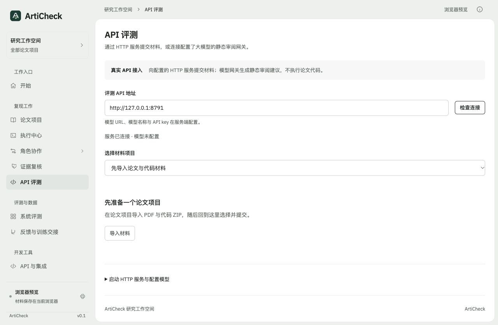

# HTTP API 与大模型 API 两种接入方式

2026-11-02。演示流程先完成并独立交付；本页描述随后补充的真实接口代码。无需训练模型，不启动 Docker，不执行论文仓库中的代码。

## 两种用法，同一份版本化契约

| 用法 | 输入与输出 | 当前验证 |
|---|---|---|
| HTTP 后端接入版 | 前端 / Python 客户端提交原始 PDF、代码 ZIP，查询任务并获取结构化报告 | 本地 HTTP 服务与头部 / 状态 / 报告协议已验证；可接兼容协议的自有服务 |
| 大模型 API 版 | 独立服务使用服务端配置的模型地址、名称与密钥，对有界 PDF / 代码文本做静态审阅 | 本地 Chat Completions 协议模型替身已端到端验证；真实付费模型未调用 |

前端演示版完全使用浏览器预设脚本；API 版没有演示回退。模型静态建议不是实验执行，也不能验收论文主要结论。API 地址、模型名称和 API key 均预留；不需要为了试运行填写真实密钥。

## 1. 先启动未配置的纯 HTTP 服务

在完整源码仓库根目录安装后运行：

```bash
python -m pip install -e .
python -m articheck.review_api --port 8790 --storage runs/review-api
python -m articheck.review_client --base-url http://127.0.0.1:8790 --health
```

返回 `service=articheck-review-api`、`version=1`、`configured=false`。提交请求返回 HTTP 503 / `provider_not_configured`，不创建假任务、假报告，也不调用模型。

同一服务附带前端：

```bash
python -m articheck.review_api --port 8790 --with-ui
# 打开 http://127.0.0.1:8790/#api-review
```

如果端口占用，用 `--port 8791` 等其他端口，并打开对应地址。

## 2. 配置大模型 API

在服务端设置环境变量，再重启服务：

```bash
export ARTICHECK_REVIEW_BASE_URL="https://your-model-provider.example/v1"
export ARTICHECK_REVIEW_MODEL="your-model-name"
export ARTICHECK_API_KEY="your-provider-key"
python -m articheck.review_api --port 8790 --with-ui
```

地址与名称为待替换的配置位，示例不指向真实服务。[环境变量模板](../examples/api_review/provider.env.example)。使用兼容的 `/chat/completions` JSON 协议：`messages`、`model`、`temperature`、`max_tokens`；不依赖模型 SDK。密钥只从服务端环境读取，不存浏览器、不进入报告与日志。模型不支持结构化 JSON、响应截断或出处格式错误时任务失败，不补造结果。

默认最多一项运行、另有一项排队；每次模型请求 60 秒超时，最多 3000 输出 token。取消会丢弃迟到响应，但不能保证终止已发出的供应商请求或免除其费用。

## 3. 不打开网页，直接调用 API

```bash
python -m articheck.review_client \
  --base-url http://127.0.0.1:8790 \
  --paper web/dist/samples/articheck-method-note.pdf \
  --code web/dist/samples/toy-artifact.zip \
  --scope "核对论文与代码材料中的静态线索" \
  --output runs/api-review-report.json
```

客户端打印 `job_id`，等待终态并下载报告。等待超时不取消服务端任务，可通过 `--job-id <实际编号>` 继续查询。命令行入口也提供 `articheck-review-api`、`articheck-review-submit`，需重新安装后生效。[Python 调用示例](../examples/api_review/submit.py)。

```python
from articheck.review_client import ReviewAPIClient

client = ReviewAPIClient("http://127.0.0.1:8790")
job = client.submit("paper.pdf", "code.zip", scope="核对方法与实验配置")
job = client.wait(job["id"], timeout=180)
if job["status"] == "completed":
    report = client.report(job["id"])
else:
    print(job["status"], job.get("error"))
```

若接入已有 HTTP 后端，只需让它实现下方契约，客户端的 `base_url` 指向该后端。头部鉴权由部署方提供时，Python 客户端支持 `ARTICHECK_REVIEW_TOKEN`。本仓库服务本身没有公网多用户认证能力。

## 4. 网页接入

侧栏「API 评测」选择已导入 PDF / ZIP 的个人项目，填写 API 地址、检查连接，确认材料发送目的地后提交。任务状态、阶段与报告只来自 HTTP 响应。更换项目或地址会清除提交确认，报告按任务编号与材料身份隔离，旧材料结果保留为历史上下文提示。

推荐直接使用 `--with-ui` 的同源界面；托管静态预览没有运行此 Python 服务，API 地址需要另行配置。跨域时部署方还需配置 CORS 与 HTTPS 代理，默认本机服务不放开跨域写入。

## API 契约

独立 [OpenAPI 3.1 契约](../web/dist/review-api.openapi.json)，与工作台现有的 Docker 核查 API 分开。

| 接口 | 作用 |
|---|---|
| `GET /v1/health` | 服务版本、模型配置 readiness；不做付费探测 |
| `POST /v1/reviews` | 接收 PDF / ZIP 并创建异步审阅任务，返回 202 |
| `GET /v1/reviews/{id}` | queued / running / completed / failed / cancelled 与阶段 |
| `GET /v1/reviews/{id}/report` | 完成后的静态报告；未就绪返回 409 |
| `POST /v1/reviews/{id}/cancel` | 取消未完成审阅，迟到响应不覆盖终态 |

POST 需要 `Content-Type: application/json`、`X-ArtiCheck-Client: review-api`。创建请求：

```json
{
  "scope": "需要检查的实验范围",
  "paper": {"name": "paper.pdf", "content_base64": "<PDF 原始字节的 base64>"},
  "code": {"name": "code.zip", "content_base64": "<ZIP 原始字节的 base64>"}
}
```

PDF 上限 20 MiB、150 页；ZIP 上限 50 MiB、5000 项、解压内容合计 100 MiB，请求体上限 100 MiB。ZIP 不解包执行，拒绝路径穿越、符号链接、加密和重复文件。PDF 复用独立受限进程解析。模型输入为有界摘录：论文与代码各最多 50000 字符，论文每页最多 8000 字符，代码每文件最多 5000 字符、80 个文本文件，目录最多 500 项；超出的覆盖范围显式记录。扫描件没有文本时不能补造 OCR。

模型报告包括八个不同维度，状态仅限 `documented / needs_review / missing`；页码与路径必须来自实际提供的摘录。报告保留材料 SHA256、覆盖范围、模型名称和供应商返回的 token 用量。`source=model_api_static_review`、`execution_performed=false`、`scientific_validation=false` 为固定语义，不能由模型更改。页码 / 文件存在性校验不证明模型建议正确，仍需人工复核。

任务与报告保存在指定 storage。服务重启将未结束任务标为 failed，不自动重复付费请求。API 默认仅监听回环地址，限制 Host 与同源写入；公网部署需增加身份认证、任务租户隔离、配额和反向代理。

## 核心模块与验收

| 文件 | 作用 |
|---|---|
| `articheck/review_api.py` | 独立 HTTP 服务、状态持久化、材料检查、模型调用、结构化建议验证 |
| `articheck/review_client.py` | 无界面的 Python SDK 与 CLI |
| `web/dist/review-api-client.mjs` | 浏览器 HTTP 适配、错误处理、任务与报告身份校验 |
| `web/dist/api-review.mjs` | 项目选择、连接检查、明确提交、轮询、取消与报告导出 |
| `tests/test_review_api.py` | 未配置、材料解析、路径风险、无效模型输出、重启、取消与本地端到端 |
| `tests/frontend/review-api.test.mjs` | 地址、来源、材料门槛、报告结构、传输绑定与错误不回退 |

本地 Chat Completions 模型替身与实际 HTTP 客户端验证了上传 → 解析 → 模型协议 → 状态 → 报告链路，无外部付费调用。浏览器验证服务连接与未配置状态；真实供应商输出质量、计费与公网部署尚未验收。

## 界面验收



沿用 taste skill 的 Framed sheet（seed 1600077506），没有重抽视觉方向。最终检查覆盖 1440 / 768 / 390，0 FAIL、1 WARN；六张最终截图已目视复核。保留的 panel-void 提示来自短空状态与折叠启动说明之间的 51px 间隔，未以虚构项目或结果填充；没有横向溢出、文字遮挡或控制项缺失。截图展示本地真实服务连接成功、模型未配置。
