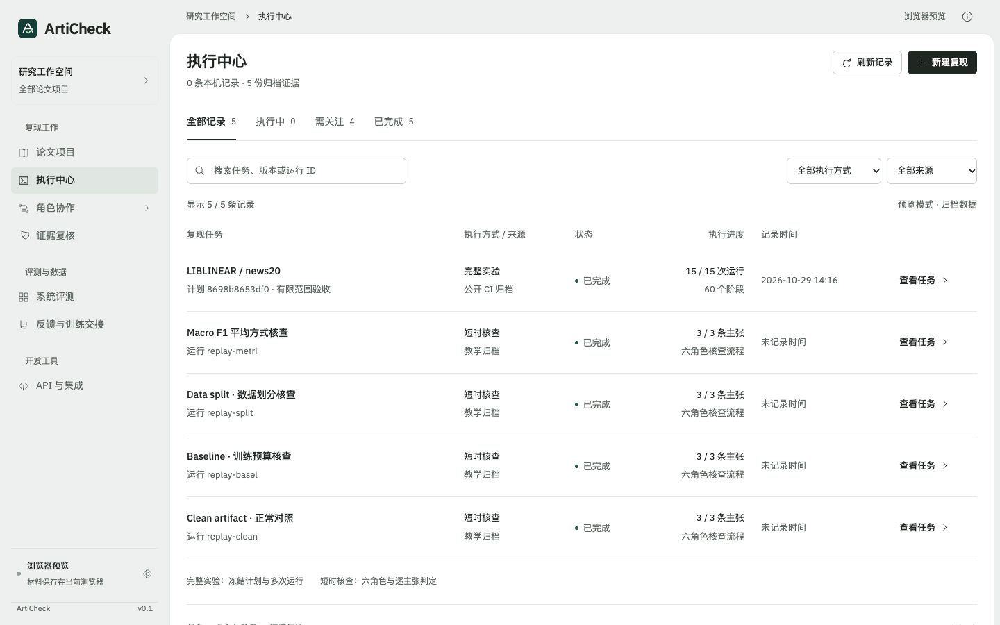
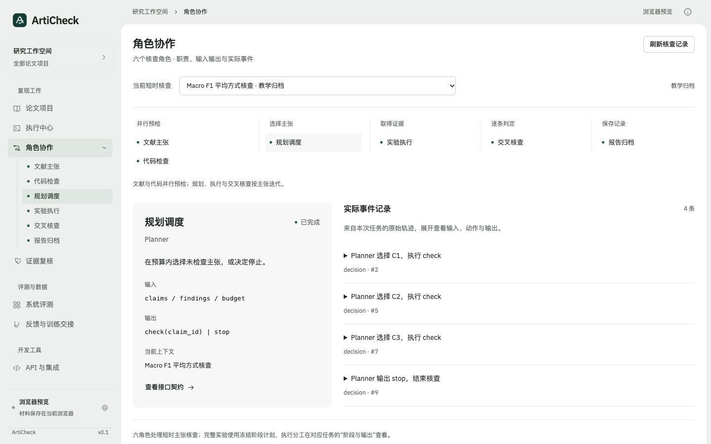

# 执行中心与角色导航

2026-10-30：按 Taste Skill 的 app-screen 流程重排现有工作台。保持原生 HTML / JavaScript、IBM Plex Sans 与灰绿色外框，采用 Framed sheet，seed `1347639923`，无重抽。

## 工作区层级

| 分组 | 页面 | 优先回答的问题 |
| --- | --- | --- |
| 复现工作 | 论文项目 | 要核查哪份论文、材料与计划？ |
| 复现工作 | 执行中心 | 哪次任务正在运行、失败或需要关注？ |
| 复现工作 | 角色协作 | 某个角色接收什么、输出什么，实际发生过什么？ |
| 复现工作 | 证据复核 | 当前任务的判断有什么依据？ |
| 评测与数据 | 系统评测 | ArtiCheck 的判定质量如何？ |
| 评测与数据 | 反馈与训练交接 | 已保存哪些人工修正？ |
| 开发工具 | API 与集成 | 这些操作对应什么接口契约？ |

“运行轨迹”并入单次任务详情。角色协作页展开六角色子导航；其他页面折叠角色树。角色的职责和事件从同一份目录映射，主张、代码并行预检，Planner / 执行 / 交叉核查按主张迭代。

## 列表与详情

执行中心是独立的记录列表，不在列表下方同时铺开报告。完整实验、短时核查、公开 CI 归档、教学归档可在同一列表检索；类型和来源分别标明。状态计数随搜索与筛选变化，返回列表保留筛选，超过 25 条按需展开。

单次完整实验有“任务概览 / 角色协作 / 阶段与输出 / 证据复核 / 完整报告”；单次短时核查有“任务概览 / 角色协作 / 执行事件 / 证据复核”。共用任务身份、来源、计划指纹和一层标签，避免重复任务选择器、执行类型切换与报告标题。

角色协作页可选择任一短时核查或完整实验记录，并查看六角色状态及各角色的真实输入输出。

- **短时核查**：`LiteratureReader` 与 `CodeInspector` 共享 preflight 事件，但仅展开所属角色数据；Planner 读 decision/model，执行器读 tool，审计读 audit，报告器读 complete。
- **完整实验**：事件来自执行器写入的 `roles.jsonl`（`GET /api/reproduction/runs/{run_id}/roles`）。阶段归属由 [`articheck/reproduction/roles.py`](../articheck/reproduction/roles.py) 定义：审计 `scope` 维度归 LiteratureReader；`code / data / environment / settings` 维度、源码快照与完整性核对归 CodeInspector；`commands / resources / acceptance` 维度、资源核对、每次运行排程与停止原因归 Planner；镜像构建、环境验证与阶段执行归 ExperimentRunner；镜像兼容、阶段核查、运行判定与实验验收归 CrossAuditor；分层验收归 Reporter。Planner 在此路径按冻结计划排程（`policy: frozen_plan`），不做模型决策。
- 角色状态只由实际事件推出：无事件为“未开始”，任一事件 `fail` 为“执行失败”，任务进行中为“执行中”。早于角色标注的归档（如当前 LIBLINEAR CI 归档）没有 `roles.jsonl`，页面明确显示“没有角色记录”，不补造事件。
- 角色记录写入失败只记入 `report.roles.errors`，不改变执行状态、指标或分层验收（`tests/test_reproduction_roles.py` 覆盖）。

归档教学报告缺少时间时显示“未记录时间”，不使用页面打开时间代替。

## 核心模块

| 模块 | 作用 |
| --- | --- |
| `web/dist/navigation.mjs` | 分组导航、角色子导航及状态标记 |
| `web/dist/execution-core.mjs` | 六角色目录、事件归属、记录归一化、筛选与计数 |
| `web/dist/execution-center.mjs` | 列表 / 详情 / 角色页面、记录读取、刷新、导出与返回 |
| `web/dist/review-view.mjs` | 嵌入任务详情的完整实验证据视图，共用单层导航 |
| `web/dist/workspaces.css` | 新工作区响应式布局，与原材料页面样式分开维护 |
| `tests/frontend/execution-center.test.mjs` | 新页面的数据关系与交互状态回归 |

本机活跃任务每 3 秒更新；输入、复核和展开阅读原始事件时暂停刷新画面。新任务响应不会覆盖已经返回的列表；缓存报告的旧状态与进度不覆盖新任务元数据。搜索只更新结果区域，保持输入节点和焦点，支持连续输入及输入法组合。

## 数据与视觉检查

设计清单：论文项目；PDF / ZIP / 计划版本；完整实验任务；短时主张核查；六角色；并行 preflight 与循环动作；阶段输入输出；真实运行状态；证据复核；来源标识；缺失的归档时间；停止 / 刷新 / 导出操作。全部计数从记录计算，未增加科研或模型成绩。

用于预览的资料：LIBLINEAR 的公开 CI 归档，15 次运行 / 60 阶段；四份自制教学归档，每份三条主张。这些资料不计入用户本机实验。真实运行通过原有两个 HTTP 注册表读取。

执行中心、角色协作、完整实验详情与证据复核均在 1440 / 768 / 390px 检查，0 FAIL / 0 WARN。源码 lint 的唯一提示为“—”缺失值占位符，属于 app 规则允许的未知数据表达。检查截图、设计 brief、前后对照保存在本地 `.taste-skill/execution-navigation/`，不上传。

目视复核：主任务列表占据主要画布，任务来源、状态与进度同一行对齐；角色树只在对应页面展开；手机六角色在两行内呈现，列表改为多行记录；原始代码与 JSON 在自身容器内滚动。内部设计自评 8 / 10：层级和任务归属清楚，原始证据仍含英文与技术字段；该分数不是用户研究。

67 项前端测试通过，包含真实记录计数、筛选组合、无伪造归档时间、事件归属、角色菜单、迟到响应、报告版本校验、旧缓存进度、嵌入报告单层导航、全部六角色入口、导出 / 回放入口及输出转义。

浏览器实际验证：角色子导航切换并展开 code preflight；搜索 LIBLINEAR 得到 1 条且计数同步；打开完整实验并进入证据复核，保持同一任务身份；返回列表保留搜索；打开 Macro F1 教学归档并读取 Planner 的四条动作记录。
