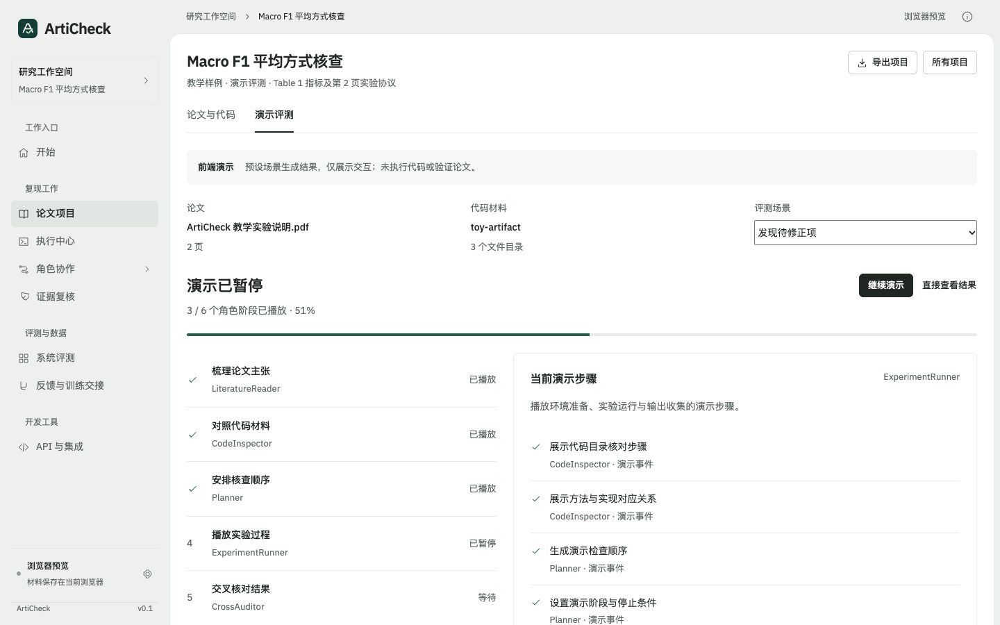
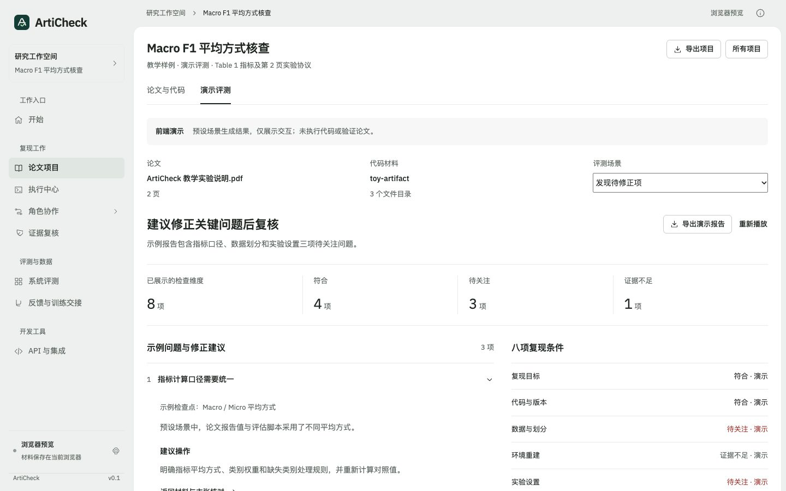

# 纯前端动态评测演示

2026-11-02。用于产品演示，无后端、模型 API 或 Docker 依赖。

## 使用

1. 打开开始页，新建论文评估。
2. 导入 PDF（真实提取文本与页数）和代码 ZIP（真实读取中央目录），也可读取公开 GitHub 目录。
3. 保持「提交后播放演示评测」选中，点击「提交材料并演示评测」。浏览器预览默认选中，本地真实运行模式默认不选中。
4. 六角色约 16 秒依次播放，阶段、百分比和事件随时间更新；可暂停、继续或直接查看结果。
5. 结果页切换「发现待修正项 / 条件全部符合 / 材料不足待补充」，展开问题建议、查看八项条件并导出 JSON。

已有项目也可从「论文与代码」的「开始演示评测」进入。开始页最近项目会续接演示结果。刷新时运行中演示恢复为暂停，不把离线时间算成已执行；更换材料会使原演示失效。

直接播放内置材料：`?mode=demo&example=demo`；静态结果：`?mode=demo&example=demo&view=report`；暂停在进度中段：`?mode=demo&example=demo&view=progress`。

## 实现与边界

- `web/dist/presentation.mjs`：六阶段脚本、三种固定场景、时间推进、暂停恢复、材料身份、结果与导出。
- `web/dist/presentation.css`：与工作台相同的 Framed sheet 风格；手机单栏、44px 操作区，尊重减少动态效果设置。
- `web/dist/intake.mjs`：导入和提交入口、独立演示标签与材料变化失效。
- `tests/frontend/presentation.test.mjs`：材料门槛、推进与暂停、来源、计数、失效、转义、刷新和真实报告隔离。

状态保存在项目 `presentation_review`，不写入 `run_id`、实际核查发现、完整实验验收或系统自评。JSON 带 `format=articheck-frontend-demo-v1`、`data_source=frontend_demo`、`scientific_validation=false`。预设问题没有被冒充为对用户代码的实际定位，文件内容不用于推导演示结论。

演示模块没有 HTTP 请求；PDF / ZIP 只在浏览器读取。选用 GitHub 来源时仍需访问 GitHub 公共目录 API。远程模型调用与实验执行不属于本演示路径。

## 验证

80 项前端测试通过（新增 8 项）。浏览器实际导入自制 2 页 PDF 与 3 文件 ZIP，提交后自动进入进度并完成报告；重播、暂停、继续、跳到结果、三种场景和下载 JSON 均已验证，下载内容的来源标记、材料信息与计数已读回核对。

taste skill 延续 Framed sheet，seed1600077506，无重抽。对照材料表单及最终进度 / 结果分别检查 1440、768、390，全部 0 FAIL；结果页 0 WARN。进度页有 no-data-hue 提示：CSS 绿色进度条在截图中正常显示，检查器未将它计入图表数据颜色，保留该提示。最终 12 张 fold / page 图已目视检查。桌面两栏，手机单栏；演示页只保留材料与演示两项页签，避免重复材料栏挤占首屏。

