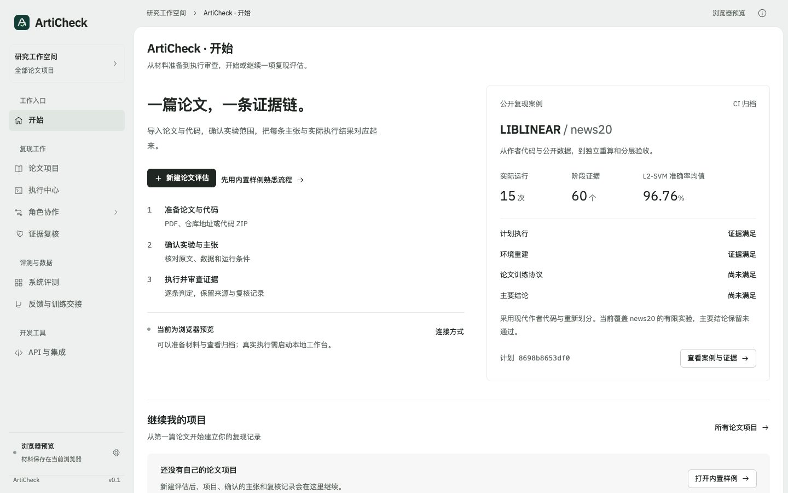
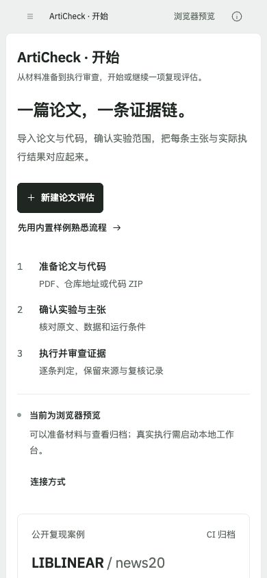

# 开始页：入口、材料与证据

2026-11-01。空路径首次访问默认显示 `home`，也可用 `#home`；旧的项目、执行中心、角色与案例链接继续有效。品牌标识与侧栏「开始」均返回首页。浏览器返回空 hash 时也恢复首页。

## 使用顺序

新建论文评估打开现有材料表单，提供项目名称、论文 PDF / 链接与代码仓库 / ZIP。入口不创建空项目，不自动执行第三方代码。内置样例单独打开其材料阶段。

「继续我的项目」仅列当前浏览器已有个人项目，排除内置样例，按更新时间 / 创建时间排序取最近三项；总数来自完整个人项目集合。已有运行跳转评估结果，有确认主张跳转复现条件，其余跳转材料阶段。没有项目时保留明确空态；存储不可用时显示原有错误信息。

公开 LIBLINEAR 案例复用现有 catalog JSON：15 次运行、60 个阶段、L2-SVM 96.76% 来自原报告；四个验收字段直接读 levels，未知值保留未知。打开案例进入 ExecutionCenter 的同一份归档详情。案例未加载时提供执行中心重试入口，不借用默认数字。

运行状态复用应用探测的 mode。本机已连接时指向运行设置，浏览器预览时说明真实执行需使用本地服务。

## 代码对应

| 位置 | 责任 |
|---|---|
| `web/dist/home.mjs` | 纯数据模型、项目过滤排序、公开报告摘要和开始页渲染 |
| `web/dist/home.css` | 双栏开始区、证据摘要、最近项目及响应式布局 |
| `web/dist/app.js` | 默认路由、首页渲染与动作接入；复用 IntakeWorkspace / ExecutionCenter |
| `web/dist/navigation.mjs` | 新增「工作入口 / 开始」导航 |
| `tests/frontend/home.test.mjs` | 空态、样例排除、摘要来源、续接分类、转义、缺失值与运行状态 |

没有新增后端接口，也没有复制项目存储或实验执行逻辑。

## Taste 设计与验证

采用 app-screen 流程，Framed sheet，seed `1600077506`，保留品牌配色与 IBM Plex 字体，无重抽。灰绿框架与白色纸面延续工作台；首页独有元素是公开证据的四层验收摘要。首要问题是「我从哪里开始，或继续哪个项目」，主操作直接连接材料准备。

1440 / 768 / 390 三宽度两轮浏览器检查，最终均为 0 FAIL、0 WARN；六张最终折叠 / 全页图已目视检查。两轮主要修正了手机首屏的产品标识与空 hash 返回。72 项前端测试通过（新增 5 项）。浏览器实测新建表单、样例材料、案例详情、个人项目续接及本地 / 预览状态。数据复用现有个人项目与公开归档，没有新增模拟项目。

设计自评 8/10：首操作明确，证据与行动并列，全部区块共享边线；手机按单栏阅读，主要入口首屏可达。最近项目和案例在小屏需向下浏览，属于内容顺序的保留取舍，不是用户研究评分。

