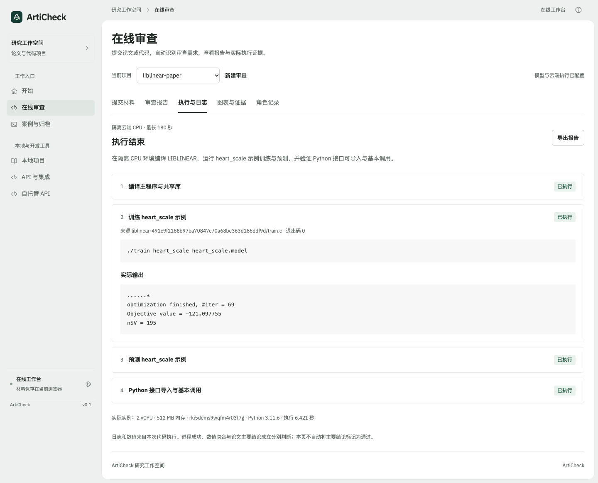

# 在线网站验收

验收日期：2026-11-05（北京时间）。地址：[ArtiCheck 在线审查](https://articheck-workbench.edgeone.dev/#api-review)。最终发布编号：`dp9tqdf54ebk`。CPU 流程记录来自 `dp2ulgg7gl1p`；随后这次发布仅调整报告标题与摘要层级，服务端执行代码保持相同，界面另行复核。

这份记录验证真实模型 API、网页操作与隔离 CPU 执行。ArtiCheck 后训练权重未参与；材料类型与图表识别的样本结果不能作为总体准确率或完整论文复现成绩。

## 1. 论文与代码的真实网页流程

浏览器上传 [LIBLINEAR 原论文](https://jmlr.org/papers/volume9/fan08a/fan08a.pdf)，粘贴 [作者仓库](https://github.com/cjlin1/liblinear) 后自动读取固定提交 `491c9f1188b97ba70847c70a68be363d186ddf9d`，取得 39 个源文件。网站调用 DeepSeek 阅读材料、生成计划，再自动创建 E2B 实例运行。

本次主动限定为 `heart_scale` 示例的依赖、编译、训练、预测与 Python 接口；论文 news20 完整实验和主要结论不在本次范围。

| 项目 | 实测结果 |
|---|---|
| 执行阶段 | 4 个，全部退出码为 0 |
| 实际实例 | 2 vCPU、512 MB 内存，Linux x86_64、Python 3.11.6 |
| 执行器墙钟时间 | 6.421 秒；不含模型审查、实例创建与上传 |
| 同数据训练/预测输出 | 84.4444%（228/270）；仅核对命令与输出，不作为泛化效果 |
| 浏览器 JavaScript 错误 | 0 |
| 论文主要结论 | 未验收；`scientific_validation=false` |

完整命令、输出、材料指纹与实际角色事件见 [CPU 执行报告](evidence/online-cpu-acceptance.json)。仅上传代码的独立流程也已通过真实网站调用与 CPU 执行，见 [代码单材料报告](evidence/online-code-only-acceptance.json)。两次运行的模型计划不同，不比较阶段数或耗时为性能提升。

## 2. 单论文、文档类型与长篇图表

以下样本均通过正式网站的同域接口调用真实模型；没有代码时没有伪造运行输出。

| 材料 | 类型 / 任务 | 输入覆盖 | 指标候选 |
|---|---|---|---:|
| diagnostic-paper | diagnostic / self_review | 15 / 15 页文字、15 页图像 | 0 |
| survey-paper | survey / self_review | 31 / 31 页文字、24 页图像 | 18 |
| 1611.03530 | diagnostic / self_review | 15 / 15 页文字、15 页图像 | 114 |
| nonpaper-memo | nonpaper / self_review | 1 / 1 页文字、1 页图像 | 0 |
| blank-document | unknown / self_review | 1 / 1 页文字、1 页图像 | 0 |

“指标候选”指经结构与出处校验后保留的模型读取结果，仍需对照原图，不表示对应实验已运行。分析论文中的诊断实验、含实验的综述和非实验性学术评论分别处理；普通备忘录不生成实验，空白 PDF 保留无法判断。

31 页综述首次测试只读取前 10 页，已修复为按全篇页数分配文字预算、优先图表，并读取 24 页原图；复测覆盖后半篇表格。旋转排版的 arXiv 页边标识另行读取，避免失去公开来源线索。

完整样本字段、覆盖缺口与原文链接见 [材料类型记录](evidence/online-paper-cases.json)。合成备忘录和空白页只验证拒绝错误任务的流程，不计入研究论文质量评测。

## 3. 状态、权限与费用预留

正式浏览器已验证：本浏览器读报告返回 200；其他身份返回 404；没有访问码返回 401。同一已完成计划再次提交执行，仍返回同一尝试与同一费用预留，没有新建实例。[生产接口检查](evidence/online-protocol-acceptance.json)。

功能回归还覆盖实际子进程失败、依赖跳过与独立实验继续、超时、停止与迟到状态竞争、受阻后的补料确认，以及计算条件不足时不伪装执行。GitHub 429 与论文/代码缺陷分开；输出中的 0.429 等普通数字不再触发限流状态。

主审、检索与复核共用最多 60 次外部请求预留，CPU 最多 20 次，每次 1 元，合计 80 元，低于用户本轮 100 元授权。预留不代表已发生费用；失败也不退回预留，重新部署不清零。供应商 key、Redis 凭据和访问码不写入上传构建包、报告或截图。

## 4. 回归与界面检查

- Python：168 项，本地 164 项通过、4 项 Docker 测试跳过；CI 在 Python 3.10–3.12 运行，3.11 另执行 Docker 路径。[CI](https://github.com/Gump111458785/ArtiCheck/actions/workflows/ci.yml)。
- 前端：103 项通过。
- 真实浏览器：桌面 1440 与 1280 宽度，复核报告、实际日志、证据、角色记录与就地表单校验。
- Taste 应用界面规则：保留原有字体与绿色体系，问题、建议和状态分层；检查器对 28 px 标题给出通用展示页警告，应用屏幕保留该尺寸。未将这个警告写成“全部检查零警告”。

[完整反馈对应表](USER_FEEDBACK.md#集中实施与验收2026-11-05) · [界面图集](UI_GALLERY.md)。

## 5. 适用范围

当前托管执行提供小规模 CPU 环境。GPU 训练、超过内存/时限的数据处理、受限数据与完整论文统计验收不因网页流程通过而成立。需要本地数据或 GPU 时，可主动选择本地工作台。

模型会误读排版、遗漏数值或提出证据不足的建议。第二轮交叉复核保留撤回与修订记录，但仍是模型复核；不能据此确认原始数据真实、作者有错或主要结论成立。默认检查适用范围并记录未覆盖项，不能保证任意论文的所有图表均能自动识别。
