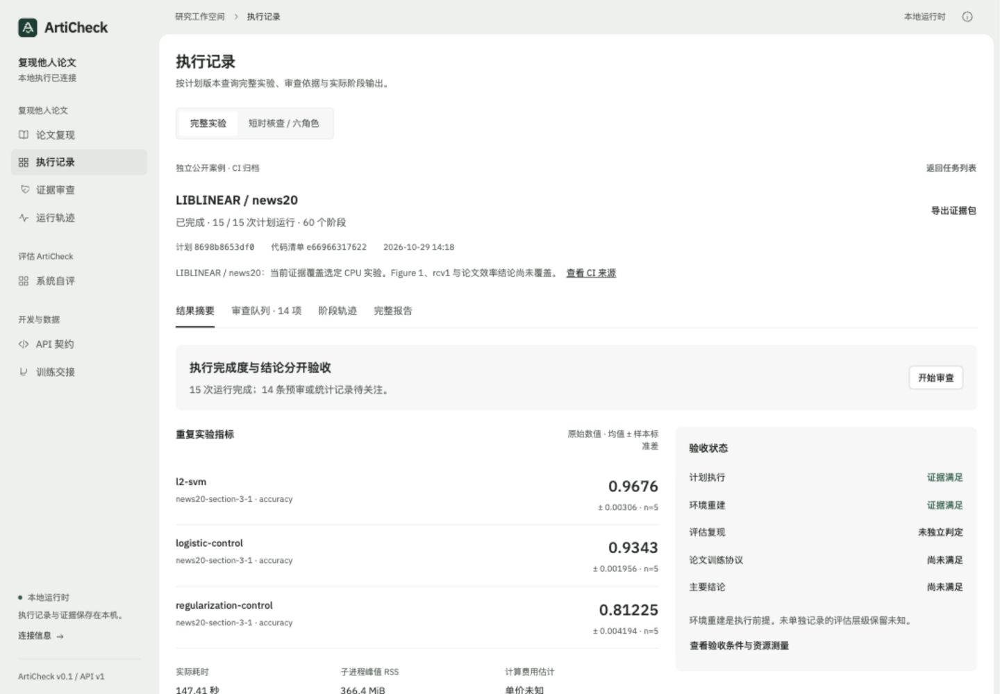
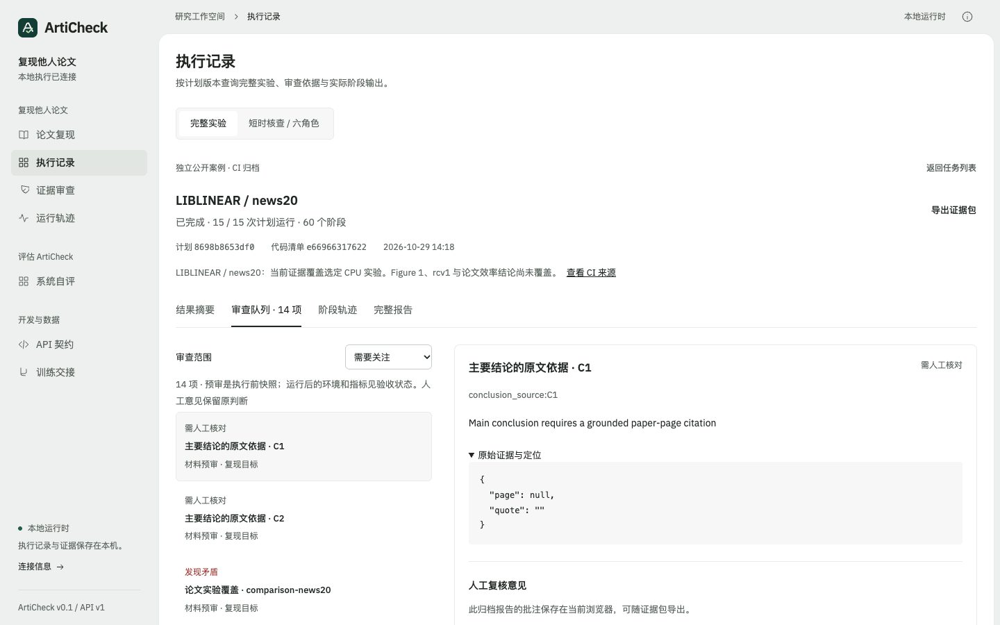

# 完整实验审查工作区

2026-10-30：使用已安装的 Taste Skill 优化现有原生 HTML / CSS / JavaScript 界面。保留绿色灰阶 L 型外框、白色工作区及 IBM Plex Sans；采用 Framed sheet，seed `2011675619`，无重抽。这里的任务是审查同一材料版本的实际证据。

## 界面与模块

| 操作 | 前端模块 | 本机接口或状态 |
| --- | --- | --- |
| 查看论文 / ZIP / 计划版本 | `intake.mjs`, `review-core.mjs` | 项目内容指纹、计划 SHA256 |
| 导入与绑定材料 | `material-intake.mjs` | `/api/materials`、二进制上传、`/bind` |
| 编辑实验、原文、结论与代码对应 | `scope-form.mjs`, `scope-review.mjs` | `/api/materials/{id}/review`，保留父版本 |
| 八项材料核验 | `reproduction-workspace.mjs` | `/api/reproduction/audit` |
| 确认实际执行配置 | `reproduction-workspace.mjs` | 审计返回 `execution_preview`，与计划指纹绑定 |
| 当前结果与历史 | `intake.mjs`, `review-core.mjs` | 显式项目 / PDF / ZIP / 计划身份；旧结果归档 |
| 摘要、审查队列、阶段轨迹 | `review-view.mjs` | 完整实验报告与 `runs` 注册表 |
| 具名复核 | `review-view.mjs` | GET / POST `/api/reproduction/runs/{id}/reviews` |
| 归档报告批注与导出 | `reproduction-core.mjs`, `review-view.mjs` | 浏览器批注；证据包导入不取得本机来源身份 |

完整实验与六角色短时核查有独立的类型切换。侧边栏的执行记录、证据审查和运行轨迹均可读取完整实验；项目的“评估结果”展示当前版本的完整报告，即使没有短时核查记录。

## 版本及证据约束

- 材料替换、选择新计划或审核生成新版本时，当前任务与报告归档，当前审计失效。
- 当前报告必须匹配项目、PDF、ZIP 和计划版本；延迟返回的任务响应不能重新绑定已变化的材料。
- 新计划核验成功不使旧报告成为当前结果；导入报告独立放入历史。
- 启动前显示本次冻结计划的运行矩阵、CPU / 内存 / GPU、时间、磁盘、单价与阶段命令。短时核查预算不覆盖完整实验预算。
- 人工复核与机器结论并存。终态运行的具名意见追加到 `reviews.jsonl`，记录任务 ID、引擎运行 ID、计划与源码清单指纹、目标 ID、意见与依据；不修改报告或科学验收层级。
- 审查队列中的材料预审是执行前快照。环境重建、资源及统计验收以运行后的证据为准。
- “评估复现”没有独立字段的旧报告显示“未独立判定”，不把环境重建等同于评估复现。

## 设计记录与验证

数据 / 工作清单：论文 PDF 与页码；ZIP 内容指纹；不可变计划；论文实验清单；结论与代码引用；八维预审；方法 × 种子矩阵；每阶段命令和文件产物；重复指标与配对区间；实际资源测量；机器验收；具名人工意见。所有计数从报告或计划计算。

| 画面 | 首要问题 | 本次实际发现 |
| --- | --- | --- |
| 材料与计划 | 当前核验的是哪份论文、代码与计划？ | 新审核产生独立计划版本 |
| 执行配置 | 实际运行哪些命令、用多少资源？ | 自制验收计划是 15 次 / 45 阶段 / 60 秒，不是 probe 的 180 秒 |
| 结果摘要 | 哪些结果已测得，哪些结论仍缺依据？ | 公开 CPU 案例保留 15 次运行、60 阶段及未覆盖实验 |
| 审查队列 | 这一条判断由什么证据支持？ | 原始判断与人工意见独立保留 |
| 阶段轨迹 | 哪个方法、种子、阶段产生这些输出？ | 可展开原始阶段并进入该阶段的人工审查 |

目视复核：主要问题由摘要、版本条与下一步动作表达；数字来自原始报告；色彩仅用于状态；手机将列表与详情拆开并提供返回按钮；导航折叠，表格及代码在自己的容器滚动。改版前、第一轮、第二轮、最终检查保存在本地 `.taste-skill/`，该目录不上传。

摘要页在 1440 / 768 / 390px 的最终 inspector 检查 0 FAIL / 0 WARN。审查队列在同三尺寸检查 0 FAIL / 0 WARN，并完成真实浏览器交互。源码检查保留两条 monospace 提示，分别用于真实代码与接口字段，符合 app 规则。

本机测试：121 项 Python 测试，117 通过、4 项 Docker 专项跳过；54 项 Node 前端测试通过。新增回归覆盖旧报告隔离、材料重绑、迟到响应、无 probe 的完整报告结果页、实际计划配置、表单与 JSON 同一草稿、证据包批注往返，以及 HTTP 复核追加与机器报告不变。

浏览器联调使用自制单页 PDF、ZIP、计划：实际上传绑定、保存审核新版本、核对执行配置及确认按钮；自制样例实际执行 15 次 / 45 阶段，在任务列表中读取后保存一条本机具名复核。联调材料和运行记录保留本机，不打包到托管预览。

仍需按论文提供实际阶段命令、数据和验收协议；表单只编辑论文清单与方法审核，没有自动生成训练流程。完整实验仍由冻结计划执行，未实现在线 Planner 动态选择实验。复核记录没有自动转成已训练的 SFT / GRPO 成果。

本轮内部目视评分：8 / 10。工作区的版本归属、数据与下一步操作已统一；高级配置仍需要理解实验协议，部分上游检查说明保持英文，尚未提供逐文件源码浏览器。该评分是设计自评，不是用户研究或模型基准。
