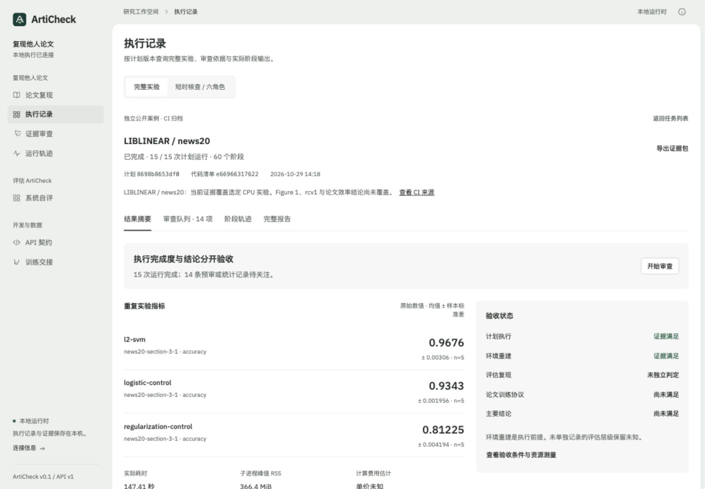
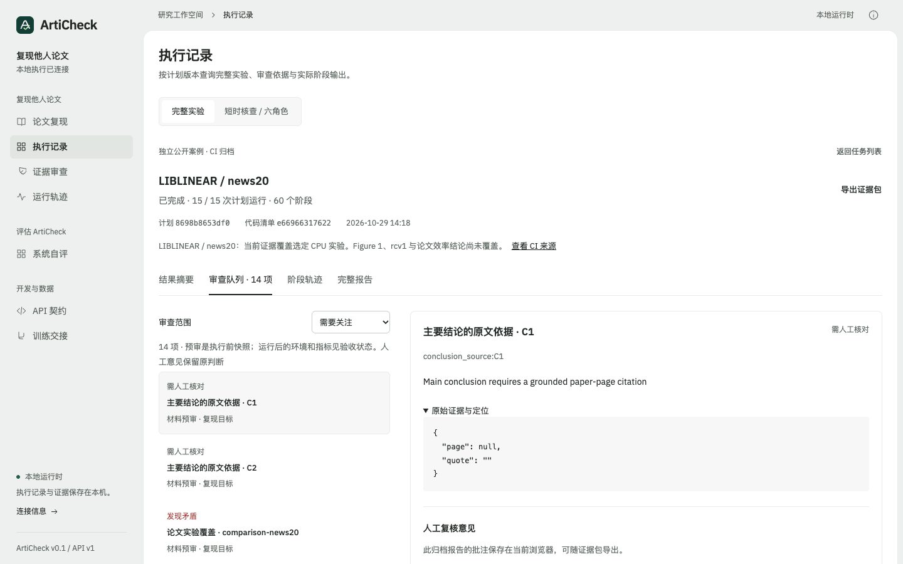

# 完整实验审查工作区

审查工作区把论文、代码、计划和执行证据绑定到同一材料版本，支持逐项查看和具名复核。

## 界面与模块

| 操作 | 前端模块 | 本机接口或状态 |
| --- | --- | --- |
| 查看论文 / ZIP / 计划版本 | `intake.mjs`, `review-core.mjs` | 项目内容指纹、计划 SHA256 |
| 导入与绑定材料 | `material-intake.mjs` | `/api/materials`、二进制上传、`/bind` |
| 编辑实验、原文、结论与代码对应 | `scope-form.mjs`, `scope-review.mjs` | `/api/materials/{id}/review`，保留父版本 |
| 八项材料核验 | `reproduction-workspace.mjs` | `/api/reproduction/audit` |
| 确认实际执行配置 | `reproduction-workspace.mjs` | 审计返回 `execution_preview`，与计划指纹绑定 |
| 当前结果与历史 | `intake.mjs`, `review-core.mjs` | 显式项目 / PDF / ZIP / 计划身份；旧结果归档 |
| 摘要、审查队列、阶段轨迹 | `review-view.mjs` | 完整实验报告与 `runs` 注册表 |
| 具名复核 | `review-view.mjs` | GET / POST `/api/reproduction/runs/{id}/reviews` |
| 归档报告批注与导出 | `reproduction-core.mjs`, `review-view.mjs` | 浏览器批注；证据包导入不取得本机来源身份 |

完整实验与六角色短时核查有独立的类型切换。侧边栏的执行记录、证据审查和运行轨迹均可读取完整实验；项目的“评估结果”展示当前版本的完整报告，即使没有短时核查记录。

## 版本及证据约束

- 材料替换、选择新计划或审核生成新版本时，当前任务与报告归档，当前审计失效。
- 当前报告必须匹配项目、PDF、ZIP 和计划版本；延迟返回的任务响应不能重新绑定已变化的材料。
- 新计划核验成功不使旧报告成为当前结果；导入报告独立放入历史。
- 启动前显示本次冻结计划的运行矩阵、CPU / 内存 / GPU、时间、磁盘、单价与阶段命令。短时核查预算不覆盖完整实验预算。
- 人工复核与机器结论并存。终态运行的具名意见追加到 `reviews.jsonl`，记录任务 ID、引擎运行 ID、计划与源码清单指纹、目标 ID、意见与依据；不修改报告或科学验收层级。
- 审查队列中的材料预审是执行前快照。环境重建、资源及统计验收以运行后的证据为准。
- “评估复现”没有独立字段的旧报告显示“未独立判定”，不把环境重建等同于评估复现。

## 准备完整实验

按论文提供阶段命令、数据和验收协议。执行器使用冻结计划，报告保留每个方法、随机种子和阶段的输入、命令、产物与统计结果。具体格式见 [实验复现引擎](REPRODUCTION_ENGINE.md)。
