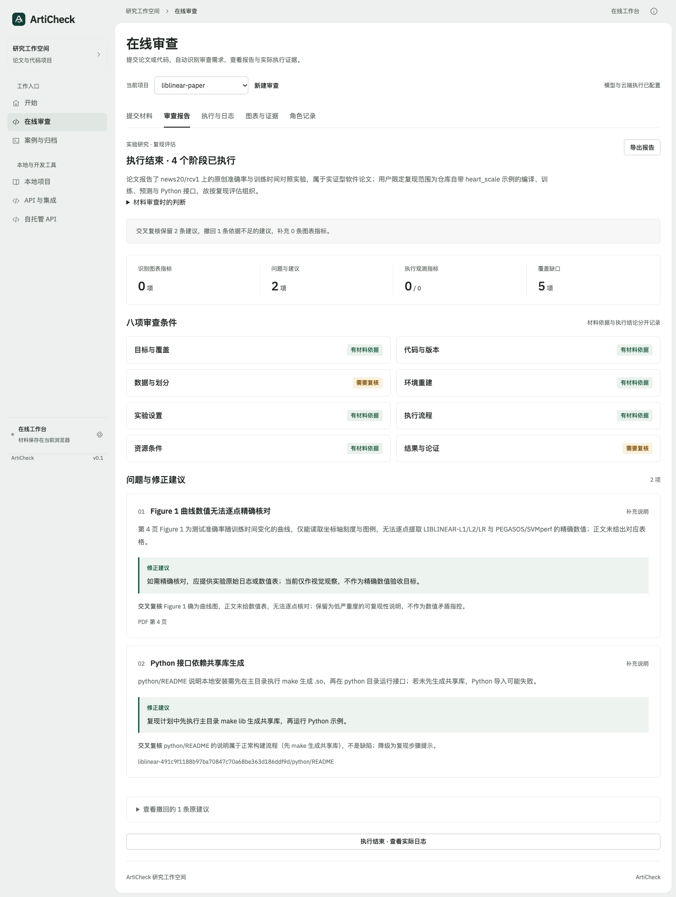
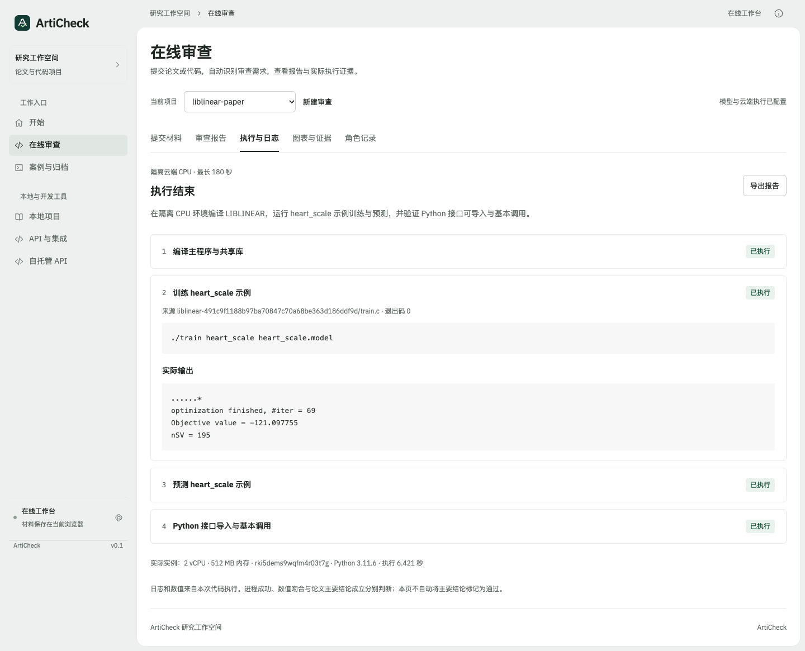
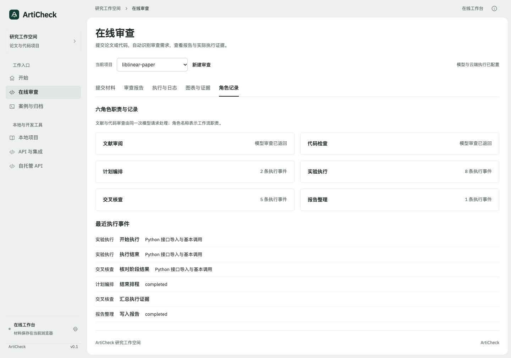
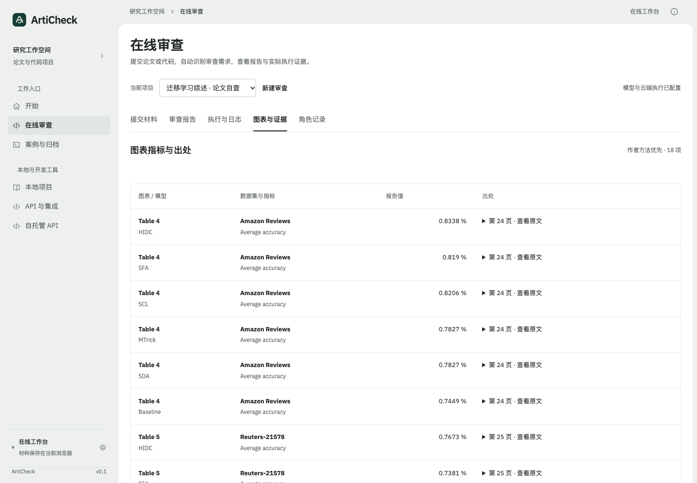
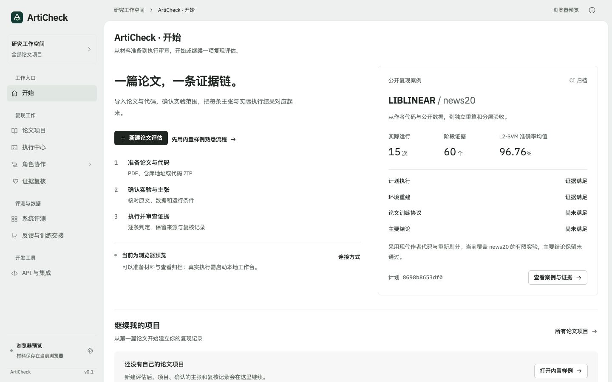
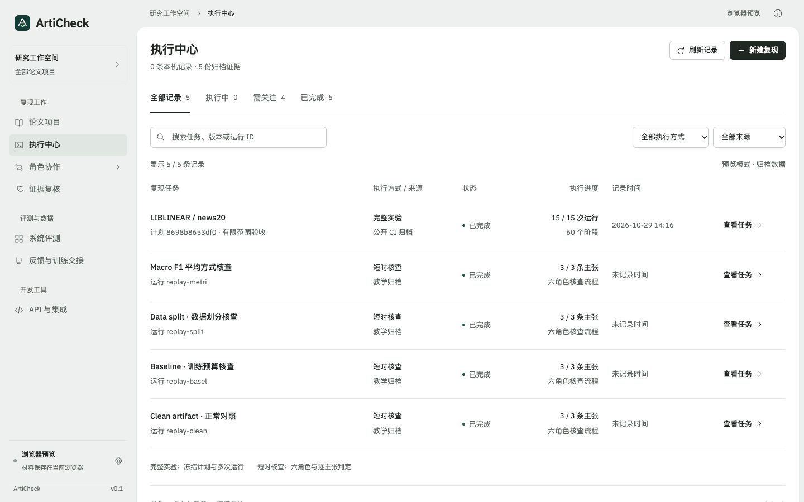
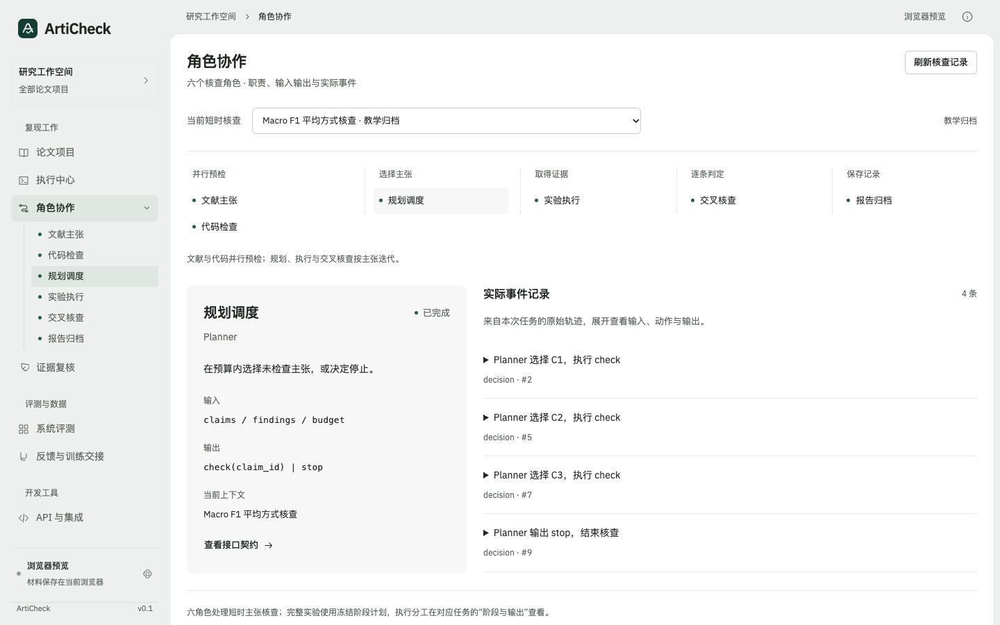
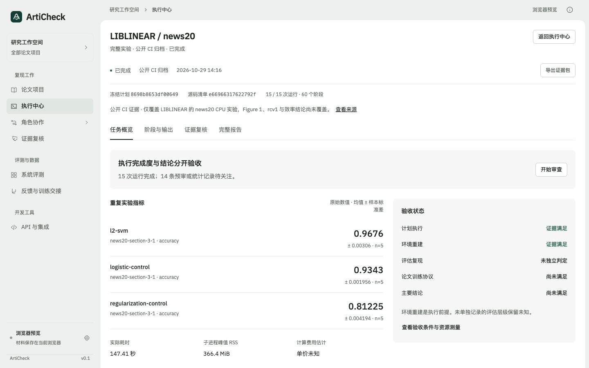

# ArtiCheck 界面图集

工作台从论文材料走向逐主张证据与分层验收。本页选取已归档的真实界面截图，点击图片可查看原尺寸；截图中的公开案例与个人项目分别保存。

[交互预览](https://articheck-workbench.edgeone.dev/#home) · [本地启动](WORKBENCH.md#运行方式) · [系统架构原图](assets/architecture.svg)

## 在线审查：材料、报告与真实执行

论文 PDF 与代码可以分别提交。GitHub 地址自动读取固定提交的源码；有适用计划时在云端 CPU 实例执行。下图来自正式网站的公开 LIBLINEAR 案例，不是预设动画。

论文自查将摘要与标题分开显示；图表清单保留模型、数据集、数值与原页入口。[实际运行范围与验收记录](ONLINE_ACCEPTANCE.md)。以下为本地工作台与归档案例页面。

## 开始：选择新建、继续项目或查看案例

新建论文评估进入现有的 PDF / 代码材料表单；最近项目来自当前浏览器，内置样例不计入个人项目数量。公开 LIBLINEAR 案例拥有独立入口。

## 执行中心：统一查找记录

完整实验与短时核查集中检索，明确区分本机执行、公开 CI 与教学归档。来源、状态、进度和实际记录时间随任务显示，打开任务后查看对应证据。

## 角色协作：从职责契约读到实际事件

文献主张与代码检查并行预检，Planner 选择检查项，执行、核查与报告形成可追溯记录。角色面板复用原始运行事件，不为完整实验生成虚构角色活动。

## 案例验收：让运行完成与结论依据分别可见

LIBLINEAR 公开案例展示 15 次运行、60 个阶段和重复实验指标。原报告中环境重建通过，而论文训练协议与主要结论尚未通过；界面保留原始判定及证据范围。

## 从界面到实现

| 界面 | 前端入口 | 数据与执行来源 |
|---|---|---|
| 开始页 | [home.mjs](../web/dist/home.mjs) | 个人项目存储、应用 mode、公开案例 catalog |
| 执行中心 | [execution-center.mjs](../web/dist/execution-center.mjs) | `/api/runs`、`/api/reproduction/runs` 和归档记录 |
| 角色协作 | [execution-core.mjs](../web/dist/execution-core.mjs) | preflight / decision / tool / audit / complete 事件 |
| 完整实验与审查 | [review-view.mjs](../web/dist/review-view.mjs) | 冻结计划、运行阶段、分层报告与追加复核意见 |

在线网站已接入模型 API 和 CPU 执行；本地工作台用于自有材料环境、GPU 或完整实验配置。[开始页说明](HOME_SCREEN.md) · [执行中心说明](EXECUTION_CENTER.md) · [审查模块对应](REVIEW_WORKSPACE.md)。
