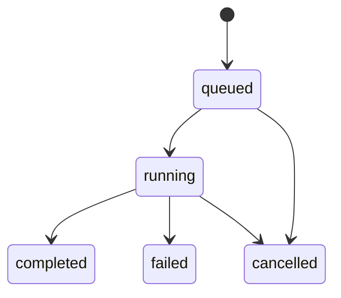

# ArtiCheck Workbench：界面与接口

工作台把现有 Python 核查链路封装为可操作的界面，并用实际交互检验接口设计。前端为原生 HTML / CSS / JavaScript，无需 Node 依赖安装；本地服务使用 Python 标准库。

## 运行方式

从完整源码 checkout 的根目录运行：

```bash
python -m pip install -e .
python -m articheck.workbench --port 8787 --workspace . --storage runs/workbench
```

打开 `http://127.0.0.1:8787`。新建任务、执行核查、读取报告和提交人工反馈均通过本地 HTTP API 调用现有 Python 实现。默认首次启动没有运行记录，点击「运行样例」即可执行内置任务。

也可以打开 [私有托管预览](https://articheck-workbench.soft-bun-8328.chatgpt.site)。它使用 `scripts/build_workbench.py` 从真实教学 fixture 生成的归档证据，在浏览器回放交互。预览不执行外部仓库、不访问本机文件系统，反馈仅保存在该浏览器。导出的回放报告带 `data_source=archived_sample_replay`，不能作为新的真实执行记录。

本地页面可使用 `?mode=demo` 检查回放模式。更新归档样例或契约后执行：

```bash
python scripts/build_workbench.py
node --check web/dist/app.js
python -m unittest discover -s tests -v
```

## 界面设计

工作区以主张和证据对照为中心，指标摘要与六角色状态位于同一运行上下文。手机端折叠导航，主张与证据详情分屏呈现。具体设计与验证见 [设计记录](WORKBENCH_DESIGN.md)。

## 五个工作视图

| 视图 | 用户操作 | 对应资源 |
|---|---|---|
| 核查任务 | 新建任务、修改主张预期值、设置预算、启动与停止运行 | Task / ReviewRun |
| 证据审查 | 搜索主张、按问题过滤、查看预期与观测值、打开原始 JSON | Claim / Finding / Evidence |
| 运行轨迹 | 查看规划动作、工具结果、核查事件、下载 JSONL | TraceEvent |
| API 契约 | 浏览接口、查看示例、复制 cURL、下载 OpenAPI | HTTP / SSE schema |
| 训练交接 | 查看人工反馈、区分困难样本候选、导出反馈 JSONL | HumanFeedback |

前端角色图对应 LiteratureReader、CodeInspector、Planner、ExperimentRunner、CrossAuditor、Reporter。当前阶段状态由原始 preflight / decision / tool / audit / complete 事件推导，不作为独立的角色耗时测量；精确的角色开始、结束时间属于后续 instrumentation 扩展。

## 关键接口决策

### 任务定义与运行分离

`POST /api/tasks` 注册或复制任务，创建独立 task_id；`POST /api/runs` 用 task_id 与运行预算创建执行实例。修改主张通过创建新任务保存，历史任务与报告保持原样。

任务来源支持内置样例，或服务 workspace 内已有的 task.json。浏览器当前不上传论文 PDF、clone 任意仓库或接受自由 shell。内置样例允许可信 local 执行；导入的 artifact 只能选择 Docker。

### 运行 ID 与报告 ID 分离

HTTP 层先返回 ReviewRun.id，Python pipeline 在执行时创建自己的 report.run_id。完成后的 ReviewRun.report_id 指向后者。反馈沿用原始 report.run_id，因此不会把任务 ID、HTTP 运行 ID 和证据 ID 混用。

状态机：



HTTP 202 表示已接收，不表示核查完成。接口关闭后重启时，未完成运行恢复为 failed 并记录原因；不将中断的任务标成成功。预算耗尽但已生成报告的运行仍保留报告与 inconclusive 判定，详细原因见 report.stop_reason。

### 证据不可变、反馈可追加

Finding.evidence_ids 关联原始 Evidence。缓存命中只复用证据，不伪造额外工具调用。人工反馈追加 reviewer、reason、label、timestamp 和 previous_verdict，不覆盖原始 Finding。

反馈不是 SFT 接受记录。导出的 feedback.jsonl 用于后续人工或独立规则审核；`export-sft` 仍要求对应教师轨迹和接受清单，界面不会自动触发 GPU 训练。

### 执行事件可重放

`GET /api/runs/{run_id}/events` 提供 SSE，trace 事件带递增 sequence / SSE id，可使用 after 或 Last-Event-ID 续读；终态发送 terminal 事件。sequence 是适配层的行序号，原始 trace 字段保留不变。

当前前端每 700ms 读取运行快照，事件流供后续更细粒度订阅。两种方式使用同一份落盘 trace。取消中途执行的任务可能只有部分 trace，没有最终 report；报告下载和反馈提交在这种情况下返回 409。

## 本地 HTTP API

契约文件：[openapi.json](../web/dist/openapi.json)。本地服务也暴露 `/api/openapi.json`。所有写请求需带 `X-ArtiCheck-Client: workbench` 与 JSON body。

| 方法 | 路径 | 作用 |
|---|---|---|
| GET | /api/health | 运行时能力 |
| GET / POST | /api/tasks | 列出 / 创建任务 |
| GET / POST | /api/runs | 列出 / 启动运行 |
| GET | /api/runs/{run_id} | 状态、角色阶段、判定、报告与反馈 |
| GET | /api/runs/{run_id}/events | SSE 事件流 |
| POST | /api/runs/{run_id}/cancel | 请求取消 |
| GET | /api/runs/{run_id}/report | JSON / Markdown 下载 |
| GET | /api/runs/{run_id}/trace | 原始轨迹 JSON |
| POST | /api/runs/{run_id}/feedback | 追加人工纠正 |
| GET | /api/feedback | 全部反馈记录 |
| GET | /api/openapi.json | OpenAPI 3.1 契约 |

```bash
curl -X POST http://127.0.0.1:8787/api/runs \
  -H 'Content-Type: application/json' \
  -H 'X-ArtiCheck-Client: workbench' \
  -d '{"task_id":"sample-metric_average","sandbox":"local","planner":"fixed","budget":{"max_tools":8,"max_seconds":180}}'
```

可在「API 契约」页复制其他接口的示例；路径中的 `{run_id}` 需替换为实际 HTTP 运行 ID。接口错误统一为 `{"error":{"code":"request_error","message":"..."}}`。

## 当前部署范围

本地服务只绑定 127.0.0.1，校验 Host、写请求 Origin 与专用客户端 header；没有多用户登录、权限分组或远程任务队列。不要将当前服务直接暴露到公网。真实任务文件及其 artifact 必须位于指定 workspace 中。

托管站点仅发布静态界面与合成教学数据。它不持有 GitHub、模型 API 或 Docker 凭据，不是远程执行服务。

后续接口扩展可沿现有资源增加：文件上传与 artifact 登记、模型配置引用、精确角色事件、异步工作队列与认证，以及独立的训练作业资源。CLI 中的模型和训练能力不等于这些 HTTP 功能已提供。
